# Nhận diện giống chuối từ ảnh — Báo cáo đồ án CS231

- **Môn học:** CS231 — Nhập môn Thị giác máy tính
- **Mã nguồn:** https://github.com/Rod-HD/banana-classification
- **Tài liệu kèm theo:** kế hoạch thực nghiệm (`docs/ke-hoach-thuc-nghiem.md`), nhật ký thực nghiệm (`docs/nhat-ky-thuc-nghiem.md`), bảng tổng hợp mọi kết quả (`results/summary.md`, `results/summary.csv`).

Mọi con số trong báo cáo lấy từ các file trong `results/` do code của đồ án sinh ra; mỗi bảng và hình đều ghi đường dẫn tới file gốc. Cách chạy lại toàn bộ: `bash scripts/run_all.sh` (xem README).

## 1. Thông tin thành viên và mức độ hoàn thành

| STT | Họ và tên | MSSV | Công việc phụ trách | Mức độ hoàn thành |
|---|---|---|---|---|
| 1 |  |  |  |  |
| 2 |  |  |  |  |
| 3 |  |  |  |  |
| 4 |  |  |  |  |

Mức độ hoàn thành chung của đồ án:

## 2. Lý do chọn đề tài và tầm quan trọng của bài toán

Bangladesh có nhiều giống chuối với giá bán, cách dùng và vùng trồng khác nhau. Ở chợ đầu mối và cửa hàng, việc phân loại giống hiện vẫn làm bằng mắt. Bộ dữ liệu BananaImageBD được nhóm tác giả của East West University thu thập từ chính các chợ đầu mối và cửa hàng trái cây ở Bangladesh, nhắm tới các ứng dụng nông nghiệp chính xác, chế biến thực phẩm và quản lý chuỗi cung ứng [1].

Với môn học, bài toán này phù hợp để so sánh các phương pháp đã học vì:

- bốn giống khác nhau cả về màu vỏ lẫn hình dạng, nên có thể kiểm chứng câu hỏi "đặc trưng màu hay đặc trưng hình dạng quan trọng hơn" bằng thực nghiệm;
- dữ liệu nhỏ (2.471 ảnh) và mất cân bằng (lớp lớn nhất gấp 2,2 lần lớp nhỏ nhất), đúng hoàn cảnh mà các tính chất như quá khớp, transfer learning, xử lý mất cân bằng thể hiện rõ;
- ảnh chụp một quả trên nền trơn, nên áp dụng được cả các kỹ thuật phân đoạn tách nền đã học.

## 3. Phát biểu bài toán

- **Input:** một ảnh màu chụp một quả hoặc nải chuối.
- **Output:** tên giống chuối, là một trong 4 lớp Bangla Kola, Champa Kola, Sabri Kola, Sagor Kola, kèm xác suất của từng lớp.
- **Ngoài phạm vi:** không xác định hàm lượng dinh dưỡng, không nhận diện giống ngoài 4 lớp trên, không phân loại độ chín.

## 4. Phương pháp giải quyết

Đồ án thử **tất cả các phương pháp đã học áp dụng được cho phân loại ảnh**, so sánh chúng bằng thực nghiệm, và giải thích kết quả bằng tính chất của từng phương pháp. Mỗi nhận định đi theo ba bước: tính chất của phương pháp → dự đoán → thí nghiệm kiểm chứng. Tổng cộng có 30 thí nghiệm (mục 5.4 đến 5.10).

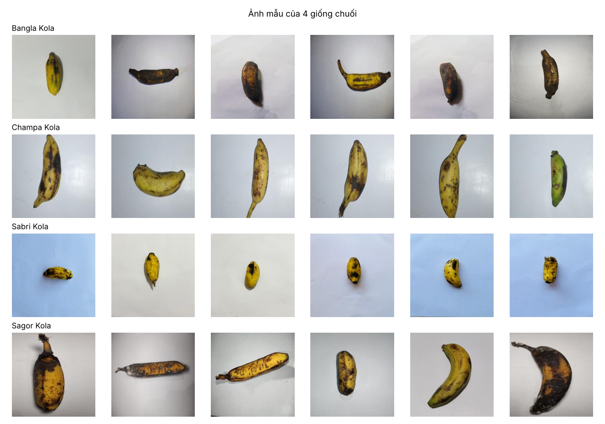

### 4.1 Hướng truyền thống: rút đặc trưng + bộ phân lớp

**Đặc trưng màu** (`src/features/color.py`):

- Histogram RGB từng kênh (mặc định 32 bin mỗi kênh, 96 chiều); histogram HSV 3 chiều (8, 8, 8) = 512 chiều; histogram chỉ dùng H và S (8, 8) = 64 chiều. Mỗi histogram chuẩn hóa tổng bằng 1.
- Moment màu trên HSV: trung bình, độ lệch chuẩn, độ lệch (skewness) của từng kênh, 9 chiều.
- Màu chủ đạo: k-means (k = 3) trên điểm ảnh RGB, mỗi cụm cho (tỉ lệ, R, G, B), sắp theo tỉ lệ giảm dần, 12 chiều.
- Color Coherence Vector (CCV): lượng tử hóa 64 màu; với mỗi màu, đếm số điểm ảnh thuộc vùng liên thông có diện tích ≥ 1% ảnh ("liên kết") và số còn lại ("không liên kết"), 128 chiều.

**Đặc trưng cạnh** (`src/features/edge.py`): gradient bằng các toán tử Roberts (2×2), Prewitt, Sobel (3×3) và Laplacian; vector đặc trưng là tổng độ lớn gradient theo 256 hàng và 256 cột của ảnh xám 256×256, 512 chiều.

**HOG** (`src/features/hog.py`), cài đặt theo đúng các bước của bài giảng: resize về 64×128 → gradient bằng mặt nạ [−1, 0, 1] → histogram 9 bin hướng không dấu trên cell 8×8 (chia phiếu cho hai bin gần nhất) → chuẩn hóa L2 trên block 16×16 (2×2 cell, trượt 1 cell) → ghép thành vector 7 × 15 × 36 = 3.780 chiều. Nhóm tự cài đặt để có tùy chọn bỏ bước chuẩn hóa block (thí nghiệm C2). Kết quả đối chiếu với `skimage.feature.hog` lệch tối đa 2,2·10⁻⁷.

**Ghép đặc trưng:** mỗi phần được chuẩn hóa z-score rồi chia cho căn bậc hai số chiều của phần đó, để phần màu (64 chiều) và phần HOG (3.780 chiều) đóng góp ngang nhau vào khoảng cách.

**Độ đo khoảng cách:** Euclidean, Manhattan, cosine và Hellinger (Euclidean trên căn bậc hai của histogram đã chuẩn hóa L1); có và không chuẩn hóa về vector đơn vị.

**Bộ phân lớp:**

- KNN: chọn k, độ đo, bình chọn đa số (`uniform`) hoặc ưu tiên điểm gần (`distance`), thuật toán tìm láng giềng Brute Force, K-D Tree, Ball Tree.
- Logistic Regression (bộ phân lớp tuyến tính).
- Linear SVM: môn học chỉ nhắc tới như bộ phân lớp đi kèm HOG ("HOG + SVM"), nên đồ án dùng nó như **bộ phân lớp bổ sung** để đối chiếu.

### 4.2 Hướng học sâu: CNN, hai hướng tách riêng

**Hướng A — CNN theo bài giảng** (`src/cnn/models.py`):

| Mô hình | Kiến trúc | Ảnh vào | Huấn luyện |
|---|---|---|---|
| `a_lenet` | Conv(6, 5×5) → MaxPool → Conv(16, 5×5) → MaxPool → Flatten → Dense(120) → Dense(84) → Softmax(4) | 64×64×3 | từ đầu |
| `a_dropout` | Conv(32, 5×5) → MaxPool → Conv(16, 5×5) → MaxPool → Flatten → Dense(128) → Dropout(0,5) → Dense(64) → Softmax(4) | 128×128×3 | từ đầu |
| `a_vgg16` | VGG16 ImageNet đóng băng phần tích chập → Flatten → Dense(1024) → Dense(256) → Softmax(4) | 224×224×3 | transfer learning (đúng ví dụ bài giảng) |

**Hướng B — CNN lớn hơn, fine-tune:** `b_mobilenetv3` (MobileNetV3-Small ImageNet) và `b_resnet50` (ResNet50 ImageNet, kiến trúc đã gặp ở bài xác định vị trí). Phần đầu: GlobalAveragePooling → Dropout(0,2) → Softmax(4). Giai đoạn 1: đóng băng thân mạng, chỉ huấn luyện phần đầu. Giai đoạn 2: mở băng (toàn mạng với MobileNetV3, khối conv5 với ResNet50), fine-tune với learning rate nhỏ, có tăng cường ảnh (lật, xoay ±30°, phóng to/thu nhỏ ±10%). Hướng B dùng kiến trúc nằm ngoài ví dụ của bài giảng, nhưng vẫn là khái niệm đã học: transfer learning, tức tái sử dụng kiến trúc và trọng số đã học.

**Cấu hình chung:** Adam, cross-entropy, lô 32, dừng sớm theo macro-F1 trên tập val (giữ trọng số tốt nhất), seed cố định. Khi fine-tune, các lớp BatchNormalization giữ đóng băng (lý do ở mục 5.8, N4).

### 4.3 Phân đoạn tách nền

Ngưỡng toàn cục, Otsu, ngưỡng thích nghi và gom cụm k-means (`src/segmentation.py`), cộng thêm Otsu trên khoảng cách màu tới màu nền ở viền ảnh. Phân đoạn dùng để kiểm tra mô hình dựa vào quả chuối hay vào nền ảnh (S2).

### 4.4 Phần mở rộng: ba nhánh so sánh độc lập

Ngoài pipeline trên (gọi là nhánh G), đồ án chạy ba nhánh độc lập để đối chiếu (mục 5.13): X — xử lý dữ liệu do nhóm thiết kế (làm sạch, tiền xử lý, tăng cường); T — huấn luyện bằng bản Augmented của tác giả bộ dữ liệu; B — phương pháp của bài báo đã công bố trên bộ dữ liệu này (đặc trưng pretrained + SVM), trong đó hướng B2 dùng Vision Transformer, nằm ngoài nội dung môn học và chỉ để đối chiếu.

### 4.5 Quy trình đánh giá

- Chia một lần, cố định: stratified 70/15/15 (train/val/test), `seed = 42` (`data/splits/`).
- **Tập test chỉ dùng một lần ở cuối** cho các cấu hình đã chốt (mục 5.11).
- Nhóm truyền thống: gộp train+val (2.100 ảnh), chọn siêu tham số bằng 5-fold stratified cross-validation, báo cáo trung bình ± độ lệch chuẩn qua 5 fold. Chênh lệch nhỏ hơn độ lệch chuẩn được kết luận là "chưa đủ cơ sở phân biệt".
- Nhóm CNN: huấn luyện trên train, chọn epoch và siêu tham số theo val.
- Các thí nghiệm "biến đổi ảnh" (xáo trộn, đổi độ sáng, nhiễu, che, xoay) chấm trên fold giữ lại (truyền thống) hoặc val (CNN); mô hình luôn học trên ảnh sạch.
- Chỉ số chính: **macro-F1** (vì dữ liệu mất cân bằng), báo cáo kèm Accuracy, Precision và Recall từng lớp, Confusion Matrix.

## 5. Kết quả thực nghiệm

### 5.1 Dataset

Bộ BananaImageBD, Version 2, phần ảnh gốc phân loại giống [1]: 2.471 ảnh JPEG, giấy phép CC BY 4.0. 2.469 ảnh có kích thước 256×256; 2 ảnh lệch kích thước nên code luôn resize. Có 93 file đuôi `.JPG` viết hoa. Không có file trùng tuyệt đối (md5).

| Tập | Bangla Kola | Champa Kola | Sabri Kola | Sagor Kola | Tổng |
|---|---|---|---|---|---|
| train | 311 | 695 | 356 | 367 | 1.729 |
| val | 66 | 150 | 76 | 79 | 371 |
| test | 67 | 149 | 77 | 78 | 371 |
| Tổng | 444 | 994 | 509 | 524 | 2.471 |

**Ảnh gần trùng.** Nhóm dùng perceptual hash (pHash 64 bit). Có 42 cặp ảnh cách nhau Hamming ≤ 2, tức cùng một quả chụp lại gần như y hệt; 7 ảnh test có bản gần trùng trong train. Chia lại dữ liệu sao cho các ảnh gần trùng nằm cùng một fold không làm đổi macro-F1 quá ±0,007, nhỏ hơn độ lệch chuẩn giữa các fold (`results/D1/table_near_duplicates.md`). Trên tập test, hai mô hình tốt nhất cũng đúng 100% ở các ảnh không có bản gần trùng (`results/final/table_near_duplicates.md`).

### 5.2 Độ đo

Với lớp c: Precision = TP / (TP + FP), Recall = TP / (TP + FN), F1 = 2·P·R / (P + R). Macro-F1 là trung bình F1 của 4 lớp, nên mỗi lớp có trọng số như nhau dù số ảnh khác nhau.

**Ví dụ tính tay 1 — Precision và Recall từ Confusion Matrix.** Confusion Matrix của `a_vgg16` trên tập test (`results/hand_calc/table_cm_a_vgg16.md`):

| Thực tế \ Dự đoán | Bangla Kola | Champa Kola | Sabri Kola | Sagor Kola |
|---|---|---|---|---|
| Bangla Kola | 65 | 0 | 0 | 2 |
| Champa Kola | 0 | 149 | 0 | 0 |
| Sabri Kola | 2 | 0 | 75 | 0 |
| Sagor Kola | 0 | 0 | 0 | 78 |

Với lớp Bangla Kola: TP = 65 (đường chéo); FP = tổng cột Bangla trừ TP = 65 + 0 + 2 + 0 − 65 = 2 (hai ảnh Sabri bị đoán thành Bangla); FN = tổng hàng Bangla trừ TP = 65 + 0 + 0 + 2 − 65 = 2 (hai ảnh Bangla bị đoán thành Sagor). Precision = 65 / (65 + 2) = 0,970; Recall = 65 / (65 + 2) = 0,970; F1 = 0,970. Kết quả khớp với `classification_report` trong `results/final/a_vgg16/`.

**Ví dụ tính tay 2 — khoảng cách giữa hai vector đặc trưng.** Vector moment màu 9 chiều (HSV đã chia về [0, 1]) của ảnh x = `Bangla_Kola_1.jpg` và y = `Champa_Kola_1.jpg` (`results/hand_calc/`):

| Thành phần | x (Bangla_Kola_1.jpg) | y (Champa_Kola_1.jpg) | x − y | (x − y)² | Trị tuyệt đối của x − y |
|---|---|---|---|---|---|
| mean H | 0,5101 | 0,5277 | -0,0177 | 0,000312 | 0,0177 |
| mean S | 0,0807 | 0,1471 | -0,0664 | 0,004414 | 0,0664 |
| mean V | 0,7770 | 0,6726 | +0,1044 | 0,010891 | 0,1044 |
| std H | 0,3993 | 0,1485 | +0,2508 | 0,062896 | 0,2508 |
| std S | 0,1833 | 0,1824 | +0,0009 | 0,000001 | 0,0009 |
| std V | 0,1433 | 0,1116 | +0,0317 | 0,001006 | 0,0317 |
| skew H | 0,0747 | -0,1999 | +0,2746 | 0,075392 | 0,2746 |
| skew S | 0,2600 | 0,2628 | -0,0028 | 0,000008 | 0,0028 |
| skew V | -0,2072 | -0,1558 | -0,0514 | 0,002643 | 0,0514 |

- Euclidean: d = √(Σ(x − y)²) = √0,157561 = 0,3969.
- Manhattan: d = Σ|x − y| = 0,8006.
- Cosine: x·y = 0,99805; ‖x‖ = 1,09546; ‖y‖ = 0,97654; cos = 0,99805 / (1,09546 × 0,97654) = 0,9330.
- Sau khi chuẩn hóa về vector đơn vị, khoảng cách Euclidean bằng √(2 − 2·cos) = √(2 − 2 × 0,9330) = 0,3662, khớp với kết quả tính trực tiếp (0,3662). Vì Euclidean trên vector đơn vị là hàm đơn điệu của cosine, hai độ đo cho cùng thứ hạng láng giềng; thí nghiệm P2 kiểm chứng điều này trên toàn bộ dữ liệu.

Ví dụ tính tay 3 (số tham số một lớp CNN) nằm ở mục 5.8, thí nghiệm N1.

### 5.3 Lập trình

- Python 3.13, OpenCV 5.0, scikit-image 0.26, scikit-learn 1.9, imbalanced-learn 0.14, TensorFlow 2.21 / Keras 3.15 (bản CPU), Gradio cho demo. Phiên bản đầy đủ: `results/environment.txt`.
- Máy chạy: CPU 4 nhân, 16 GB RAM, không có GPU. Đặc trưng thủ công và đầu ra của các thân mạng đóng băng chỉ tính một lần rồi lưu vào `data/cache/`.
- Mỗi bước là một module chạy được từ dòng lệnh (`python -m src.<module> --help`); `scripts/run_all.sh` chạy lại toàn bộ theo thứ tự. Huấn luyện CNN lưu checkpoint mỗi epoch và hỗ trợ `--resume`.
- Kết quả: `results/<mã thí nghiệm>/` (bảng `table*.md`, `metrics.json`), hình trong `results/figures/`, tổng hợp ở `results/summary.csv` (968 dòng, gồm cả phần mở rộng).

### 5.4 Thí nghiệm dữ liệu: D1 — rò rỉ do tăng cường ảnh trước khi chia tập

**Tính chất.** Tăng cường ảnh trước khi chia tập làm bản sao của cùng một ảnh rơi vào cả train lẫn test.
**Dự đoán.** Kết quả trên test bị thổi phồng; đây là lý do không dùng bản "Augmented" có sẵn của bộ dữ liệu.
**Thí nghiệm.** Trong tập train+val, tạo 2 bản tăng cường cho mỗi ảnh (lật ngang, xoay ±10–30°). So ba cách: (a) tăng cường rồi chia ngẫu nhiên 80/20; (b) chia trước, chỉ tăng cường phần huấn luyện; (c) chia theo ảnh gốc rồi tăng cường cả hai phía. (c) có tập chấm cùng thành phần với (a), nên (a) − (c) là phần thổi phồng thuần do rò rỉ. Lặp 5 lần.

| Mô hình | (a) tăng cường rồi chia | (b) chia rồi tăng cường train | (c) chia theo ảnh gốc, tăng cường 2 phía | Thổi phồng (a)−(b) | Thổi phồng (a)−(c) | Macro-F1 (a) | Macro-F1 (b) |
|---|---|---|---|---|---|---|---|
| hsv_hist + knn (k=1) | 0,999 ± 0,001 | 0,978 ± 0,010 | 0,978 ± 0,008 | +0,022 ± 0,010 | +0,021 ± 0,009 | 0,999 ± 0,001 | 0,974 ± 0,011 |
| hsv_hist + logreg | 0,999 ± 0,001 | 0,991 ± 0,002 | 0,990 ± 0,002 | +0,008 ± 0,002 | +0,009 ± 0,002 | 0,999 ± 0,001 | 0,989 ± 0,003 |
| hog + knn (k=1) | 0,974 ± 0,003 | 0,974 ± 0,003 | 0,970 ± 0,002 | +0,000 ± 0,003 | +0,005 ± 0,004 | 0,972 ± 0,003 | 0,974 ± 0,004 |
| hog + logreg | 0,973 ± 0,006 | 0,981 ± 0,003 | 0,973 ± 0,003 | -0,008 ± 0,004 | +0,000 ± 0,004 | 0,969 ± 0,006 | 0,978 ± 0,004 |
| edge + knn (k=1) | 0,896 ± 0,012 | 0,889 ± 0,014 | 0,862 ± 0,012 | +0,007 ± 0,020 | +0,034 ± 0,020 | 0,895 ± 0,013 | 0,885 ± 0,016 |

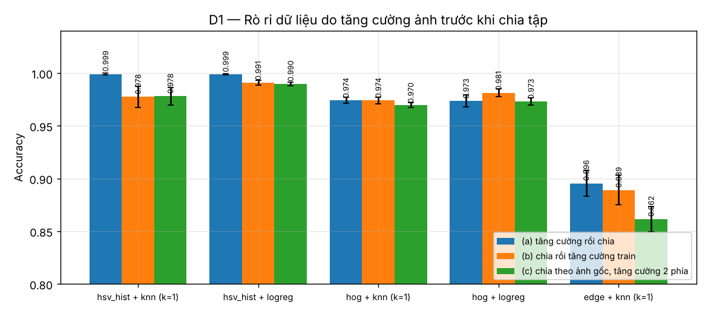

**Kết luận.** Khớp dự đoán với đặc trưng màu: histogram HSV gần như không đổi khi lật hay xoay, nên bản sao trong train là "đáp án có sẵn". Accuracy bị đẩy lên 0,999, thổi phồng +0,021 (KNN k = 1) và +0,009 (LogReg). **Trái dự đoán với HOG:** mức thổi phồng ≈ 0 (+0,005 ± 0,004 và +0,000 ± 0,004), vì HOG mã hóa hướng cạnh theo vị trí nên bản lật hay xoay có vector khác hẳn ảnh gốc. Rò rỉ chỉ gây hại khi đặc trưng bất biến với phép tăng cường.

### 5.5 Thí nghiệm đặc trưng màu: M1–M6

Mọi số liệu dưới đây là macro-F1, 5-fold CV trên train+val; phép biến đổi chỉ áp lên fold giữ lại.

**M1 — Histogram bỏ thông tin vị trí.** *Dự đoán:* xáo trộn ảnh chấm thành lưới 4×4 thì histogram giữ nguyên, HOG giảm.

| Đặc trưng | Bộ phân lớp | Macro-F1 ảnh gốc | Macro-F1 ảnh xáo trộn 4×4 | Độ sụt |
|---|---|---|---|---|
| Hist RGB (3×32) | KNN (k=5) | 0,964 ± 0,012 | 0,964 ± 0,012 | +0,000 ± 0,000 |
| Hist RGB (3×32) | LogReg | 0,976 ± 0,013 | 0,976 ± 0,013 | +0,000 ± 0,000 |
| Hist HSV (8,8,8) | KNN (k=5) | 0,965 ± 0,014 | 0,965 ± 0,014 | +0,000 ± 0,000 |
| Hist HSV (8,8,8) | LogReg | 0,991 ± 0,005 | 0,991 ± 0,005 | +0,000 ± 0,000 |
| Moment màu | KNN (k=5) | 0,972 ± 0,008 | 0,972 ± 0,008 | +0,000 ± 0,000 |
| Moment màu | LogReg | 0,908 ± 0,009 | 0,908 ± 0,009 | +0,000 ± 0,000 |
| CCV (64 màu) | KNN (k=5) | 0,946 ± 0,011 | 0,864 ± 0,018 | +0,082 ± 0,015 |
| CCV (64 màu) | LogReg | 0,975 ± 0,006 | 0,922 ± 0,011 | +0,053 ± 0,009 |
| Cạnh Sobel | KNN (k=5) | 0,890 ± 0,019 | 0,231 ± 0,021 | +0,658 ± 0,028 |
| Cạnh Sobel | LogReg | 0,894 ± 0,008 | 0,201 ± 0,040 | +0,692 ± 0,042 |
| HOG 64×128 | KNN (k=5) | 0,946 ± 0,007 | 0,260 ± 0,017 | +0,687 ± 0,011 |
| HOG 64×128 | LogReg | 0,985 ± 0,004 | 0,287 ± 0,020 | +0,699 ± 0,024 |

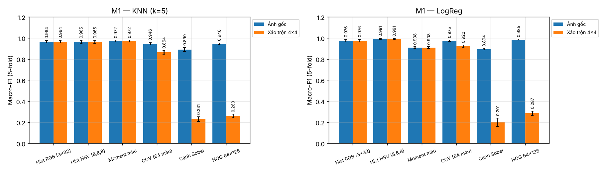

*Kết luận:* khớp. Histogram và moment màu không đổi đúng đến chữ số cuối (độ sụt 0,000); HOG và vector cạnh rơi về mức đoán mò (0,20–0,29); CCV sụt 0,05–0,08 vì có thông tin liên kết không gian.

**M2 — HSV tách độ sáng khỏi sắc màu.** *Dự đoán:* khi nhân kênh V với 0,6 hoặc 1,4, histogram RGB sụt nhiều nhất, HSV ít hơn, H-S bền nhất.

| Đặc trưng | Bộ phân lớp | Ảnh gốc | V×0,6 | Sụt (V×0,6) | V×1,4 | Sụt (V×1,4) |
|---|---|---|---|---|---|---|
| Hist RGB (3×32) | KNN (k=5) | 0,964 ± 0,012 | 0,092 ± 0,002 | +0,873 ± 0,013 | 0,205 ± 0,019 | +0,760 ± 0,024 |
| Hist RGB (3×32) | LogReg | 0,976 ± 0,013 | 0,212 ± 0,054 | +0,763 ± 0,064 | 0,279 ± 0,038 | +0,696 ± 0,036 |
| Hist HSV (8,8,8) | KNN (k=5) | 0,965 ± 0,014 | 0,302 ± 0,042 | +0,663 ± 0,043 | 0,589 ± 0,020 | +0,376 ± 0,025 |
| Hist HSV (8,8,8) | LogReg | 0,991 ± 0,005 | 0,318 ± 0,035 | +0,673 ± 0,035 | 0,662 ± 0,004 | +0,329 ± 0,009 |
| Hist H-S (8,8) | KNN (k=5) | 0,976 ± 0,006 | 0,975 ± 0,009 | +0,000 ± 0,008 | 0,975 ± 0,006 | +0,001 ± 0,002 |
| Hist H-S (8,8) | LogReg | 0,985 ± 0,008 | 0,959 ± 0,014 | +0,027 ± 0,011 | 0,974 ± 0,007 | +0,011 ± 0,004 |

*Kết luận:* khớp một phần. Chỉ histogram H-S (bỏ hẳn kênh V) là bền (sụt ≤ 0,027). Histogram HSV đủ 3 kênh vẫn sụt 0,33–0,67 vì kênh V vẫn nằm trong đặc trưng: tách V ra thành một trục riêng thôi chưa đủ, phải bỏ nó khỏi vector.

**M3 — Số bin.** *Dự đoán:* ít bin thì mất khả năng phân biệt, nhiều bin thì vector thưa và nhạy nhiễu.

| Đặc trưng | Số bin mỗi kênh | Số chiều | KNN (k=5) | LogReg | Tỉ lệ phần tử bằng 0 |
|---|---|---|---|---|---|
| Hist RGB từng kênh | 4 | 12 | 0,936 ± 0,015 | 0,914 ± 0,015 | 0,00 |
| Hist RGB từng kênh | 8 | 24 | 0,966 ± 0,010 | 0,968 ± 0,007 | 0,03 |
| Hist RGB từng kênh | 16 | 48 | 0,969 ± 0,011 | 0,979 ± 0,012 | 0,06 |
| Hist RGB từng kênh | 32 | 96 | 0,964 ± 0,012 | 0,976 ± 0,013 | 0,08 |
| Hist RGB từng kênh | 64 | 192 | 0,963 ± 0,015 | 0,977 ± 0,012 | 0,09 |
| Hist RGB từng kênh | 256 | 768 | 0,962 ± 0,015 | 0,975 ± 0,011 | 0,12 |
| Hist HSV 3 chiều | 2 | 8 | 0,932 ± 0,011 | 0,885 ± 0,012 | 0,20 |
| Hist HSV 3 chiều | 4 | 64 | 0,963 ± 0,009 | 0,965 ± 0,012 | 0,55 |
| Hist HSV 3 chiều | 8 | 512 | 0,965 ± 0,014 | 0,991 ± 0,005 | 0,72 |
| Hist HSV 3 chiều | 16 | 4096 | 0,917 ± 0,015 | 0,992 ± 0,004 | 0,87 |

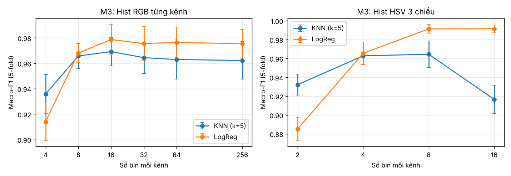

*Kết luận:* vế "ít bin" khớp (4 bin mỗi kênh: 0,914–0,936). Vế "nhiều bin" chỉ thấy ở KNN trên histogram 3 chiều: 16³ = 4.096 chiều, 87% phần tử bằng 0, KNN giảm còn 0,917, trong khi LogReg vẫn 0,992. Histogram RGB từng kênh từ 8 đến 256 bin cho kết quả ngang nhau (chênh nhỏ hơn độ lệch chuẩn).

**M4 — Moment màu gọn nhưng thô.** *Dự đoán:* 9 chiều nhanh nhưng kém histogram.

| Đặc trưng | Số chiều | Rút đặc trưng (ms/ảnh) | KNN (k=5) | Huấn luyện KNN (k=5) (s) | Dự đoán KNN (k=5) (ms/ảnh) | LogReg | Huấn luyện LogReg (s) | Dự đoán LogReg (ms/ảnh) | Linear SVM |
|---|---|---|---|---|---|---|---|---|---|
| Hist RGB (3×32) | 96 | 0,15 | 0,964 ± 0,012 | 0,003 | 0,010 | 0,976 ± 0,013 | 0,038 | 0,002 | 0,960 ± 0,012 |
| Hist HSV (8,8,8) | 512 | 0,23 | 0,965 ± 0,014 | 0,008 | 0,024 | 0,991 ± 0,005 | 0,774 | 0,007 | 0,989 ± 0,008 |
| Hist H-S (8,8) | 64 | 0,20 | 0,976 ± 0,006 | 0,002 | 0,009 | 0,985 ± 0,008 | 0,017 | 0,001 | 0,958 ± 0,007 |
| Moment màu | 9 | 4,04 | 0,972 ± 0,008 | 0,002 | 0,007 | 0,908 ± 0,009 | 0,017 | 0,001 | 0,838 ± 0,011 |
| Màu chủ đạo (k=3) | 12 | 1,58 | 0,945 ± 0,005 | 0,002 | 0,007 | 0,899 ± 0,009 | 0,018 | 0,001 | 0,826 ± 0,013 |
| CCV (64 màu) | 128 | 1,90 | 0,946 ± 0,011 | 0,003 | 0,012 | 0,975 ± 0,006 | 0,016 | 0,001 | 0,965 ± 0,014 |
| Hist 64 màu | 64 | 0,50 | 0,966 ± 0,010 | 0,002 | 0,008 | 0,968 ± 0,008 | 0,014 | 0,001 | 0,945 ± 0,020 |

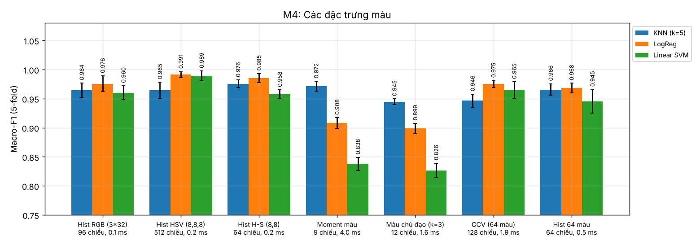

*Kết luận:* khớp với bộ phân lớp tuyến tính (LogReg 0,908, Linear SVM 0,838). **Trái dự đoán với KNN** (0,972, ngang histogram) và về thời gian: rút moment màu (khoảng 4 ms/ảnh) chậm hơn rút histogram (0,2 ms/ảnh) vì phải tính lũy thừa trên từng điểm ảnh. Giải thích ở P6: 9 con số đủ tách 4 lớp nếu biên quyết định được phép cong.

**M5 — CCV bổ sung thông tin liên kết không gian.** *Dự đoán:* CCV tốt hơn histogram cùng mức lượng tử hóa và nhạy với bố cục.

| Đặc trưng | Số chiều | Bộ phân lớp | Ảnh gốc | Xáo trộn 4×4 | Độ sụt |
|---|---|---|---|---|---|
| Hist 64 màu | 64 | KNN (k=5) | 0,966 ± 0,010 | 0,962 ± 0,008 | +0,003 ± 0,004 |
| Hist 64 màu | 64 | LogReg | 0,968 ± 0,008 | 0,966 ± 0,009 | +0,002 ± 0,004 |
| CCV (64 màu) | 128 | KNN (k=5) | 0,946 ± 0,011 | 0,864 ± 0,018 | +0,082 ± 0,015 |
| CCV (64 màu) | 128 | LogReg | 0,975 ± 0,006 | 0,922 ± 0,011 | +0,053 ± 0,009 |

*Kết luận:* vế "nhạy với bố cục" khớp (xáo trộn làm CCV sụt 0,05–0,08, histogram ≤ 0,003). Vế "tốt hơn histogram" không được xác nhận: với LogReg 0,975 so với 0,968 (chênh nhỏ hơn độ lệch chuẩn), với KNN còn kém hơn. Trên ảnh một quả chuối nền trơn, hầu hết điểm ảnh cùng màu nằm trong vùng liên thông lớn, nên phần "không liên kết" gần như rỗng và mang ít thông tin.

**M6 — Giống chuối khác nhau ở màu hay ở hình dạng?** *Dự đoán:* chuyển ảnh sang xám thì đặc trưng màu mất tác dụng, đặc trưng cạnh và HOG gần như không đổi.

| Đặc trưng | Bộ phân lớp | Học màu, chấm màu | Học màu, chấm xám | Học xám, chấm xám | Sụt khi bỏ màu (học lại) |
|---|---|---|---|---|---|
| Hist RGB (3×32) | KNN (k=5) | 0,964 ± 0,012 | 0,631 ± 0,026 | 0,927 ± 0,015 | +0,038 |
| Hist RGB (3×32) | LogReg | 0,976 ± 0,013 | 0,456 ± 0,030 | 0,865 ± 0,012 | +0,111 |
| Hist HSV (8,8,8) | KNN (k=5) | 0,965 ± 0,014 | 0,121 ± 0,021 | 0,912 ± 0,020 | +0,052 |
| Hist HSV (8,8,8) | LogReg | 0,991 ± 0,005 | 0,154 ± 0,022 | 0,804 ± 0,010 | +0,187 |
| Moment màu | KNN (k=5) | 0,972 ± 0,008 | 0,120 ± 0,041 | 0,748 ± 0,038 | +0,223 |
| Moment màu | LogReg | 0,908 ± 0,009 | 0,320 ± 0,063 | 0,676 ± 0,018 | +0,232 |
| CCV (64 màu) | KNN (k=5) | 0,946 ± 0,011 | 0,403 ± 0,014 | 0,782 ± 0,028 | +0,164 |
| CCV (64 màu) | LogReg | 0,975 ± 0,006 | 0,292 ± 0,035 | 0,762 ± 0,020 | +0,213 |
| Cạnh Sobel | KNN (k=5) | 0,890 ± 0,019 | 0,890 ± 0,019 | 0,890 ± 0,019 | +0,000 |
| Cạnh Sobel | LogReg | 0,894 ± 0,008 | 0,894 ± 0,008 | 0,894 ± 0,008 | +0,000 |
| HOG 64×128 | KNN (k=5) | 0,946 ± 0,007 | 0,946 ± 0,012 | 0,945 ± 0,012 | +0,001 |
| HOG 64×128 | LogReg | 0,985 ± 0,004 | 0,987 ± 0,006 | 0,986 ± 0,005 | -0,001 |
| HOG 64×128 (màu, kênh gradient lớn nhất) | KNN (k=5) | 0,944 ± 0,013 | 0,943 ± 0,012 | 0,945 ± 0,012 | -0,001 |
| HOG 64×128 (màu, kênh gradient lớn nhất) | LogReg | 0,982 ± 0,005 | 0,984 ± 0,005 | 0,986 ± 0,005 | -0,005 |

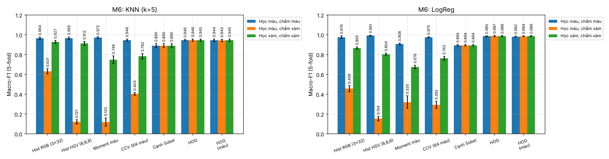

*Kết luận:* khớp. Khi học lại trên ảnh xám, đặc trưng màu sụt 0,04–0,23; cạnh và HOG đổi ≤ 0,005, và HOG trên ảnh xám vẫn đạt 0,986. Bốn giống phân biệt được bằng cả màu (hist HSV 0,991) lẫn hình dạng (HOG 0,986). Mục 5.10 (S2) cho thấy một phần của cả hai con số này đến từ nền ảnh.

### 5.6 Thí nghiệm đặc trưng cạnh và HOG: C1–C5

**C1 — Toán tử cạnh và nhiễu.** *Tính chất:* Roberts dùng mặt nạ 2×2 nên nhạy nhiễu; Prewitt và Sobel có làm trơn; Laplacian là đạo hàm bậc hai nên nhạy nhiễu nhất. *Dự đoán:* thêm nhiễu Gauss thì độ sụt xếp theo thứ tự Prewitt ≈ Sobel < Roberts < Laplacian. Nhóm thêm mức σ = 2 vì từ σ = 10 mọi toán tử đều rơi về mức đoán mò.

| Toán tử | Bộ phân lớp | Ảnh gốc | Sụt σ=2 | Sụt σ=5 | Sụt σ=10 | Sụt σ=20 |
|---|---|---|---|---|---|---|
| Roberts (2×2) | KNN (k=5) | 0,901 ± 0,019 | +0,461 ± 0,017 | +0,789 ± 0,019 | +0,813 ± 0,019 | +0,813 ± 0,019 |
| Roberts (2×2) | LogReg | 0,932 ± 0,011 | +0,669 ± 0,015 | +0,839 ± 0,007 | +0,844 ± 0,010 | +0,844 ± 0,010 |
| Prewitt (3×3) | KNN (k=5) | 0,890 ± 0,019 | +0,026 ± 0,020 | +0,523 ± 0,025 | +0,799 ± 0,014 | +0,803 ± 0,019 |
| Prewitt (3×3) | LogReg | 0,892 ± 0,007 | +0,198 ± 0,019 | +0,768 ± 0,013 | +0,805 ± 0,007 | +0,805 ± 0,007 |
| Sobel (3×3) | KNN (k=5) | 0,890 ± 0,019 | +0,023 ± 0,022 | +0,535 ± 0,021 | +0,800 ± 0,017 | +0,802 ± 0,019 |
| Sobel (3×3) | LogReg | 0,894 ± 0,008 | +0,226 ± 0,020 | +0,776 ± 0,013 | +0,806 ± 0,007 | +0,806 ± 0,007 |
| Laplacian (bậc hai) | KNN (k=5) | 0,886 ± 0,014 | +0,601 ± 0,008 | +0,797 ± 0,014 | +0,798 ± 0,014 | +0,798 ± 0,014 |
| Laplacian (bậc hai) | LogReg | 0,914 ± 0,015 | +0,826 ± 0,015 | +0,827 ± 0,015 | +0,827 ± 0,015 | +0,827 ± 0,015 |

| Toán tử | σ=2 | σ=5 | σ=10 | σ=20 |
|---|---|---|---|---|
| Roberts (2×2) | 0,35 | 1,00 | 2,14 | 4,47 |
| Prewitt (3×3) | 0,14 | 0,43 | 0,98 | 2,11 |
| Sobel (3×3) | 0,15 | 0,46 | 1,03 | 2,22 |
| Laplacian (bậc hai) | 0,78 | 2,16 | 4,55 | 9,37 |

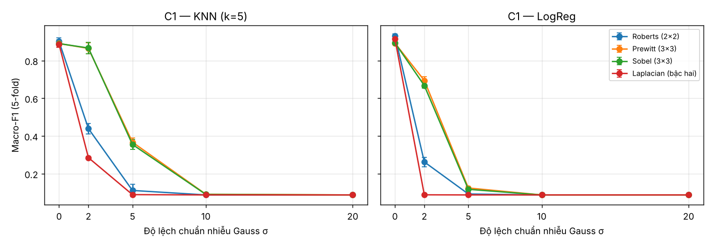

*Kết luận:* khớp. Ở σ = 5, vector đặc trưng thay đổi 43–46% với Prewitt/Sobel, 100% với Roberts và 216% với Laplacian. Ngoài dự đoán: vector "tổng theo hàng/cột" kém bền với mọi toán tử, sập hoàn toàn từ σ = 10, vì nhiễu cộng thêm gradient ở mọi điểm ảnh nền và tổng theo hàng/cột cộng dồn hết phần đó.

**C2 — HOG chuẩn hóa block bền với độ sáng.** *Dự đoán:* lặp lại M2 với HOG; bản có chuẩn hóa bền hơn bản không chuẩn hóa.

| Đặc trưng | Số chiều | Bộ phân lớp | Ảnh gốc | Sụt (V×0,6) | Sụt (V×1,4) |
|---|---|---|---|---|---|
| HOG, chuẩn hóa block L2 | 3780 | KNN (k=5) | 0,946 ± 0,007 | +0,009 ± 0,007 | +0,163 ± 0,008 |
| HOG, chuẩn hóa block L2 | 3780 | LogReg | 0,985 ± 0,004 | +0,004 ± 0,004 | +0,215 ± 0,033 |
| HOG, không chuẩn hóa block | 1152 | KNN (k=5) | 0,845 ± 0,015 | +0,394 ± 0,023 | -0,032 ± 0,011 |
| HOG, không chuẩn hóa block | 1152 | LogReg | 0,960 ± 0,005 | +0,080 ± 0,009 | +0,057 ± 0,006 |
| Hist RGB (3×32) | 96 | KNN (k=5) | 0,964 ± 0,012 | +0,873 ± 0,013 | +0,760 ± 0,024 |
| Hist RGB (3×32) | 96 | LogReg | 0,976 ± 0,013 | +0,763 ± 0,064 | +0,696 ± 0,036 |
| Hist HSV (8,8,8) | 512 | KNN (k=5) | 0,965 ± 0,014 | +0,663 ± 0,043 | +0,376 ± 0,025 |
| Hist HSV (8,8,8) | 512 | LogReg | 0,991 ± 0,005 | +0,673 ± 0,035 | +0,329 ± 0,009 |
| Hist H-S (8,8) | 64 | KNN (k=5) | 0,976 ± 0,006 | +0,000 ± 0,008 | +0,001 ± 0,002 |
| Hist H-S (8,8) | 64 | LogReg | 0,985 ± 0,008 | +0,027 ± 0,011 | +0,011 ± 0,004 |

| Ảnh | Tỉ lệ cell gần như không có gradient | Tỉ lệ điểm ảnh bão hòa (kênh lớn nhất = 255) |
|---|---|---|
| Ảnh gốc | 0,002 | 0,005 |
| V×0,6 | 0,003 | 0,000 |
| V×1,4 | 0,141 | 0,687 |

*Kết luận:* khớp khi làm tối (V×0,6: sụt 0,004–0,009 so với 0,08–0,39). **Trái dự đoán khi làm sáng** (V×1,4: bản chuẩn hóa sụt 0,16–0,22, bản không chuẩn hóa chỉ −0,03 đến +0,06). Nguyên nhân: V×1,4 làm 68,7% điểm ảnh bão hòa ở 255 và 14,1% số cell mất hẳn gradient. Đây không còn là phép đổi độ sáng tuyến tính mà chuẩn hóa khử được. Chuẩn hóa L2 còn khuếch đại các block nền có gradient yếu lên độ dài đơn vị, nên khi nền bão hòa thì vector đã chuẩn hóa đổi nhiều hơn.

**C3 — Tham số HOG.** *Dự đoán:* kích thước ảnh, cell và số bin quyết định mức chi tiết.

| Kích thước ảnh (rộng×cao) | Cell | Số bin | Số chiều | Rút đặc trưng (ms/ảnh) | KNN (k=5) | LogReg | Linear SVM |
|---|---|---|---|---|---|---|---|
| 64×128 | 8×8 | 6 | 2520 | 0,76 | 0,954 ± 0,007 | 0,982 ± 0,007 | 0,977 ± 0,003 |
| 64×128 | 8×8 | 9 | 3780 | 0,94 | 0,946 ± 0,007 | 0,985 ± 0,004 | 0,982 ± 0,004 |
| 64×128 | 8×8 | 12 | 5040 | 1,31 | 0,939 ± 0,011 | 0,985 ± 0,006 | 0,979 ± 0,006 |
| 64×128 | 16×16 | 6 | 504 | 0,96 | 0,920 ± 0,010 | 0,959 ± 0,006 | 0,959 ± 0,008 |
| 64×128 | 16×16 | 9 | 756 | 0,83 | 0,911 ± 0,010 | 0,959 ± 0,005 | 0,958 ± 0,009 |
| 64×128 | 16×16 | 12 | 1008 | 1,00 | 0,910 ± 0,008 | 0,960 ± 0,006 | 0,959 ± 0,009 |
| 128×128 | 8×8 | 6 | 5400 | 1,86 | 0,952 ± 0,013 | 0,986 ± 0,005 | 0,978 ± 0,006 |
| 128×128 | 8×8 | 9 | 8100 | 1,88 | 0,942 ± 0,017 | 0,986 ± 0,004 | 0,982 ± 0,007 |
| 128×128 | 8×8 | 12 | 10800 | 2,32 | 0,941 ± 0,013 | 0,985 ± 0,005 | 0,978 ± 0,010 |
| 128×128 | 16×16 | 6 | 1176 | 1,35 | 0,961 ± 0,007 | 0,983 ± 0,007 | 0,981 ± 0,005 |
| 128×128 | 16×16 | 9 | 1764 | 1,96 | 0,951 ± 0,014 | 0,982 ± 0,007 | 0,981 ± 0,011 |
| 128×128 | 16×16 | 12 | 2352 | 1,89 | 0,954 ± 0,011 | 0,984 ± 0,006 | 0,981 ± 0,010 |

*Kết luận:* khớp một phần. Chỉ tỉ lệ kích thước cell so với kích thước ảnh tạo khác biệt đo được: cell 16×16 trên ảnh 64×128 còn 0,959. Với LogReg, 9/12 cấu hình nằm trong khoảng 0,982–0,986 và số bin (6, 9, 12) không tạo khác biệt vượt độ lệch chuẩn. Đồ án giữ cấu hình của bài giảng (64×128, cell 8, 9 bin, 3.780 chiều).

**C4 — Đặc trưng toàn cục và cục bộ khi bị che.** *Dự đoán:* che một hình vuông 25% diện tích thì histogram (toàn cục) sụt nhiều hơn HOG (ghép từ đặc trưng cục bộ).

| Đặc trưng | Loại | Bộ phân lớp | Ảnh gốc | Che 25% | Độ sụt |
|---|---|---|---|---|---|
| Hist RGB (3×32) | toàn cục | KNN (k=5) | 0,964 ± 0,012 | 0,085 ± 0,000 | +0,879 ± 0,012 |
| Hist RGB (3×32) | toàn cục | LogReg | 0,976 ± 0,013 | 0,085 ± 0,000 | +0,890 ± 0,014 |
| Hist HSV (8,8,8) | toàn cục | KNN (k=5) | 0,965 ± 0,014 | 0,077 ± 0,003 | +0,887 ± 0,013 |
| Hist HSV (8,8,8) | toàn cục | LogReg | 0,991 ± 0,005 | 0,222 ± 0,113 | +0,769 ± 0,117 |
| Hist H-S (8,8) | toàn cục | KNN (k=5) | 0,976 ± 0,006 | 0,843 ± 0,030 | +0,133 ± 0,029 |
| Hist H-S (8,8) | toàn cục | LogReg | 0,985 ± 0,008 | 0,762 ± 0,028 | +0,224 ± 0,021 |
| Moment màu | toàn cục | KNN (k=5) | 0,972 ± 0,008 | 0,312 ± 0,042 | +0,659 ± 0,043 |
| Moment màu | toàn cục | LogReg | 0,908 ± 0,009 | 0,227 ± 0,006 | +0,681 ± 0,010 |
| HOG 64×128 | cục bộ ghép lại | KNN (k=5) | 0,946 ± 0,007 | 0,784 ± 0,030 | +0,162 ± 0,028 |
| HOG 64×128 | cục bộ ghép lại | LogReg | 0,985 ± 0,004 | 0,794 ± 0,027 | +0,192 ± 0,026 |
| Cạnh Sobel | cục bộ ghép lại | KNN (k=5) | 0,890 ± 0,019 | 0,322 ± 0,006 | +0,568 ± 0,023 |
| Cạnh Sobel | cục bộ ghép lại | LogReg | 0,894 ± 0,008 | 0,272 ± 0,014 | +0,621 ± 0,017 |

| Đặc trưng | KNN (k=5), chuẩn hóa | Ảnh gốc | Che 25% | Độ sụt |
|---|---|---|---|---|
| Hist RGB (3×32) | z-score | 0,964 ± 0,012 | 0,085 ± 0,000 | +0,879 ± 0,012 |
| Hist RGB (3×32) | không chuẩn hóa | 0,952 ± 0,013 | 0,859 ± 0,024 | +0,093 ± 0,027 |
| Hist RGB (3×32) | Hellinger | 0,974 ± 0,011 | 0,870 ± 0,028 | +0,104 ± 0,026 |
| Hist HSV (8,8,8) | z-score | 0,965 ± 0,014 | 0,077 ± 0,003 | +0,887 ± 0,013 |
| Hist HSV (8,8,8) | không chuẩn hóa | 0,953 ± 0,006 | 0,920 ± 0,021 | +0,032 ± 0,019 |
| Hist HSV (8,8,8) | Hellinger | 0,976 ± 0,015 | 0,964 ± 0,013 | +0,012 ± 0,002 |
| Hist H-S (8,8) | z-score | 0,976 ± 0,006 | 0,843 ± 0,030 | +0,133 ± 0,029 |
| Hist H-S (8,8) | không chuẩn hóa | 0,947 ± 0,011 | 0,556 ± 0,103 | +0,391 ± 0,107 |
| Hist H-S (8,8) | Hellinger | 0,979 ± 0,005 | 0,605 ± 0,136 | +0,374 ± 0,138 |

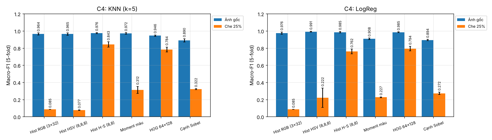

*Kết luận:* với cấu hình mặc định (z-score) thì khớp: Hist RGB/HSV rơi về 0,08–0,22, HOG còn 0,78–0,79. Nhưng phép đo phụ cho thấy **nguyên nhân chính là bước chuẩn hóa z-score**, không phải tính "toàn cục". Hình vuông đen dồn 25% khối lượng histogram vào một bin hầu như luôn bằng 0 trên ảnh huấn luyện; z-score chia cho độ lệch chuẩn rất nhỏ của bin đó nên một chiều chi phối khoảng cách. Dùng Hellinger thì Hist HSV chỉ sụt 0,012.

**C5 — Màu và hình dạng bổ sung cho nhau.** *Dự đoán:* ghép màu + HOG (chuẩn hóa từng phần) tốt hơn từng đặc trưng riêng lẻ.

| Đặc trưng | Cách ghép | Số chiều | KNN (k=5) | LogReg | Linear SVM |
|---|---|---|---|---|---|
| Hist HSV (8,8,8) | — | 512 | 0,965 ± 0,014 | 0,991 ± 0,005 | 0,989 ± 0,008 |
| Hist H-S (8,8) | — | 64 | 0,976 ± 0,006 | 0,985 ± 0,008 | 0,958 ± 0,007 |
| HOG 64×128 | — | 3780 | 0,946 ± 0,007 | 0,985 ± 0,004 | 0,982 ± 0,004 |
| Hist HSV + HOG | ghép thẳng, z-score chung | 4292 | 0,943 ± 0,008 | 0,993 ± 0,003 | 0,991 ± 0,003 |
| Hist HSV + HOG | chuẩn hóa từng phần rồi ghép | 4292 | 0,956 ± 0,012 | 0,993 ± 0,004 | 0,961 ± 0,007 |
| Hist H-S + HOG | ghép thẳng, z-score chung | 3844 | 0,948 ± 0,009 | 0,989 ± 0,003 | 0,989 ± 0,003 |
| Hist H-S + HOG | chuẩn hóa từng phần rồi ghép | 3844 | 0,977 ± 0,005 | 0,992 ± 0,003 | 0,966 ± 0,014 |
| Hist HSV + moment + HOG | ghép thẳng, z-score chung | 4301 | 0,945 ± 0,008 | 0,993 ± 0,003 | 0,992 ± 0,003 |
| Hist HSV + moment + HOG | chuẩn hóa từng phần rồi ghép | 4301 | 0,985 ± 0,009 | 0,991 ± 0,004 | 0,959 ± 0,007 |

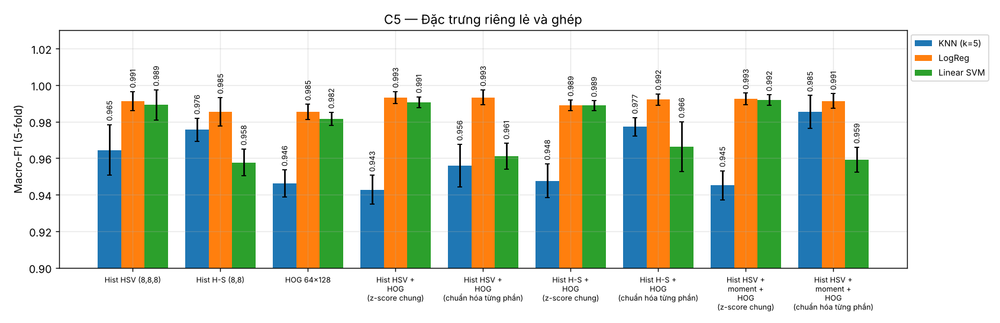

*Kết luận:* khớp với KNN: chuẩn hóa từng phần nâng Hist H-S + HOG từ 0,948 (ghép thẳng) lên 0,977. Sau khi chọn siêu tham số (mục 5.7), cấu hình ghép đạt 0,996 ± 0,003, hơn HOG riêng 0,010 (lớn hơn độ lệch chuẩn) và hơn màu riêng 0,005 (bằng độ lệch chuẩn, chưa đủ cơ sở phân biệt).

### 5.7 Thí nghiệm bộ phân lớp: P1–P6 và cấu hình truyền thống đã chốt

**P1 — Chọn k.** *Dự đoán:* k nhỏ nhạy nhiễu, k lớn kém nhạy với đặc điểm cục bộ; so quy tắc k = số lớp + 1 với k chọn bằng cross-validation.

| Đặc trưng | k = số lớp + 1 = 5 | k tốt nhất theo CV | Macro-F1 tại k tốt nhất | Chênh so với k=5 | k=1 | k=31 |
|---|---|---|---|---|---|---|
| Moment màu (9 chiều) | 0,972 ± 0,008 | 1 | 0,977 ± 0,003 | +0,006 | 0,977 ± 0,003 | 0,937 ± 0,012 |
| Hist HSV (512 chiều) | 0,965 ± 0,014 | 1 | 0,975 ± 0,005 | +0,011 | 0,975 ± 0,005 | 0,867 ± 0,026 |
| HOG 64×128 (3780 chiều) | 0,946 ± 0,007 | 1 | 0,967 ± 0,011 | +0,020 | 0,967 ± 0,011 | 0,871 ± 0,012 |

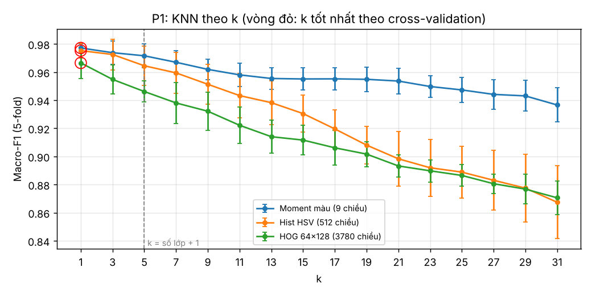

*Kết luận:* vế "k lớn" khớp (k = 31 thấp nhất). Vế "k nhỏ nhạy nhiễu" **không xuất hiện**: k = 1 tốt nhất với cả ba đặc trưng, hơn quy tắc k = 5 từ 0,006 đến 0,020. Các lớp tách nhau rõ và mỗi quả thường có nhiều ảnh gần giống nhau, nên láng giềng gần nhất hầu như luôn cùng lớp; tăng k chỉ kéo thêm điểm ở xa, phần nhiều thuộc lớp đông nhất.

**P2 — Độ đo và thang đo.** *Dự đoán:* KNN phụ thuộc độ đo và chuẩn hóa; sau khi chuẩn hóa về vector đơn vị, Euclidean và cosine cho cùng thứ hạng láng giềng.

| Độ đo | Chuẩn hóa | Moment màu (9 chiều) | Hist HSV (512 chiều) | HOG 64×128 (3780 chiều) |
|---|---|---|---|---|
| Euclidean | không | 0,977 ± 0,005 | 0,953 ± 0,006 | 0,954 ± 0,008 |
| Euclidean | vector đơn vị (L2) | 0,970 ± 0,005 | 0,936 ± 0,011 | 0,954 ± 0,008 |
| Euclidean | z-score | 0,972 ± 0,008 | 0,965 ± 0,014 | 0,946 ± 0,007 |
| Manhattan | không | 0,977 ± 0,004 | 0,964 ± 0,009 | 0,978 ± 0,007 |
| Manhattan | vector đơn vị (L2) | 0,967 ± 0,006 | 0,956 ± 0,013 | 0,978 ± 0,007 |
| Manhattan | z-score | 0,974 ± 0,008 | 0,961 ± 0,009 | 0,975 ± 0,010 |
| Cosine | không | 0,970 ± 0,005 | 0,936 ± 0,011 | 0,954 ± 0,008 |
| Cosine | vector đơn vị (L2) | 0,970 ± 0,005 | 0,936 ± 0,011 | 0,954 ± 0,008 |
| Hellinger | L1 rồi lấy căn | không áp dụng (có giá trị âm) | 0,976 ± 0,015 | 0,957 ± 0,011 |

| Đặc trưng | Đã chuẩn hóa đơn vị: cùng 10 láng giềng, cùng thứ tự | Đã chuẩn hóa đơn vị: cùng tập 10 láng giềng | Chưa chuẩn hóa: cùng tập 10 láng giềng |
|---|---|---|---|
| Moment màu (9 chiều) | 99,5% | 100,0% | 11,2% |
| Hist HSV (512 chiều) | 100,0% | 100,0% | 18,1% |
| HOG 64×128 (3780 chiều) | 100,0% | 100,0% | 99,3% |

*Kết luận:* khớp. Sau chuẩn hóa đơn vị, 100% ảnh truy vấn có cùng tập 10 láng giềng theo Euclidean và theo cosine (trước chuẩn hóa: 11% với moment, 18% với hist HSV); macro-F1 của hai cách trùng nhau. Manhattan tốt nhất trên HOG (0,978 so với 0,954 của Euclidean).

**P3 — Ưu tiên điểm gần.** *Dự đoán:* `weights='distance'` giúp khi các lớp chồng lấn, nhất là với lớp ít ảnh.

| Đặc trưng | k | Macro-F1 uniform | Macro-F1 distance | Recall Bangla Kola (lớp ít ảnh nhất) uniform | Recall Bangla Kola distance | Recall thấp nhất trong 4 lớp uniform → distance |
|---|---|---|---|---|---|---|
| Moment màu (9 chiều) | 5 | 0,972 ± 0,008 | 0,972 ± 0,008 | 0,984 ± 0,013 | 0,984 ± 0,013 | 0,922 → 0,924 |
| Moment màu (9 chiều) | 15 | 0,955 ± 0,008 | 0,961 ± 0,006 | 0,942 ± 0,026 | 0,968 ± 0,018 | 0,888 → 0,888 |
| Hist HSV (512 chiều) | 5 | 0,965 ± 0,014 | 0,966 ± 0,013 | 0,981 ± 0,007 | 0,981 ± 0,007 | 0,879 → 0,888 |
| Hist HSV (512 chiều) | 15 | 0,931 ± 0,013 | 0,933 ± 0,014 | 0,952 ± 0,018 | 0,955 ± 0,022 | 0,756 → 0,765 |
| HOG 64×128 (3780 chiều) | 5 | 0,946 ± 0,007 | 0,949 ± 0,008 | 0,955 ± 0,021 | 0,952 ± 0,026 | 0,816 → 0,830 |
| HOG 64×128 (3780 chiều) | 15 | 0,912 ± 0,011 | 0,914 ± 0,010 | 0,920 ± 0,033 | 0,923 ± 0,036 | 0,697 → 0,706 |

*Kết luận:* chưa đủ cơ sở phân biệt. Macro-F1 đổi ≤ 0,006; recall của Bangla Kola (lớp ít ảnh nhất) đổi từ −0,003 đến +0,026, nhỏ hơn hoặc xấp xỉ độ lệch chuẩn giữa các fold.

**P4 — K-D Tree và Ball Tree.** *Dự đoán:* chỉ tăng tốc, không đổi kết quả, và kém hiệu quả khi nhiều chiều.

| Đặc trưng | brute: dựng (ms) | brute: dự đoán 420 ảnh (ms) | kd_tree: dựng (ms) | kd_tree: dự đoán 420 ảnh (ms) | kd_tree: kết quả trùng brute | ball_tree: dựng (ms) | ball_tree: dự đoán 420 ảnh (ms) | ball_tree: kết quả trùng brute |
|---|---|---|---|---|---|---|---|---|
| Moment màu (9 chiều) | 0,7 | 1,8 | 1,5 | 4,0 | có | 1,6 | 4,9 | có |
| Hist HSV (512 chiều) | 1,5 | 8,1 | 38,1 | 363,7 | có | 32,7 | 271,6 | có |
| HOG 64×128 (3780 chiều) | 7,3 | 63,3 | 276,2 | 3795,9 | có | 303,9 | 3196,5 | có |

| Số điểm tham chiếu | brute: dự đoán 420 ảnh (ms) | kd_tree: dự đoán 420 ảnh (ms) | ball_tree: dự đoán 420 ảnh (ms) |
|---|---|---|---|
| 1680 | 1,9 | 3,7 | 4,5 |
| 8400 | 21,3 | 5,8 | 8,4 |
| 33600 | 111,3 | 10,6 | 24,0 |
| 100800 | 487,0 | 20,6 | 68,3 |

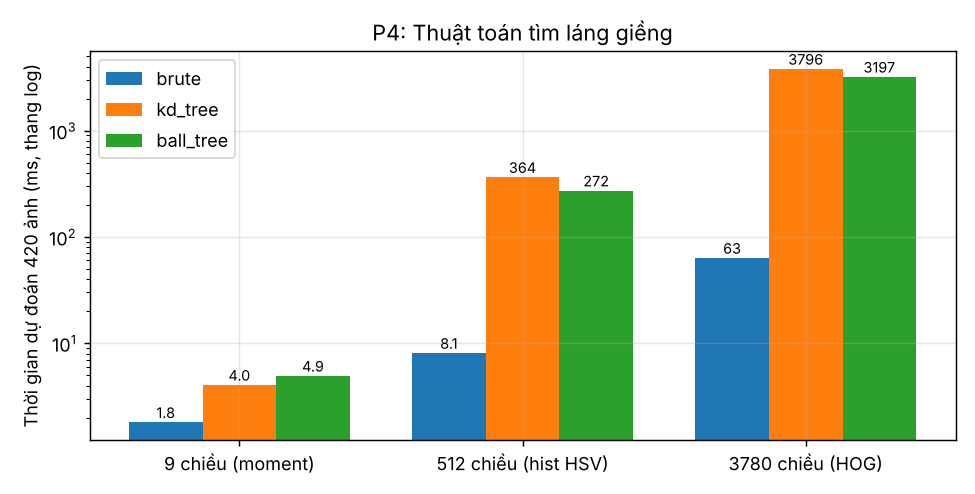

*Kết luận:* khớp, kèm điều kiện. Kết quả trùng Brute Force trong mọi trường hợp. Với 3.780 chiều, K-D Tree chậm hơn Brute Force khoảng 60 lần. Ngay cả với 9 chiều, khi chỉ có 1.680 ảnh tham chiếu thì cây vẫn chậm hơn; từ 8.400 điểm trở lên K-D Tree mới nhanh hơn (6,1 ms so với 22,3 ms). Cây chỉ có lợi khi **ít chiều và tập tham chiếu đủ lớn**.

**P5 — Thời gian huấn luyện và dự đoán.** *Dự đoán:* KNN không tốn thời gian huấn luyện nhưng dự đoán chậm; mô hình tuyến tính thì ngược lại.

| Đặc trưng | Bộ phân lớp | Huấn luyện 1680 ảnh (ms) | Dự đoán 420 ảnh (ms) | Dự đoán (ms/ảnh) | Macro-F1 |
|---|---|---|---|---|---|
| Moment màu (9 chiều) | KNN (k=5) | 2,2 | 3,9 | 0,0094 | 0,972 ± 0,008 |
| Moment màu (9 chiều) | Logistic Regression | 14,7 | 0,4 | 0,0010 | 0,908 ± 0,009 |
| Moment màu (9 chiều) | Linear SVM | 5,0 | 0,4 | 0,0011 | 0,838 ± 0,011 |
| Hist HSV (512 chiều) | KNN (k=5) | 8,0 | 21,7 | 0,0518 | 0,965 ± 0,014 |
| Hist HSV (512 chiều) | Logistic Regression | 479,1 | 4,0 | 0,0095 | 0,991 ± 0,005 |
| Hist HSV (512 chiều) | Linear SVM | 464,2 | 2,7 | 0,0065 | 0,989 ± 0,008 |
| HOG 64×128 (3780 chiều) | KNN (k=5) | 70,7 | 84,6 | 0,2014 | 0,946 ± 0,007 |
| HOG 64×128 (3780 chiều) | Logistic Regression | 1019,2 | 13,8 | 0,0328 | 0,985 ± 0,004 |
| HOG 64×128 (3780 chiều) | Linear SVM | 2211,7 | 8,3 | 0,0197 | 0,982 ± 0,004 |

*Kết luận:* khớp. Trên HOG, KNN "huấn luyện" 0,07 s (chỉ lưu dữ liệu) nhưng dự đoán 0,22 ms/ảnh; LogReg huấn luyện 1,2 s nhưng dự đoán chỉ 0,02 ms/ảnh.

**P6 — Biên quyết định tuyến tính.** *Dự đoán:* LogReg kém KNN khi đặc trưng ít chiều, tốt hơn khi nhiều chiều.

| Đặc trưng | KNN (k=5) | Logistic Regression | Linear SVM | LogReg − KNN |
|---|---|---|---|---|
| Moment màu (9 chiều) | 0,972 ± 0,008 | 0,908 ± 0,009 | 0,838 ± 0,011 | -0,064 |
| Hist HSV (512 chiều) | 0,965 ± 0,014 | 0,991 ± 0,005 | 0,989 ± 0,008 | +0,027 |
| HOG 64×128 (3780 chiều) | 0,946 ± 0,007 | 0,985 ± 0,004 | 0,982 ± 0,004 | +0,039 |

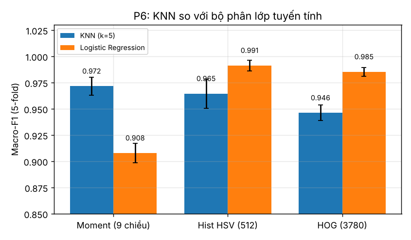

*Kết luận:* khớp. Với 9 chiều, LogReg kém KNN 0,064; với 512 và 3.780 chiều thì hơn 0,027 và 0,039. Trong không gian nhiều chiều, các lớp dễ tách tuyến tính hơn.

**Cấu hình truyền thống đã chốt.** Quét k ∈ {1, 3, 5}, độ đo (Euclidean, Manhattan, Hellinger) cho KNN và tham số C cho LogReg, Linear SVM (`results/select_traditional/table.md`):

| Vai trò | Cấu hình | Macro-F1 (5-fold) | Accuracy |
|---|---|---|---|
| trad_color | Hist HSV (8,8,8) + LogReg C=0,1 | 0,991 ± 0,005 | 0,992 |
| trad_edge | Cạnh Roberts + KNN k=1, Manhattan, ưu tiên điểm gần | 0,955 ± 0,015 | 0,959 |
| trad_hog | HOG 64×128 + LogReg C=0,1 | 0,986 ± 0,007 | 0,989 |
| trad_fusion | Hist H-S + HOG + LogReg C=100, chuẩn hóa từng phần | 0,996 ± 0,003 | 0,997 |

### 5.8 CNN hướng A và hướng B: N1–N8

Hai hướng được trình bày riêng (5.8.1, 5.8.2) trước khi so sánh (5.8.3). Số liệu CNN trong mục này chấm trên val (371 ảnh); kết quả trên test ở mục 5.11.

#### 5.8.1 Hướng A — CNN theo bài giảng

**N1 — Số tham số tính được từ kiến trúc.** Lớp tích chập có (F×F×C + 1)×K tham số, lớp kết nối đầy đủ có (N_in + 1)×N_out tham số.

**Ví dụ tính tay 3.** Lớp `conv2` của `a_lenet`: kernel 5×5, đầu vào 6 kênh, 16 bộ lọc → (5×5×6 + 1) × 16 = 151 × 16 = 2.416 tham số. Lớp `fc1`: ảnh 64×64 qua Conv 5×5 còn 60×60, qua MaxPool còn 30×30, qua Conv 5×5 còn 26×26, qua MaxPool còn 13×13; Flatten cho 13 × 13 × 16 = 2.704 giá trị → (2.704 + 1) × 120 = 324.600 tham số.

| Mô hình | Lớp | Công thức | Tính tay | model.summary() | Khớp | Ghi chú |
|---|---|---|---|---|---|---|
| a_lenet | conv1 | (5×5×3+1)×6 | 456 | 456 | có |  |
| a_lenet | conv2 | (5×5×6+1)×16 | 2416 | 2416 | có |  |
| a_lenet | fc1 | (2704+1)×120 | 324600 | 324600 | có | Flatten: 13×13×16 = 2704 |
| a_lenet | fc2 | (120+1)×84 | 10164 | 10164 | có |  |
| a_lenet | softmax | (84+1)×4 | 340 | 340 | có |  |
| a_lenet | Tổng |  | 337976 | 337976 | có | đầu vào 64×64×3 |
| a_dropout | conv1 | (5×5×3+1)×32 | 2432 | 2432 | có |  |
| a_dropout | conv2 | (5×5×32+1)×16 | 12816 | 12816 | có |  |
| a_dropout | fc1 | (13456+1)×128 | 1722496 | 1722496 | có | Flatten: 29×29×16 = 13456 |
| a_dropout | fc2 | (128+1)×64 | 8256 | 8256 | có |  |
| a_dropout | softmax | (64+1)×4 | 260 | 260 | có |  |
| a_dropout | Tổng |  | 1746260 | 1746260 | có | đầu vào 128×128×3 |

| Mô hình | Tổng số tham số | Tham số được huấn luyện |
|---|---|---|
| a_lenet | 337976 | 337976 |
| a_dropout | 1746260 | 1746260 |
| a_vgg16 | 40669252 | 25954564 |
| b_mobilenetv3 | 941428 | giai đoạn 1: 2308; giai đoạn 2: 917204 |
| b_resnet50 | 23595908 | giai đoạn 1: 8196; giai đoạn 2: 14961668 |

*Kết luận:* 10/10 lớp khớp đúng `model.summary()`. Lớp Dense đầu tiên chiếm 96% số tham số của `a_lenet` và 99% của `a_dropout`.

Kết quả huấn luyện của hướng A trên val: `a_lenet` 0,973 (ảnh vào 64×64; 32×32 cho 0,954; 128×128 cho 0,956), `a_dropout` 0,940 (0,948 khi có tăng cường ảnh), `a_vgg16` 0,984 với learning rate 1e-4 và 0,990 với 1e-3 (`results/cnn/table_runs.md`).

**N2 — Lượng dữ liệu.** *Tính chất:* CNN học đặc trưng từ dữ liệu nên cần nhiều dữ liệu; transfer learning tận dụng đặc trưng đã học. *Dự đoán:* khi giảm dữ liệu, `a_lenet` sụt nhiều hơn `a_vgg16` và `b_mobilenetv3`.

| Mô hình | 25% train (432 ảnh) | 50% train (864 ảnh) | 100% train (1729 ảnh) | Tăng từ 25% lên 100% |
|---|---|---|---|---|
| a_lenet (LeNet, từ đầu) | 0,924 | 0,950 | 0,973 | +0,050 |
| a_vgg16 (đóng băng) | 0,967 | 0,963 | 0,984 | +0,016 |
| b_mobilenetv3 (fine-tune) | 0,975 | 0,974 | 0,993 | +0,018 |

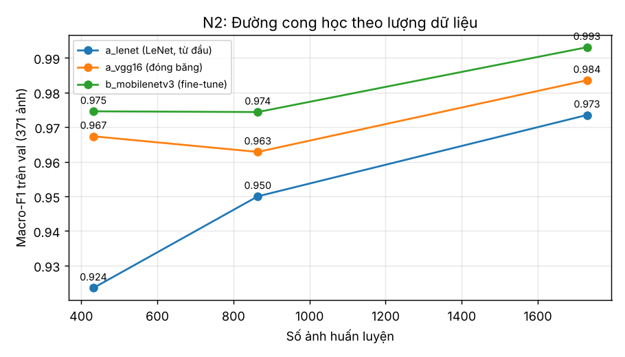

*Kết luận:* khớp. Từ 25% lên 100% train, `a_lenet` tăng 0,050, hai mô hình pretrained chỉ tăng 0,016–0,018. Với 25% train (432 ảnh), `a_vgg16` (0,967) và `b_mobilenetv3` (0,975) đã ngang hoặc hơn `a_lenet` dùng đủ 1.729 ảnh (0,973).

**N3 — Dropout giảm quá khớp.** *Dự đoán:* `a_dropout` có Dropout có khoảng cách train–val nhỏ hơn và kết quả trên val tốt hơn bản không Dropout.

| Cấu hình | Số lần chạy | Macro-F1 val từng seed | Macro-F1 val (TB ± ĐLC) | Khoảng cách loss val − train ở epoch 40 (TB ± ĐLC) | Loss val thấp nhất (TB ± ĐLC) |
|---|---|---|---|---|---|
| Có Dropout(0,5) | 3 | 0,940, 0,947, 0,935 | 0,941 ± 0,005 | 0,456 ± 0,061 | 0,248 ± 0,021 |
| Không Dropout | 3 | 0,951, 0,960, 0,947 | 0,953 ± 0,006 | 0,376 ± 0,081 | 0,202 ± 0,055 |

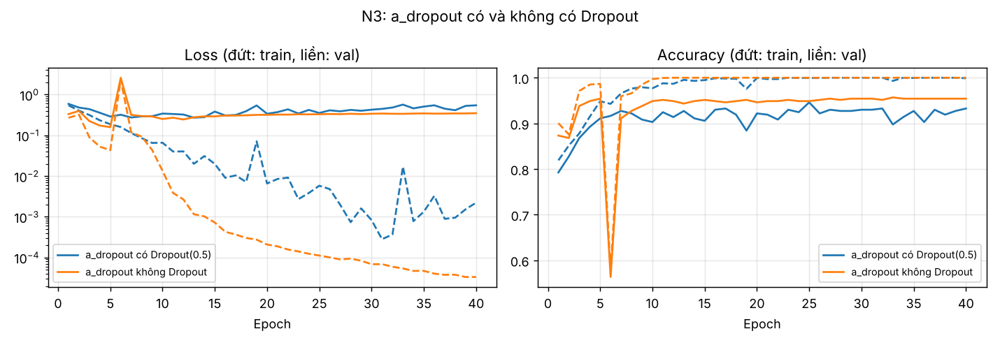

*Kết luận:* **trái dự đoán**. Qua 3 seed khởi tạo, bản có Dropout(0,5) kém hơn 0,012 (0,941 ± 0,005 so với 0,953 ± 0,006), và khoảng cách loss val − train không nhỏ hơn. Giải thích của nhóm: 99% tham số nằm ở lớp Dense ngay sau Flatten, trước lớp Dropout; lớp này vẫn khớp tập train đến accuracy 0,999 ở cả hai cấu hình. Dropout chỉ làm nhiễu 128 đầu ra của lớp đó nên không chặn được quá khớp ở nơi nó xảy ra, lại làm quá trình tối ưu ồn hơn.

**N5 — Tăng cường ảnh giảm quá khớp.** (Hướng A và B chung một bảng.)

| Cấu hình | Epoch chọn / tổng | Macro-F1 val | Accuracy train (epoch chọn) | Accuracy val (epoch chọn) | Loss train (epoch cuối) | Loss val (epoch cuối) | Khoảng cách loss val − train (epoch cuối) | Loss val thấp nhất |
|---|---|---|---|---|---|---|---|---|
| a_dropout, không tăng cường | 25 / 40 | 0,940 | 0,999 | 0,946 | 0,0022 | 0,5444 | 0,5422 | 0,2713 |
| a_dropout, có tăng cường | 25 / 40 | 0,948 | 0,967 | 0,954 | 0,2613 | 0,3150 | 0,0536 | 0,1286 |
| b_mobilenetv3 giai đoạn 2, không tăng cường | 4 / 9 | 0,997 | 0,999 | 0,997 | 0,0045 | 0,0107 | 0,0062 | 0,0107 |
| b_mobilenetv3 giai đoạn 2, có tăng cường | 12 / 17 | 0,993 | 0,997 | 0,995 | 0,0125 | 0,0183 | 0,0058 | 0,0183 |

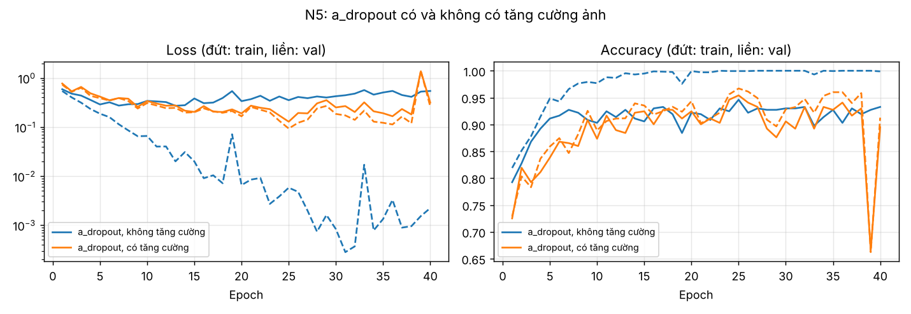

*Kết luận:* khớp với mô hình học từ đầu. Với `a_dropout`, khoảng cách loss val − train giảm từ 0,542 xuống 0,054 và macro-F1 tăng 0,940 → 0,948; tăng cường tác động vào đầu vào nên hiệu quả hơn Dropout rõ rệt. Với `b_mobilenetv3` pretrained, quá khớp vốn đã nhỏ nên tăng cường không tăng điểm trên val (0,993 so với 0,997), nhưng làm mô hình bền hơn với phép xoay ±30°: 0,987–0,993 so với 0,958–0,978 (bảng N8).

#### 5.8.2 Hướng B — CNN lớn hơn, fine-tune

**N4 — Đóng băng và fine-tune.** *Tính chất:* đóng băng giữ nguyên đặc trưng đã học; fine-tune thích nghi đặc trưng với dữ liệu mới, nhưng learning rate lớn sẽ phá trọng số đã học. *Dự đoán:* giai đoạn 2 tốt hơn giai đoạn 1; lr 1e-3 kém và kém ổn định hơn lr 1e-5.

| Cấu hình | Tham số được huấn luyện | Macro-F1 val | Accuracy val | Loss val (epoch chọn) | Macro-F1 val sau epoch 1 | Macro-F1 val thấp nhất | Epoch chọn / tổng | Thời gian mỗi epoch (s) |
|---|---|---|---|---|---|---|---|---|
| MobileNetV3-Small, giai đoạn 1 (đóng băng thân) | 2308 | 0,987 | 0,989 | 0,0505 | 0,872 | 0,872 | 21 / 31 | 0,1 |
| MobileNetV3-Small, giai đoạn 2, lr = 1e-5 | 917204 | 0,993 | 0,995 | 0,0203 | 0,981 | 0,978 | 12 / 17 | 20,1 |
| MobileNetV3-Small, giai đoạn 2, lr = 1e-4 | 917204 | 1,000 | 1,000 | 0,0045 | 0,974 | 0,974 | 7 / 12 | 26,9 |
| MobileNetV3-Small, giai đoạn 2, lr = 1e-3 | 917204 | 0,993 | 0,995 | 0,0184 | 0,964 | 0,917 | 4 / 9 | 26,3 |
| ResNet50, giai đoạn 1 (đóng băng thân) | 8196 | 0,996 | 0,997 | 0,0269 | 0,942 | 0,942 | 10 / 20 | 0,2 |
| ResNet50, giai đoạn 2 (mở băng conv5), lr = 1e-5 | 14961668 | 0,998 | 0,997 | 0,0140 | 0,984 | 0,984 | 3 / 8 | 91,2 |

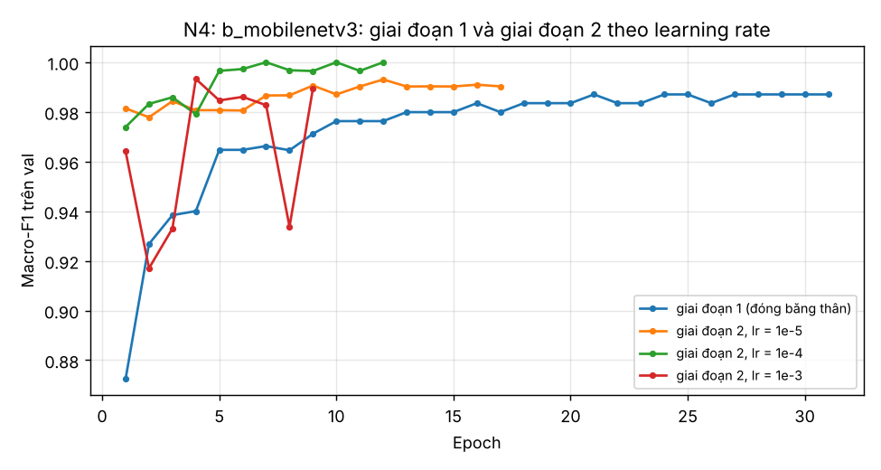

*Kết luận:* vế đầu khớp, nhưng mức tăng nhỏ vì giai đoạn 1 đã rất cao: MobileNetV3 0,987 → 0,993–1,000, ResNet50 0,996 → 0,998. Vế learning rate: lr 1e-3 làm quá trình huấn luyện mất ổn định (macro-F1 tụt xuống 0,917 ở epoch 2 và dao động tới cuối, trong khi lr 1e-5 không xuống dưới 0,978). Tuy vậy, nhờ dừng sớm theo val, kết quả cuối không kém. ResNet50 chạy được giai đoạn 2 trên CPU (mở băng khối conv5, khoảng 61 s mỗi epoch, 8 epoch).

**Một chi tiết cài đặt quan trọng.** Lần fine-tune đầu để các lớp BatchNormalization mở băng: accuracy trên train ở epoch 1 chỉ 0,356. Phép đo lặp lại được cho thấy nguyên nhân:

| Thân mạng | Cách mở băng | Thay đổi tương đối của embedding (training=True so với suy luận) | Accuracy đầu phân lớp GĐ1, embedding chế độ suy luận | Accuracy đầu phân lớp GĐ1, embedding chế độ huấn luyện |
|---|---|---|---|---|
| b_mobilenetv3 | BN mở (trainable=True) | 0,820 | 1,000 | 0,047 |
| b_mobilenetv3 | BN đóng băng (cách đồ án dùng) | 0,000 | 1,000 | 1,000 |
| b_resnet50 | BN mở (trainable=True) | 0,838 | 1,000 | 0,125 |
| b_resnet50 | BN đóng băng (cách đồ án dùng) | 0,000 | 1,000 | 1,000 |

Khi BN ở chế độ huấn luyện, nó dùng thống kê của từng lô thay cho thống kê đã học trên ImageNet. Embedding đổi 82–84%, và đầu phân lớp học ở giai đoạn 1 chỉ còn đoán đúng 4,7–12,5% ảnh. Giữ BN đóng băng khi fine-tune thì vấn đề biến mất.

#### 5.8.3 So sánh hai hướng

**N6 — Mạng lớn hơn, pretrained, tốt hơn nhưng tốn tài nguyên hơn.**

| Hướng | Mô hình | Biến thể được chốt | Macro-F1 val | Accuracy val | Số tham số | File mô hình (MB) | Thời gian huấn luyện (s) | Dự đoán 1 ảnh (ms, CPU) | Dự đoán theo lô 32 (ms/ảnh) | Cách tính thời gian huấn luyện |
|---|---|---|---|---|---|---|---|---|---|---|
| A | a_lenet | a_lenet | 0,973 | 0,978 | 337976 | 1,4 | 30 | 1,4 | 0,2 | 50 epoch × 0,6 s |
| A | a_dropout | a_dropout_aug | 0,948 | 0,954 | 1746260 | 7,0 | 192 | 2,5 | 0,7 | 40 epoch × 4,8 s |
| A | a_vgg16 | a_vgg16_lr1e-3 | 0,990 | 0,992 | 40669252 | 162,8 | 226 | 130,4 | 67,5 | tính đặc trưng thân đóng băng cho 1729 ảnh train: 129 s; đầu phân lớp 24 epoch × 4,0 s |
| B | b_mobilenetv3 | b_mobilenetv3_lr1e-4 | 1,000 | 1,000 | 941428 | 4,3 | 216 | 12,5 | 2,6 | tính đặc trưng thân đóng băng cho 1729 ảnh train: 25 s; giai đoạn 1: 31 epoch, 4 s; giai đoạn 2: 12 epoch × 15,6 s |
| B | b_resnet50 | b_resnet50 | 0,998 | 0,997 | 23595908 | 95,1 | 591 | 61,1 | 28,0 | tính đặc trưng thân đóng băng cho 1729 ảnh train: 98 s; giai đoạn 1: 20 epoch, 4 s; giai đoạn 2: 8 epoch × 61,2 s |

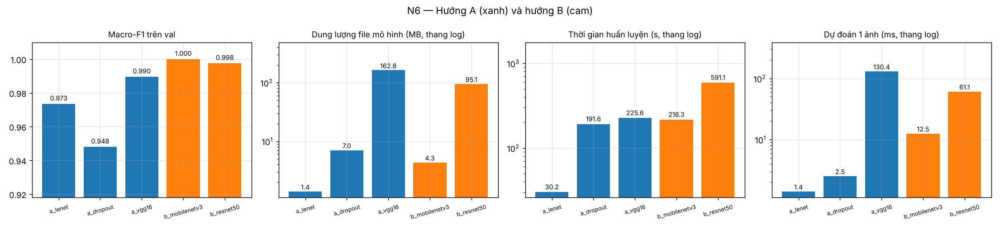

*Kết luận:* vế "tốt hơn" khớp: hướng B đạt 0,998–1,000 trên val, hướng A 0,948–0,990. Vế "tốn tài nguyên hơn" chỉ đúng với ResNet50. MobileNetV3-Small có 0,94 triệu tham số, file 4,3 MB, dự đoán 12,5 ms mỗi ảnh; trong khi `a_vgg16` của hướng A có 40,7 triệu tham số, file 163 MB, dự đoán 130 ms mỗi ảnh. Dung lượng là của file `.keras` chỉ gồm kiến trúc và trọng số (khoảng 4 byte mỗi tham số), không kèm trạng thái của bộ tối ưu. Một kiến trúc được thiết kế cho thiết bị di động có thể vừa chính xác hơn vừa nhẹ hơn mô hình theo bài giảng.

**N7 — Feature vector thủ công và embedding.** *Dự đoán:* embedding do mạng học tốt hơn đặc trưng thủ công với cùng bộ phân lớp.

| Đặc trưng | Loại | Số chiều | KNN (k=5) | LogReg |
|---|---|---|---|---|
| Hist HSV (8,8,8) | thủ công | 512 | 0,982 | 0,997 |
| HOG 64×128 | thủ công | 3780 | 0,945 | 0,987 |
| Hist H-S + HOG (ghép, chuẩn hóa từng phần) | thủ công | 3844 | 0,990 | 0,998 |
| VGG16 ImageNet, trung bình 7×7 (chưa học trên chuối) | embedding | 512 | 0,932 | 0,986 |
| a_vgg16, lớp Dense(256) áp chót | embedding | 256 | 0,986 | 0,986 |
| MobileNetV3 ImageNet, sau GAP (chưa fine-tune) | embedding | 576 | 0,981 | 0,993 |
| b_mobilenetv3_lr1e-4, sau GAP (đã fine-tune) | embedding | 576 | 1,000 | 0,996 |

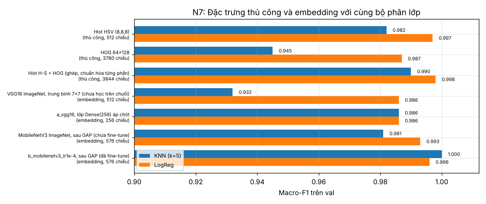

*Kết luận:* khớp với KNN (embedding MobileNetV3 đã fine-tune: 1,000; đặc trưng thủ công tốt nhất: 0,990). Với LogReg thì ngang nhau (0,996 so với 0,998). Embedding ImageNet **chưa học trên chuối** (VGG16) cho KNN chỉ 0,932, kém histogram HSV (0,982). Embedding chỉ vượt trội sau khi được học trên chính dữ liệu này.

**N8 — CNN có bền với thay đổi hơn đặc trưng thủ công không?**

| Mô hình | Ảnh gốc | Xáo trộn 4×4 | V×0,6 | V×1,4 | Ảnh xám | Nhiễu σ=5 | Nhiễu σ=10 | Nhiễu σ=20 | Che 25% | Xoay −30° | Xoay −15° | Xoay +15° | Xoay +30° |
|---|---|---|---|---|---|---|---|---|---|---|---|---|---|
| Truyền thống: Hist HSV (8,8,8) | 0,997 | 0,997 | 0,280 | 0,705 | 0,145 | 0,451 | 0,085 | 0,085 | 0,076 | 0,987 | 0,993 | 0,992 | 0,994 |
| Truyền thống: HOG 64×128 | 0,983 | 0,302 | 0,984 | 0,800 | 0,981 | 0,537 | 0,461 | 0,318 | 0,801 | 0,679 | 0,929 | 0,886 | 0,550 |
| Truyền thống: Hist H-S + HOG | 0,998 | 0,898 | 0,995 | 0,888 | 0,770 | 0,706 | 0,180 | 0,101 | 0,918 | 0,978 | 0,987 | 0,988 | 0,974 |
| Hướng A tốt nhất: a_vgg16_lr1e-3 | 0,990 | 0,097 | 0,984 | 0,969 | 0,953 | 0,981 | 0,976 | 0,932 | 0,850 | 0,888 | 0,973 | 0,980 | 0,906 |
| Hướng B tốt nhất: b_mobilenetv3_lr1e-4 | 1,000 | 0,850 | 0,913 | 0,907 | 0,963 | 0,997 | 0,987 | 0,953 | 0,659 | 0,993 | 1,000 | 0,997 | 0,996 |
| Hướng B, lr 1e-5, có tăng cường (N5): b_mobilenetv3 | 0,993 | 0,775 | 0,899 | 0,936 | 0,914 | 0,980 | 0,972 | 0,949 | 0,506 | 0,987 | 0,990 | 0,993 | 0,993 |
| Hướng B, lr 1e-5, không tăng cường (N5): b_mobilenetv3_noaug | 0,997 | 0,717 | 0,952 | 0,911 | 0,959 | 0,977 | 0,955 | 0,908 | 0,555 | 0,958 | 0,977 | 0,993 | 0,978 |

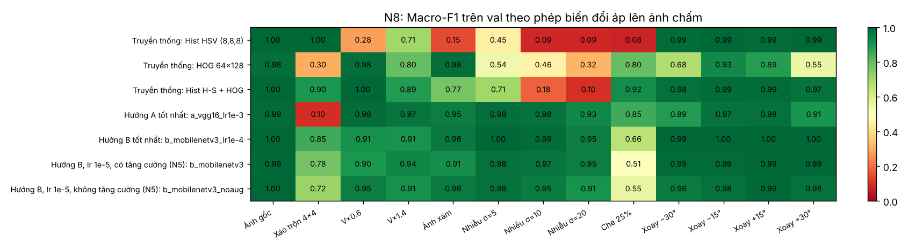

*Kết luận:* CNN bền hơn hẳn với **nhiễu** (MobileNetV3 0,953 ở σ = 20, histogram và H-S + HOG ≤ 0,101), **xoay** và **ảnh xám**. **Trái dự đoán** với phép che 25%: MobileNetV3 còn 0,659, kém HOG (0,801) và H-S + HOG (0,918). Với xáo trộn 4×4, `a_vgg16` sập về 0,097 vì dùng Flatten, mỗi trọng số gắn với một vị trí cố định; MobileNetV3 dùng GlobalAveragePooling nên giữ được 0,850. Không có phương pháp nào bền với mọi phép biến đổi; mỗi phương pháp bền với đúng loại thay đổi mà cấu trúc của nó bất biến.

### 5.9 Mất cân bằng dữ liệu: I1–I2

**I1 — Accuracy che khuất lớp bị nhận kém.**

| Mô hình (chưa xử lý mất cân bằng) | Chấm trên | Accuracy | Macro-F1 | Accuracy − Macro-F1 | Recall Bangla | Recall Champa | Recall Sabri | Recall Sagor | Recall thấp nhất |
|---|---|---|---|---|---|---|---|---|---|
| Luôn đoán lớp đông nhất (Champa Kola) | train+val | 0,402 | 0,143 | +0,259 | 0,000 | 1,000 | 0,000 | 0,000 | 0,000 (Bangla) |
| HOG 64×128 + KNN k=31 | out-of-fold 5-fold | 0,884 | 0,871 | +0,014 | 0,899 | 1,000 | 0,988 | 0,552 | 0,552 (Sagor) |
| Hist HSV + KNN k=31 | out-of-fold 5-fold | 0,883 | 0,868 | +0,015 | 0,870 | 0,998 | 0,986 | 0,576 | 0,576 (Sagor) |
| Moment màu + LogReg | out-of-fold 5-fold | 0,925 | 0,908 | +0,017 | 0,870 | 0,992 | 0,986 | 0,785 | 0,785 (Sagor) |
| Cạnh Sobel + LogReg | out-of-fold 5-fold | 0,900 | 0,894 | +0,007 | 0,822 | 0,920 | 0,977 | 0,857 | 0,822 (Bangla) |
| Cạnh Roberts + KNN k=1, Manhattan, ưu tiên điểm gần | out-of-fold 5-fold | 0,959 | 0,955 | +0,004 | 0,950 | 0,995 | 0,988 | 0,870 | 0,870 (Sagor) |
| HOG 64×128 + LogReg C=0,1 | out-of-fold 5-fold | 0,989 | 0,986 | +0,002 | 0,968 | 0,998 | 0,993 | 0,984 | 0,968 (Bangla) |
| Hist HSV (8,8,8) + LogReg C=0,1 | out-of-fold 5-fold | 0,992 | 0,991 | +0,001 | 0,992 | 0,998 | 0,998 | 0,978 | 0,978 (Sagor) |
| Hist H-S + HOG + LogReg C=100, chuẩn hóa từng phần | out-of-fold 5-fold | 0,997 | 0,996 | +0,000 | 0,995 | 0,996 | 1,000 | 0,996 | 0,995 (Bangla) |
| CNN a_lenet_frac25 | val | 0,930 | 0,924 | +0,006 | 0,879 | 0,953 | 0,961 | 0,899 | 0,879 (Bangla) |
| CNN a_lenet | val | 0,978 | 0,973 | +0,005 | 1,000 | 0,993 | 0,987 | 0,924 | 0,924 (Sagor) |
| CNN a_dropout | val | 0,946 | 0,940 | +0,006 | 0,924 | 0,987 | 0,987 | 0,848 | 0,848 (Sagor) |
| CNN a_vgg16_lr1e-3 | val | 0,992 | 0,990 | +0,002 | 0,985 | 1,000 | 0,987 | 0,987 | 0,985 (Bangla) |
| CNN b_mobilenetv3_s1 | val | 0,989 | 0,987 | +0,002 | 0,970 | 1,000 | 1,000 | 0,975 | 0,970 (Bangla) |
| CNN b_mobilenetv3_lr1e-4 | val | 1,000 | 1,000 | +0,000 | 1,000 | 1,000 | 1,000 | 1,000 | 1,000 (Bangla) |
| CNN b_resnet50_s1 | val | 0,997 | 0,996 | +0,001 | 0,985 | 1,000 | 1,000 | 1,000 | 0,985 (Bangla) |
| CNN b_resnet50 | val | 0,997 | 0,998 | -0,000 | 1,000 | 1,000 | 1,000 | 0,987 | 0,987 (Sagor) |

*Kết luận:* khớp. Bộ phân lớp "luôn đoán Champa Kola" đạt accuracy 0,402 nhưng macro-F1 chỉ 0,143. KNN k = 31 trên HOG đạt accuracy 0,884 nhưng recall Sagor Kola chỉ 0,552. Ở các mô hình tốt, accuracy và macro-F1 chênh ≤ 0,003. Lớp bị nhận kém nhất thường là Sagor Kola (524 ảnh) chứ không phải lớp ít ảnh nhất (Bangla Kola, 444 ảnh).

**I2 — Các cách xử lý mất cân bằng.** Mọi phép lấy mẫu lại chỉ áp dụng trên phần huấn luyện.

| Mô hình | Cách xử lý | Chấm | Macro-F1 | Accuracy | Precision Bangla (ít nhất) | Recall Bangla (ít nhất) | Precision Champa (đông nhất) | Recall Champa (đông nhất) | Recall thấp nhất |
|---|---|---|---|---|---|---|---|---|---|
| Truyền thống tốt nhất: Hist H-S + HOG + LogReg C=100, chuẩn hóa từng phần | Không xử lý | 5-fold CV | 0,996 ± 0,003 | 0,997 | 0,995 | 0,995 | 0,999 | 0,996 | 0,995 (Bangla) |
| Truyền thống tốt nhất: Hist H-S + HOG + LogReg C=100, chuẩn hóa từng phần | Class weight | 5-fold CV | 0,996 ± 0,003 | 0,997 | 0,995 | 0,995 | 0,999 | 0,996 | 0,995 (Bangla) |
| Truyền thống tốt nhất: Hist H-S + HOG + LogReg C=100, chuẩn hóa từng phần | Oversampling | 5-fold CV | 0,995 ± 0,005 | 0,996 | 0,992 | 0,992 | 0,999 | 0,996 | 0,992 (Bangla) |
| Truyền thống tốt nhất: Hist H-S + HOG + LogReg C=100, chuẩn hóa từng phần | Tăng cường lớp ít | 5-fold CV | 0,996 ± 0,002 | 0,996 | 0,992 | 0,997 | 0,999 | 0,995 | 0,993 (Sagor) |
| Truyền thống yếu hơn (minh họa): Cạnh Sobel + LogReg | Không xử lý | 5-fold CV | 0,894 ± 0,008 | 0,900 | 0,849 | 0,822 | 0,921 | 0,920 | 0,822 (Bangla) |
| Truyền thống yếu hơn (minh họa): Cạnh Sobel + LogReg | Class weight | 5-fold CV | 0,888 ± 0,007 | 0,895 | 0,823 | 0,828 | 0,925 | 0,902 | 0,828 (Bangla) |
| Truyền thống yếu hơn (minh họa): Cạnh Sobel + LogReg | Oversampling | 5-fold CV | 0,888 ± 0,005 | 0,895 | 0,821 | 0,825 | 0,926 | 0,905 | 0,825 (Bangla) |
| Truyền thống yếu hơn (minh họa): Cạnh Sobel + LogReg | Tăng cường lớp ít | 5-fold CV | 0,884 ± 0,011 | 0,892 | 0,776 | 0,857 | 0,957 | 0,892 | 0,852 (Sagor) |
| Hướng A tốt nhất: a_vgg16_lr1e-3 | Không xử lý | val | 0,990 | 0,992 | 0,970 | 0,985 | 1,000 | 1,000 | 0,985 (Bangla) |
| Hướng A tốt nhất: a_vgg16_lr1e-3 | Class weight | val | 0,987 | 0,989 | 0,970 | 0,985 | 0,993 | 1,000 | 0,975 (Sagor) |
| Hướng A tốt nhất: a_vgg16_lr1e-3 | Oversampling | val | 0,987 | 0,989 | 0,956 | 0,985 | 1,000 | 0,993 | 0,985 (Bangla) |
| Hướng A tốt nhất: a_vgg16_lr1e-3 | Tăng cường lớp ít | val | 0,994 | 0,995 | 1,000 | 1,000 | 0,993 | 1,000 | 0,987 (Sabri) |
| Hướng B tốt nhất: b_mobilenetv3_lr1e-4 | Không xử lý | val | 1,000 | 1,000 | 1,000 | 1,000 | 1,000 | 1,000 | 1,000 (Bangla) |
| Hướng B tốt nhất: b_mobilenetv3_lr1e-4 | Class weight | val | 1,000 | 1,000 | 1,000 | 1,000 | 1,000 | 1,000 | 1,000 (Bangla) |
| Hướng B tốt nhất: b_mobilenetv3_lr1e-4 | Oversampling | val | 1,000 | 1,000 | 1,000 | 1,000 | 1,000 | 1,000 | 1,000 (Bangla) |
| Hướng B tốt nhất: b_mobilenetv3_lr1e-4 | Tăng cường lớp ít | val | 1,000 | 1,000 | 1,000 | 1,000 | 1,000 | 1,000 | 1,000 (Bangla) |

*Kết luận:* ở mô hình yếu (cạnh Sobel + LogReg), các cách xử lý **đổi precision lấy recall** của lớp ít: tăng cường lớp ít nâng recall Bangla 0,822 → 0,857 nhưng hạ precision Bangla 0,849 → 0,776. Ở các mô hình mạnh không đo được tác động (truyền thống tốt nhất: cả bốn cách 0,995–0,996; `b_mobilenetv3`: cả bốn cách 1,000 trên val). Với tỉ lệ mất cân bằng 2,2 lần, mất cân bằng không phải vấn đề chính của bộ dữ liệu này, nên cấu hình cuối không thêm bước xử lý.

### 5.10 Phân đoạn tách nền: S1–S2

**S1 — Các phương pháp phân đoạn.** *Tính chất:* ngưỡng toàn cục chỉ tốt khi nền và vật tách biệt về mức xám; Otsu tự chọn ngưỡng; k-means gom theo màu. Dữ liệu không có nhãn mask, nên nhóm đánh giá định tính bằng hình, kèm hai chỉ số không cần nhãn: số mảnh rời và tỉ lệ lỗ thủng.

| Phương pháp | Số mảnh rời (trung bình) | Số mảnh rời (trung vị) | Tỉ lệ lỗ thủng trong vật | Tỉ lệ diện tích vật | IoU với phương pháp được chọn |
|---|---|---|---|---|---|
| Ngưỡng toàn cục (T=127) | 11,6 | 9 | 0,085 | 0,105 | 0,689 |
| Otsu (ảnh xám) | 2,9 | 2 | 0,052 | 0,149 | 0,799 |
| Ngưỡng thích nghi | 16,9 | 14 | 0,282 | 0,081 | 0,561 |
| K-means màu (k=2) | 2,5 | 1 | 0,027 | 0,140 | 0,859 |
| Otsu trên khoảng cách màu tới nền | 2,5 | 1 | 0,010 | 0,145 | 0,971 |
| Otsu khoảng cách màu + hậu xử lý (dùng cho S2) | 1,0 | 1 | 0,000 | 0,144 | 1,000 |

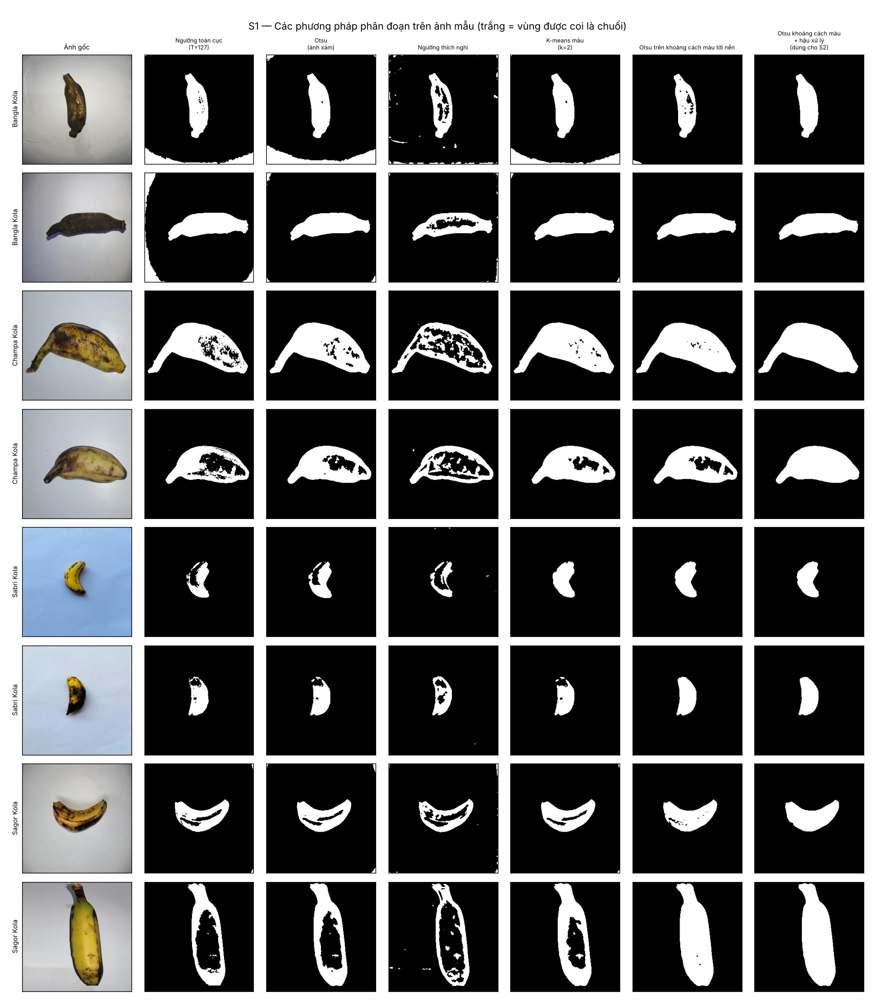

*Kết luận:* khớp. Ngưỡng toàn cục và ngưỡng thích nghi tách cả vết thâm trên vỏ thành nền (lỗ thủng 0,085 và 0,282). Ngưỡng thích nghi chỉ bắt được viền và vân. Các cách dựa trên màu (k-means, Otsu trên khoảng cách màu tới nền) cho mask liền nhất, vì nền trơn sáng khác quả chuối về màu rõ hơn về mức xám.

**S2 — Mô hình dựa vào quả chuối hay vào nền?** *Dự đoán:* nếu chỉ dùng vùng nền mà vẫn phân loại tốt thì dữ liệu có thiên lệch theo bối cảnh chụp.

| Đặc trưng + bộ phân lớp | Phiên bản ảnh | Macro-F1 | Accuracy |
|---|---|---|---|
| Hist HSV (8,8,8) + LogReg C=0,1 [màu tốt nhất] | Toàn ảnh | 0,991 ± 0,005 | 0,992 ± 0,005 |
| HOG 64×128 + LogReg C=0,1 | Toàn ảnh | 0,986 ± 0,007 | 0,989 ± 0,006 |
| Hist H-S + HOG + LogReg C=100 [truyền thống tốt nhất] | Toàn ảnh | 0,996 ± 0,003 | 0,997 ± 0,003 |
| Hist HSV (8,8,8) + LogReg C=0,1 [màu tốt nhất] | Chỉ vùng chuối | 0,964 ± 0,010 | 0,967 ± 0,008 |
| HOG 64×128 + LogReg C=0,1 | Chỉ vùng chuối | 0,884 ± 0,010 | 0,888 ± 0,009 |
| Hist H-S + HOG + LogReg C=100 [truyền thống tốt nhất] | Chỉ vùng chuối | 0,958 ± 0,005 | 0,961 ± 0,005 |
| Hist HSV (8,8,8) + LogReg C=0,1 [màu tốt nhất] | Chỉ vùng nền | 0,933 ± 0,008 | 0,943 ± 0,008 |
| HOG 64×128 + LogReg C=0,1 | Chỉ vùng nền | 0,980 ± 0,009 | 0,983 ± 0,008 |
| Hist H-S + HOG + LogReg C=100 [truyền thống tốt nhất] | Chỉ vùng nền | 0,986 ± 0,005 | 0,988 ± 0,005 |

| Đặc trưng + bộ phân lớp | Số chiều | Macro-F1 | Accuracy |
|---|---|---|---|
| HOG của 4 góc ảnh (128×128) + LogReg C=0,1 | 8100 | 0,968 ± 0,008 | 0,973 ± 0,007 |
| Hist HSV (8,8,8) của 4 góc ảnh + LogReg C=0,1 | 512 | 0,939 ± 0,009 | 0,948 ± 0,008 |

| Đặc trưng + bộ phân lớp | Số chiều | Macro-F1 | Accuracy |
|---|---|---|---|
| Màu Lab trung bình của nền (3 số) + KNN k=5 | 3 | 0,937 ± 0,011 | 0,948 ± 0,011 |
| Màu Lab trung bình của nền (3 số) + LogReg | 3 | 0,618 ± 0,027 | 0,693 ± 0,018 |
| Tỉ lệ diện tích quả chuối trong ảnh (1 số) + KNN k=5 | 1 | 0,619 ± 0,022 | 0,642 ± 0,016 |
| HOG của mask nhị phân (chỉ hình bóng) + LogReg C=0,1 | 3780 | 0,857 ± 0,017 | 0,861 ± 0,014 |

| Lớp | Nền: L trung bình ± std | Nền: a | Nền: b | Tỉ lệ diện tích quả chuối |
|---|---|---|---|---|
| Bangla Kola | 201,1 ± 13,7 | 128,1 ± 1,1 | 128,3 ± 2,1 | 0,136 |
| Champa Kola | 190,2 ± 11,7 | 127,2 ± 0,4 | 123,6 ± 0,9 | 0,164 |
| Sabri Kola | 207,4 ± 12,4 | 127,3 ± 1,0 | 119,9 ± 10,4 | 0,054 |
| Sagor Kola | 196,1 ± 20,1 | 128,2 ± 0,7 | 128,2 ± 2,3 | 0,220 |

| Mô hình (học trên ảnh đầy đủ) | Toàn ảnh | Chỉ vùng chuối | Chỉ vùng nền |
|---|---|---|---|
| a_vgg16_lr1e-3 | 0,990 | 0,952 | 0,792 |
| b_mobilenetv3_lr1e-4 | 1,000 | 0,927 | 0,683 |
| b_resnet50 | 0,998 | 0,926 | 0,725 |

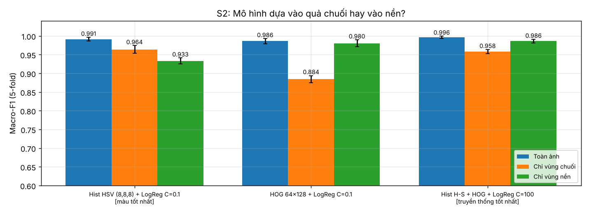

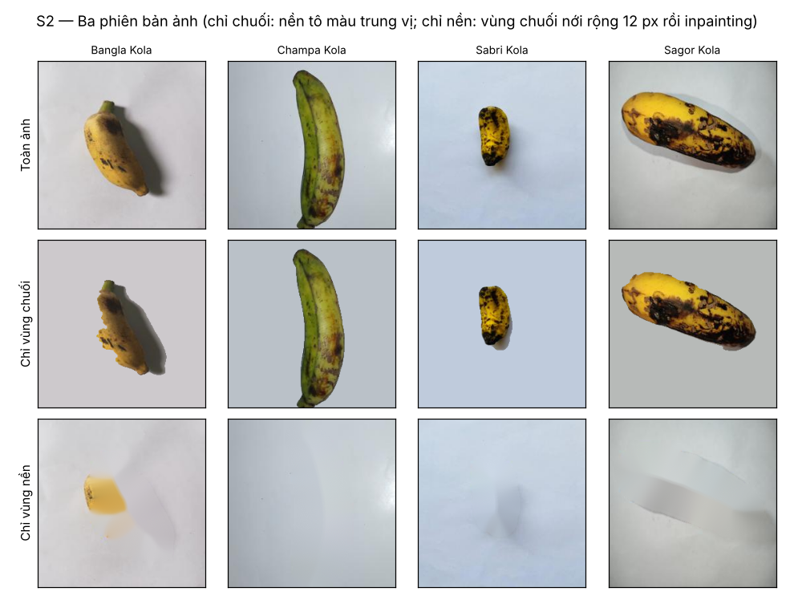

*Kết luận:* **dữ liệu có thiên lệch theo bối cảnh chụp.** Chỉ dùng 4 góc ảnh 64×64, nơi trung bình chỉ 2,5% điểm ảnh thuộc vùng chuối, HOG vẫn đạt 0,968 và histogram màu 0,939. Chỉ 3 con số là màu trung bình của nền đã cho KNN đạt 0,937. CNN học trên ảnh đầy đủ, khi đoán trên ảnh đã xóa quả chuối, vẫn đạt 0,683–0,792 (đoán mò ≈ 0,25). Mỗi lớp được chụp trong điều kiện riêng: nền Sabri Kola xanh hơn (b = 119,9 so với 123,6–128,3 ở các lớp khác), quả Sabri chiếm 5,4% diện tích ảnh so với 22,0% ở Sagor. Khi chỉ nhìn quả chuối, cấu hình truyền thống tốt nhất còn 0,958 và CNN còn 0,926–0,952; các con số này gần với khả năng phân biệt giống bằng chính quả chuối hơn.

### 5.11 Đánh giá cuối trên tập test

Tập test (371 ảnh) chỉ dùng ở bước này, cho 9 cấu hình đã chốt. Nhóm truyền thống học lại trên train+val; CNN học trên train. Khoảng tin cậy 95% tính bằng bootstrap (2.000 lần lấy mẫu lại).

| Nhóm | Mô hình | Macro-F1 test | KTC 95% (bootstrap) | Accuracy test | Số ảnh sai / 371 | Recall thấp nhất | Macro-F1 lúc chọn (5-fold CV hoặc val) |
|---|---|---|---|---|---|---|---|
| Truyền thống (màu) | Hist HSV (8,8,8) + LogReg C=0,1 | 0,994 | [0,984; 1,000] | 0,995 | 2 | 0,985 (Bangla) | 0,991 ± 0,005 |
| Truyền thống (cạnh) | Cạnh Roberts + KNN k=1, Manhattan, ưu tiên điểm gần | 0,964 | [0,944; 0,982] | 0,968 | 12 | 0,885 (Sagor) | 0,955 ± 0,015 |
| Truyền thống (HOG) | HOG 64×128 + LogReg C=0,1 | 0,990 | [0,977; 1,000] | 0,992 | 3 | 0,985 (Bangla) | 0,986 ± 0,007 |
| Truyền thống (ghép) | Hist H-S + HOG + LogReg C=100, chuẩn hóa từng phần | 1,000 | [1,000; 1,000] | 1,000 | 0 | 1,000 (Bangla) | 0,996 ± 0,003 |
| CNN hướng A | a_lenet (biến thể: a_lenet) | 0,978 | [0,960; 0,993] | 0,981 | 7 | 0,955 (Bangla) | 0,973 |
| CNN hướng A | a_dropout (biến thể: a_dropout_aug) | 0,942 | [0,917; 0,965] | 0,943 | 21 | 0,872 (Sagor) | 0,948 |
| CNN hướng A | a_vgg16 (biến thể: a_vgg16_lr1e-3) | 0,986 | [0,971; 0,997] | 0,989 | 4 | 0,970 (Bangla) | 0,990 |
| CNN hướng B | b_mobilenetv3 (biến thể: b_mobilenetv3_lr1e-4) | 1,000 | [1,000; 1,000] | 1,000 | 0 | 1,000 (Bangla) | 1,000 |
| CNN hướng B | b_resnet50 (biến thể: b_resnet50) | 0,997 | [0,988; 1,000] | 0,997 | 1 | 0,987 (Sabri) | 0,998 |

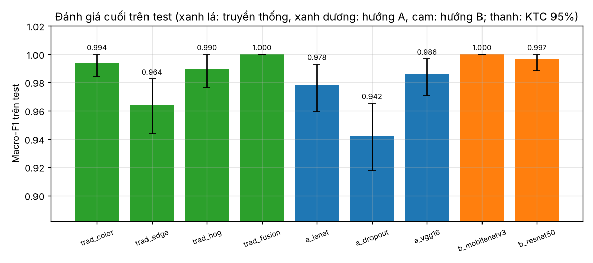

**Mô hình tốt nhất của từng nhóm (chọn theo CV/val, kết quả trên test):**

- Truyền thống: **Hist H-S + HOG + Logistic Regression** (C = 100, chuẩn hóa từng phần): macro-F1 1,000, đúng 371/371 ảnh.
- CNN hướng A: **`a_vgg16`** (VGG16 đóng băng, lr 1e-3): macro-F1 0,986, sai 4 ảnh.
- CNN hướng B: **`b_mobilenetv3`** (MobileNetV3-Small fine-tune, lr 1e-4): macro-F1 1,000, đúng 371/371 ảnh.

Hai cấu hình đúng toàn bộ tập test không phân biệt được với nhau. Khoảng tin cậy của các cấu hình từ 0,986 trở lên chồng lên nhau; chỉ kết luận được rằng `a_dropout` (0,942), cạnh Roberts + KNN (0,964) và `a_lenet` (0,978) kém hơn nhóm dẫn đầu. Với 0/371 ảnh sai, cận trên 95% của tỉ lệ lỗi thật xấp xỉ 3/371 ≈ 0,8% (quy tắc ba). Điểm trên test bằng hoặc cao hơn điểm lúc chọn ở 6/9 cấu hình; 3 cấu hình còn lại giảm trong khoảng 1–2 ảnh. Không thấy dấu hiệu quá khớp vào tập chọn siêu tham số.

**Phân tích lỗi.** Gộp trên 9 mô hình, có 41 ảnh test bị ít nhất một mô hình đoán sai.

| Thực tế | Đoán thành | Số lượt sai (cộng trên 9 mô hình) |
|---|---|---|
| Sagor Kola | Champa Kola | 16 |
| Bangla Kola | Sagor Kola | 8 |
| Sagor Kola | Bangla Kola | 7 |
| Champa Kola | Sagor Kola | 5 |
| Bangla Kola | Sabri Kola | 4 |
| Sabri Kola | Bangla Kola | 4 |
| Sabri Kola | Sagor Kola | 3 |
| Champa Kola | Bangla Kola | 2 |
| Bangla Kola | Champa Kola | 1 |

| Lớp | Số ảnh test | Ảnh bị ≥ 1 mô hình đoán sai | Diện tích quả TB (ảnh đúng hết) | Diện tích quả TB (ảnh bị sai) |
|---|---|---|---|---|
| Bangla Kola | 67 | 9 | 0,127 | 0,142 |
| Champa Kola | 149 | 7 | 0,166 | 0,153 |
| Sabri Kola | 77 | 2 | 0,054 | 0,099 |
| Sagor Kola | 78 | 23 | 0,244 | 0,181 |

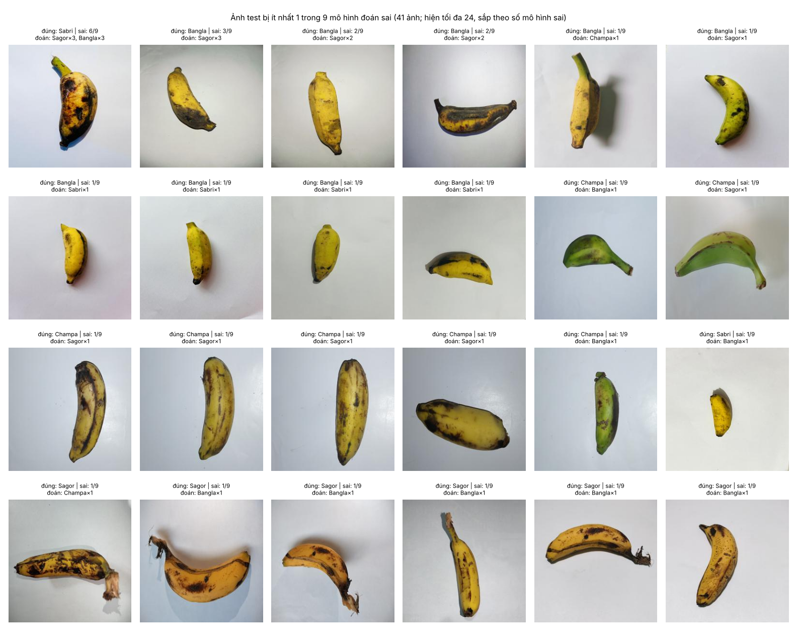

Lỗi tập trung ở Sagor Kola: 23/78 ảnh bị ít nhất một mô hình đoán sai, chủ yếu bị nhầm thành Champa Kola. Ảnh Sagor bị sai có quả nhỏ hơn trung bình của lớp (diện tích 0,181 so với 0,244). Ảnh bị nhiều mô hình đoán sai nhất (`Sabri_Kola_5.jpg`, 6/9 mô hình) là một quả Sabri to trên nền trắng, không giống ảnh Sabri điển hình (quả nhỏ, nền xanh nhạt). Cả hai quan sát khớp với thiên lệch theo kích thước quả và nền đã đo ở S2.

### 5.12 Demo

`app/app.py` (Gradio, chạy bằng `python app/app.py`) có 7 tab. (1) **Dự đoán**: tải ảnh, chụp webcam hoặc dán ảnh, chọn mô hình (`b_mobilenetv3`, bản X-b có thay nền, `a_lenet` hoặc cấu hình truyền thống tốt nhất), nhận giống dự đoán, xác suất 4 lớp, thời gian dự đoán và thông tin giống. (2) **So sánh mô hình**: một ảnh qua cả 4 mô hình. (3) **Giải thích**: Grad-CAM trên lớp tích chập cuối của CNN. (4) **Thử độ bền**: áp đúng các phép của bộ kiểm tra khó (độ sáng, nhiễu, xoay, che, thay nền) lên một ảnh rồi so dự đoán trước và sau. (5) **Nhiều ảnh**: dự đoán hàng loạt, tải CSV. (6) **Đánh giá theo metric**: tính lại accuracy, precision, recall, F1 từng lớp, macro, weighted, ma trận nhầm lẫn và ảnh bị đoán sai trên val hoặc test, với ảnh gốc hoặc từng phép thử khó; kết quả trùng với số đã ghi ở mục 5.10 và 5.13. (7) **Kết quả thực nghiệm**: xem các bảng và hình trong `results/`. Thông tin về giống trong `app/variety_info.json` chỉ ghi những gì có nguồn dẫn; chỗ chưa có nguồn để "TODO".

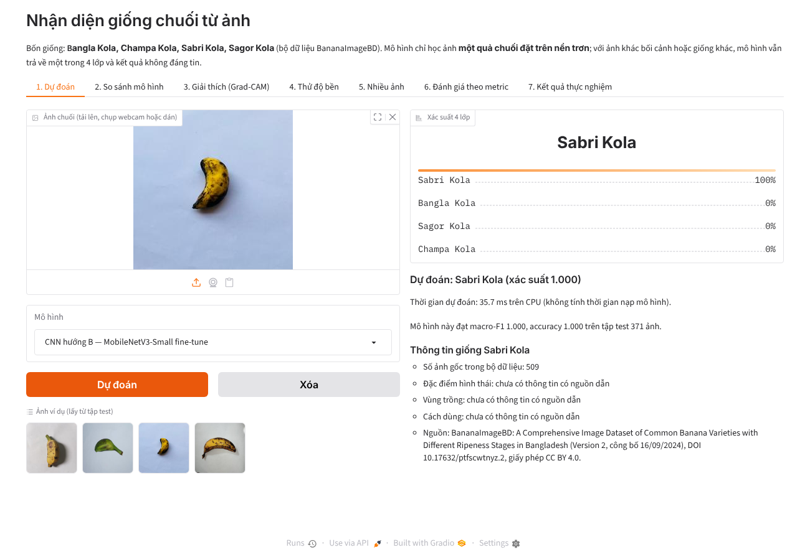

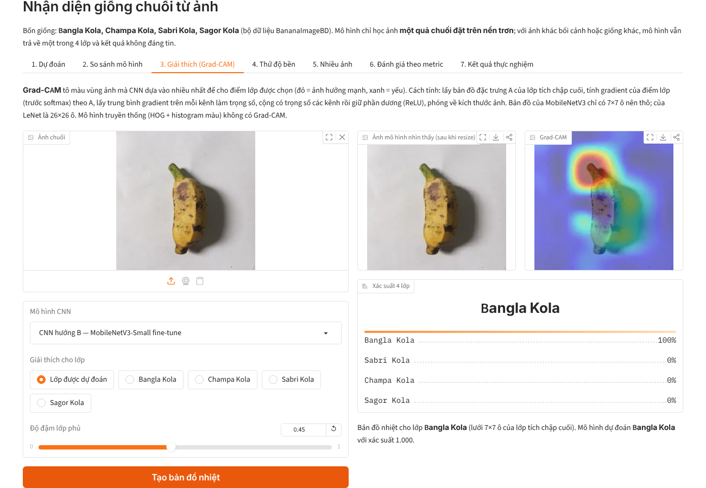

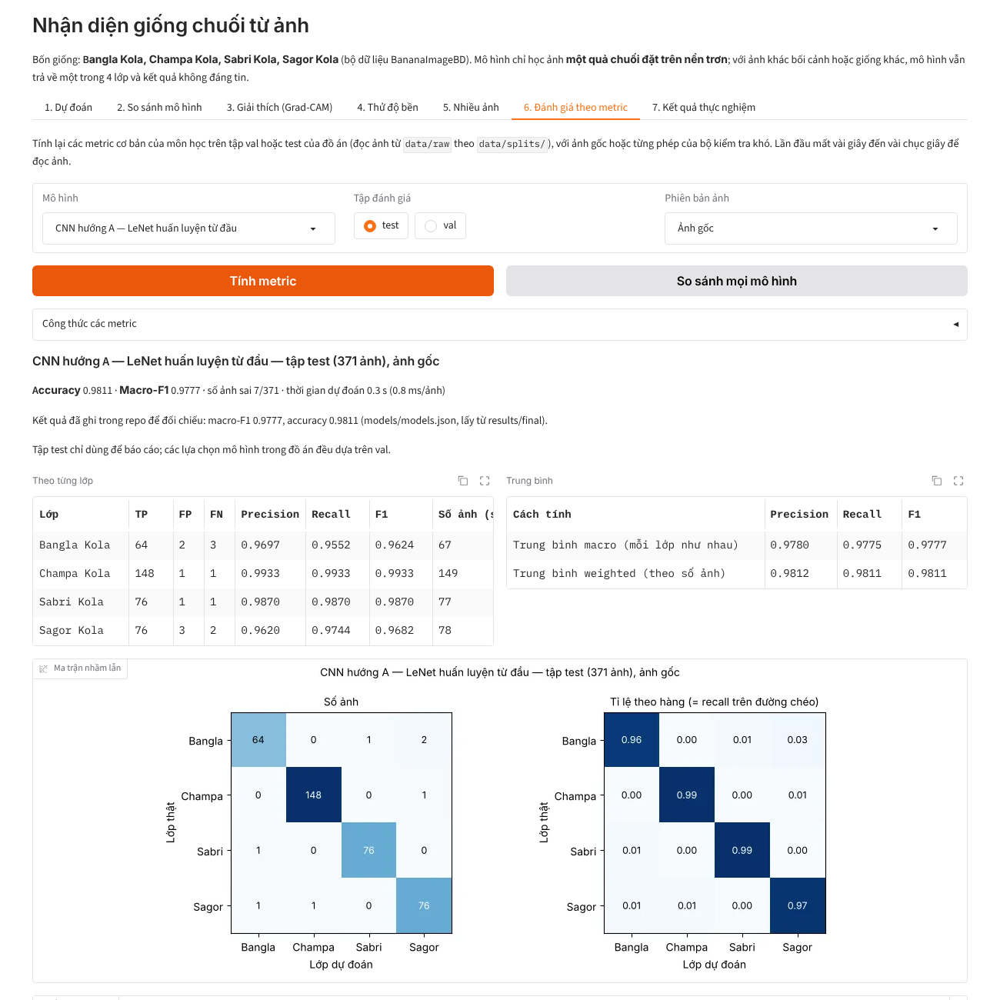

### 5.13 Phần mở rộng: ba nhánh so sánh độc lập với pipeline gốc

Sau khi hoàn tất 30 thí nghiệm, đồ án thêm ba nhánh (mục 12 của kế hoạch). Mỗi nhánh chỉ đổi **một thứ** so với pipeline gốc và được so sánh độc lập với nhau và với pipeline gốc; các nhánh không chồng lên nhau.

| Nhánh | Thay đổi so với pipeline gốc | Giữ nguyên |
|---|---|---|
| **G** — gốc | (mốc so sánh: ảnh gốc resize 256×256, 9 cấu hình đã chốt ở mục 5.11) | — |
| **X** — xử lý dữ liệu | Thêm làm sạch, tiền xử lý và tăng cường dữ liệu do nhóm thiết kế | 9 cấu hình, siêu tham số, cách chia tập |
| **T** — bản Augmented của tác giả | Tập huấn luyện lấy từ bản "Augmented Banana Classification Dataset" (7.413 ảnh) của tác giả bộ dữ liệu [1] | 9 cấu hình, siêu tham số |
| **B** — phương pháp của bài báo | Phương pháp phân loại lấy từ bài báo của Ergün [18] trên chính bộ dữ liệu này | Dữ liệu và cách chia tập |

**Cùng một tập chấm.** Mọi nhánh báo cáo trên 371 ảnh test gốc; mọi lựa chọn bên trong một nhánh chỉ dùng train và val.

**Bộ kiểm tra khó.** Hai cấu hình của nhánh G đã đúng 371/371 ảnh test gốc, nên điểm trên ảnh gốc không còn chỗ để phân biệt các nhánh. Mỗi mô hình được chấm thêm trên 6 phiên bản biến đổi của tập test: **nền hoán đổi** (quả chuối được ghép lên nền lấy từ ảnh của một lớp khác), V×0,6, V×1,4, nhiễu Gauss σ = 10, xoay +30°, che 25%. Phép biến đổi áp lên ảnh thô, trước mọi bước tiền xử lý riêng của nhánh. **Điểm bền** là trung bình macro-F1 trên 6 phiên bản này. Các phép này là biến đổi tổng hợp; chúng không thay được một tập ảnh chụp thật ở bối cảnh khác.

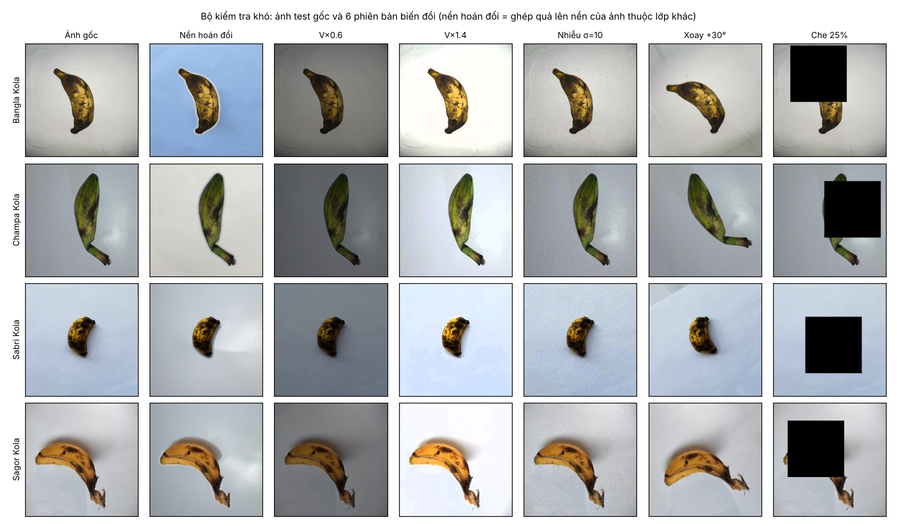

#### 5.13.1 Nhánh G trên bộ kiểm tra khó

| Nhóm | Mô hình | Macro-F1 val | Macro-F1 test | KTC 95% | Accuracy test | Số ảnh sai / 371 | Nền hoán đổi | V×0,6 | V×1,4 | Nhiễu σ=10 | Xoay +30° | Che 25% | Điểm bền |
|---|---|---|---|---|---|---|---|---|---|---|---|---|---|
| Truyền thống (màu) | Hist HSV (8,8,8) + LogReg C=0,1 | 0,997 | 0,994 | [0,984; 1,000] | 0,995 | 2 | 0,726 | 0,304 | 0,673 | 0,086 | 0,983 | 0,150 | 0,487 |
| Truyền thống (cạnh) | Cạnh Roberts + KNN k=1, Manhattan, ưu tiên điểm gần | 0,957 | 0,964 | [0,944; 0,982] | 0,968 | 12 | 0,759 | 0,691 | 0,901 | 0,085 | 0,730 | 0,755 | 0,654 |
| Truyền thống (HOG) | HOG 64×128 + LogReg C=0,1 | 0,983 | 0,990 | [0,977; 1,000] | 0,992 | 3 | 0,145 | 0,987 | 0,776 | 0,484 | 0,505 | 0,805 | 0,617 |
| Truyền thống (ghép) | Hist H-S + HOG + LogReg C=100, chuẩn hóa từng phần | 0,998 | 1,000 | [1,000; 1,000] | 1,000 | 0 | 0,410 | 0,997 | 0,856 | 0,172 | 0,972 | 0,959 | 0,728 |
| CNN hướng A | a_lenet | 0,973 | 0,978 | [0,960; 0,993] | 0,981 | 7 | 0,744 | 0,979 | 0,977 | 0,978 | 0,874 | 0,469 | 0,837 |
| CNN hướng A | a_dropout | 0,948 | 0,942 | [0,917; 0,965] | 0,943 | 21 | 0,855 | 0,864 | 0,932 | 0,940 | 0,925 | 0,100 | 0,769 |
| CNN hướng A | a_vgg16 | 0,990 | 0,986 | [0,971; 0,997] | 0,989 | 4 | 0,657 | 0,979 | 0,963 | 0,984 | 0,887 | 0,843 | 0,886 |
| CNN hướng B | b_mobilenetv3 | 1,000 | 1,000 | [1,000; 1,000] | 1,000 | 0 | 0,794 | 0,919 | 0,890 | 0,989 | 1,000 | 0,659 | 0,875 |
| CNN hướng B | b_resnet50 | 0,998 | 0,997 | [0,988; 1,000] | 0,997 | 1 | 0,792 | 0,916 | 0,966 | 0,990 | 0,993 | 0,714 | 0,895 |

Macro-F1 trên ảnh gốc là 0,94–1,00, nhưng điểm bền chỉ 0,49–0,90, và thứ hạng thay đổi: `b_resnet50` (0,895) và `a_vgg16` (0,886) bền hơn `b_mobilenetv3` (0,875), dù `b_mobilenetv3` đúng 371/371 ảnh gốc. Phép **nền hoán đổi** làm mọi cấu hình tụt: HOG còn 0,145, cấu hình truyền thống tốt nhất còn 0,410, các CNN còn 0,66–0,86. Đây là xác nhận thứ hai, bằng một phép đo khác, cho kết luận của S2: các mô hình dựa một phần vào nền ảnh.

#### 5.13.2 Nhánh X — xử lý dữ liệu do nhóm thiết kế

**Pipeline gốc xử lý dữ liệu tới đâu?** Chỉ resize ảnh về 256×256 và chuẩn hóa giá trị điểm ảnh bên trong mô hình. Không có bước làm sạch, không cân bằng trắng, không tách nền. Tăng cường ảnh chỉ bật lúc huấn luyện cho các CNN có tăng cường (`a_dropout`, hướng B); nhóm truyền thống không có. Nhánh X bổ sung cả ba phần: làm sạch, tiền xử lý, tăng cường, và chọn tổ hợp bằng số liệu trên val.

**X1 — Làm sạch và kiểm tra dữ liệu** (`results/E1_xu_ly/table_cleaning.md`):

| Kiểm tra | Kết quả |
|---|---|
| File không đọc được | 0 |
| Ảnh không phải 256×256 (được resize khi đọc) | 2 |
| File trùng tuyệt đối (md5) | 0 |
| Ảnh train gần trùng (pHash, Hamming ≤ 2) với ảnh val hoặc test → loại khỏi train | 15 |
| Bản lặp gần trùng trong nội bộ train → giữ 1 ảnh mỗi nhóm, loại | 20 |
| Số ảnh train sau khi làm sạch | 1694 / 1729 |
| Độ nét (phương sai Laplacian): phân vị 5% / trung vị / phân vị 95% | 56 / 153 / 280 |
| Ảnh có độ nét dưới 1/4 trung vị (nghi mờ; giữ lại, chỉ liệt kê) | 18 |
| Mask của bước S1 lớn hơn mask mới từ 1,5 lần (mask cũ tràn ra nền) | 129 / 2471 (5,2%) |

Không có ảnh nào bị cả hai mô hình kiểm tra (truyền thống tốt nhất, embedding CNN) cùng đoán sai ngoài phần học, nên không có ảnh nghi sai nhãn. Bài báo mô tả dữ liệu [17] cho biết **mỗi quả chuối được chụp từ bốn mặt**. Điều này để lại dấu vết trong dữ liệu:

| Chỉ số | Đo được | Nếu ngẫu nhiên |
|---|---|---|
| Ảnh có láng giềng gần nhất cùng lớp (embedding MobileNetV3) mang số thứ tự cách ≤ 3 | 20,0% | 1,0% |
| … cách đúng 1 | 10,1% | 0,3% |

| Mô hình | 5-fold ngẫu nhiên phân tầng | 5-fold theo khối ảnh liên tiếp | Chênh |
|---|---|---|---|
| Hist HSV (8,8,8) + LogReg C=0,1 | 0,991 ± 0,005 | 0,922 ± 0,042 | +0,069 |
| HOG 64×128 + LogReg C=0,1 | 0,986 ± 0,007 | 0,933 ± 0,062 | +0,053 |
| Hist H-S + HOG + LogReg C=100 | 0,996 ± 0,003 | 0,973 ± 0,017 | +0,024 |
| Embedding MobileNetV3 (ImageNet) + LogReg | 0,995 ± 0,005 | 0,964 ± 0,025 | +0,031 |

*Kết luận X1.* Làm sạch chỉ loại 35/1.729 ảnh train. Quan trọng hơn là phát hiện về cách chia tập: ảnh mang số thứ tự liền kề giống nhau gấp khoảng 20 lần mức ngẫu nhiên (20,0% so với 1,0%), và cross-validation chia theo khối ảnh liên tiếp cho macro-F1 thấp hơn chia ngẫu nhiên 0,024–0,069. Ảnh của cùng một quả hoặc cùng một đợt chụp nằm ở cả train lẫn test khi chia ngẫu nhiên, nên mọi con số chấm bằng cách chia ngẫu nhiên (kể cả bảng ở mục 5.11) lạc quan hơn so với khi gặp quả chuối chưa từng thấy. pHash không bắt được hiện tượng này (mục 5.1) vì các mặt của một quả không giống nhau từng điểm ảnh.

**X2 — Tiền xử lý.** Năm mức, áp dụng giống nhau cho ảnh train và ảnh cần dự đoán:

| Mức | Nội dung |
|---|---|
| Không xử lý | Chỉ resize (như pipeline gốc) |
| Cân bằng trắng theo nền | Chia ảnh cho mô hình nền bậc hai (màu giấy trắng ước lượng tại từng vị trí), khử sắc màu nguồn sáng và độ sáng không đều |
| Nền phẳng | Tách quả chuối bằng mask (mô hình nền bậc hai + Otsu), giữ nguyên màu quả, thay toàn bộ nền bằng một màu trắng |
| Cân bằng trắng + nền phẳng | Cả hai bước trên |
| Cân bằng trắng + nền phẳng + cắt theo quả | Thêm: cắt theo khung bao của quả, đệm thành hình vuông, resize |

Mask của bước S1 không dùng lại được: nó tràn ra nền ở 5,2% số ảnh (những ảnh có vệt sáng của đèn quanh quả). Nhánh X dùng mask mới: khớp một mặt bậc hai theo (x, y) cho màu nền rồi tách ngưỡng Otsu trên khoảng cách màu tới mặt đó.

**X3 — Tăng cường dữ liệu (chỉ trên train).** Ba mức: không; hình học + quang học (lật, xoay bội số 90°, xoay ±15°, độ sáng ±15%, làm mờ, nhiễu muối tiêu; 2 bản mỗi ảnh, cùng loại phép với công thức của tác giả [17]); thêm **thay nền ngẫu nhiên** (ghép quả chuối lên nền của một ảnh train bất kỳ, để màu và kết cấu nền không còn đi kèm với nhãn).

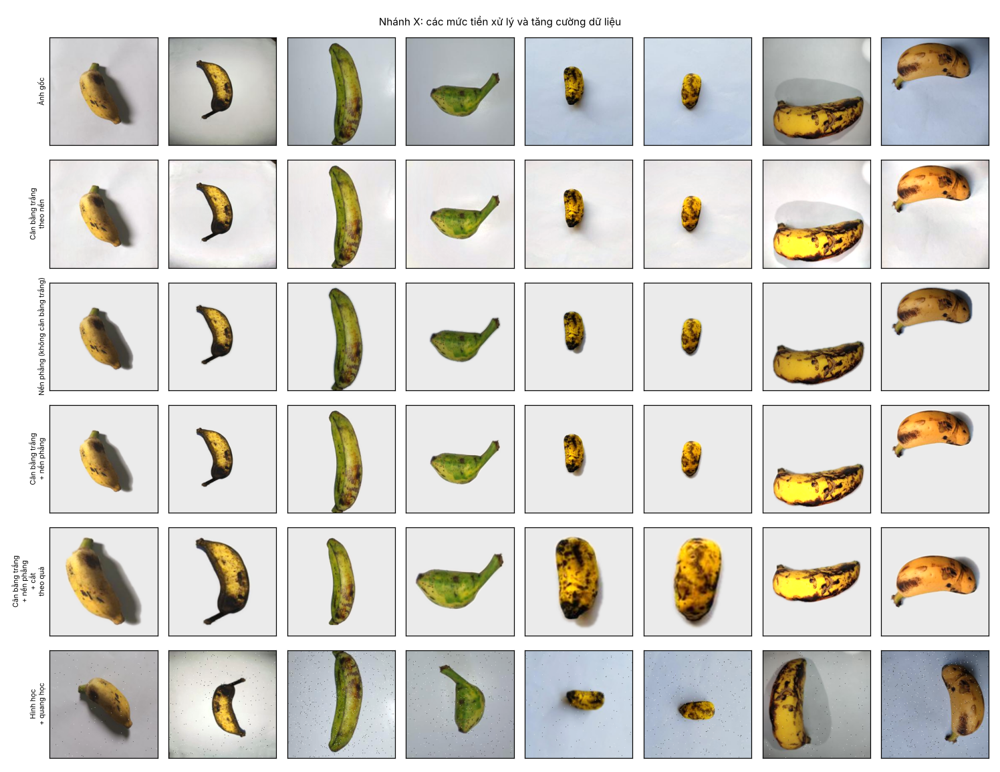

**X4 — Chọn tổ hợp trên val.** Điểm chọn là trung bình macro-F1 trên val của 7 phép thử (ảnh gốc và 6 phép của bộ kiểm tra khó), lấy trung bình hai mô hình đại diện: TT = cấu hình truyền thống tốt nhất, CNN = embedding MobileNetV3 đóng băng + Logistic Regression. Sai số là độ lệch chuẩn bootstrap trên ảnh val (`results/E1_xu_ly/table_selection.md`):

| Tiền xử lý | Tăng cường (train) | Số ảnh train | Ảnh gốc (TT / CNN) | Nền hoán đổi (TT / CNN) | V×0,6 (TT / CNN) | V×1,4 (TT / CNN) | Nhiễu σ=10 (TT / CNN) | Xoay +30° (TT / CNN) | Che 25% (TT / CNN) | TB 7 phép thử (TT) | TB 7 phép thử (CNN) | Điểm chọn | Kém tổ hợp đứng đầu (KTC 95%) | Phân biệt được với tổ hợp đứng đầu |
|---|---|---|---|---|---|---|---|---|---|---|---|---|---|---|
| Không xử lý | Không tăng cường | 1694 | 1,000 / 0,993 | 0,354 / 0,788 | 0,995 / 0,955 | 0,900 / 0,906 | 0,190 / 0,930 | 0,970 / 0,961 | 0,947 / 0,372 | 0,765 | 0,843 | 0,804 ± 0,006 | 0,085 [+0,073; +0,098] | có |
| Không xử lý | Hình học + quang học | 5082 | 0,997 / 0,986 | 0,479 / 0,768 | 0,994 / 0,896 | 0,992 / 0,881 | 0,245 / 0,924 | 0,963 / 0,971 | 0,965 / 0,502 | 0,805 | 0,847 | 0,826 ± 0,006 | 0,064 [+0,052; +0,075] | có |
| Không xử lý | Hình học + quang học + thay nền ngẫu nhiên | 5082 | 0,998 / 0,987 | 0,859 / 0,960 | 0,988 / 0,952 | 0,945 / 0,916 | 0,141 / 0,945 | 0,932 / 0,954 | 0,834 / 0,284 | 0,814 | 0,857 | 0,835 ± 0,006 | 0,054 [+0,043; +0,065] | có |
| Cân bằng trắng theo nền | Không tăng cường | 1694 | 0,988 / 0,987 | 0,661 / 0,788 | 0,982 / 0,985 | 0,874 / 0,948 | 0,172 / 0,926 | 0,906 / 0,932 | 0,770 / 0,304 | 0,765 | 0,838 | 0,802 ± 0,007 | 0,088 [+0,074; +0,102] | có |
| Cân bằng trắng theo nền | Hình học + quang học | 5082 | 0,976 / 0,980 | 0,727 / 0,855 | 0,973 / 0,985 | 0,973 / 0,944 | 0,221 / 0,942 | 0,912 / 0,960 | 0,836 / 0,379 | 0,802 | 0,863 | 0,833 ± 0,006 | 0,056 [+0,045; +0,068] | có |
| Cân bằng trắng theo nền | Hình học + quang học + thay nền ngẫu nhiên | 5082 | 0,967 / 0,970 | 0,836 / 0,944 | 0,974 / 0,978 | 0,939 / 0,943 | 0,165 / 0,927 | 0,888 / 0,924 | 0,802 / 0,522 | 0,796 | 0,887 | 0,841 ± 0,007 | 0,048 [+0,036; +0,059] | có |
| Nền phẳng (không cân bằng trắng) | Không tăng cường | 1694 | 0,985 / 0,978 | 0,962 / 0,973 | 0,985 / 0,923 | 0,974 / 0,945 | 0,678 / 0,955 | 0,964 / 0,962 | 0,744 / 0,271 | 0,899 | 0,858 | 0,878 ± 0,006 | 0,011 [+0,003; +0,020] | có |
| Nền phẳng (không cân bằng trắng) | Hình học + quang học | 5082 | 0,984 / 0,971 | 0,933 / 0,974 | 0,988 / 0,930 | 0,982 / 0,949 | 0,633 / 0,955 | 0,965 / 0,967 | 0,822 / 0,398 | 0,901 | 0,878 | 0,889 ± 0,006 | — | — |
| Cân bằng trắng + nền phẳng | Không tăng cường | 1694 | 0,957 / 0,981 | 0,844 / 0,974 | 0,953 / 0,981 | 0,946 / 0,974 | 0,624 / 0,967 | 0,882 / 0,970 | 0,513 / 0,231 | 0,817 | 0,868 | 0,843 ± 0,006 | 0,047 [+0,037; +0,057] | có |
| Cân bằng trắng + nền phẳng | Hình học + quang học | 5082 | 0,963 / 0,965 | 0,758 / 0,952 | 0,961 / 0,965 | 0,936 / 0,961 | 0,505 / 0,948 | 0,911 / 0,961 | 0,540 / 0,394 | 0,796 | 0,878 | 0,837 ± 0,007 | 0,052 [+0,042; +0,061] | có |
| Cân bằng trắng + nền phẳng + cắt theo quả | Không tăng cường | 1694 | 0,950 / 0,977 | 0,759 / 0,968 | 0,956 / 0,977 | 0,938 / 0,983 | 0,635 / 0,974 | 0,788 / 0,952 | 0,289 / 0,113 | 0,759 | 0,849 | 0,804 ± 0,005 | 0,085 [+0,071; +0,099] | có |
| Cân bằng trắng + nền phẳng + cắt theo quả | Hình học + quang học | 5082 | 0,937 / 0,961 | 0,752 / 0,940 | 0,952 / 0,963 | 0,929 / 0,970 | 0,652 / 0,930 | 0,839 / 0,951 | 0,287 / 0,316 | 0,764 | 0,862 | 0,813 ± 0,007 | 0,077 [+0,063; +0,091] | có |

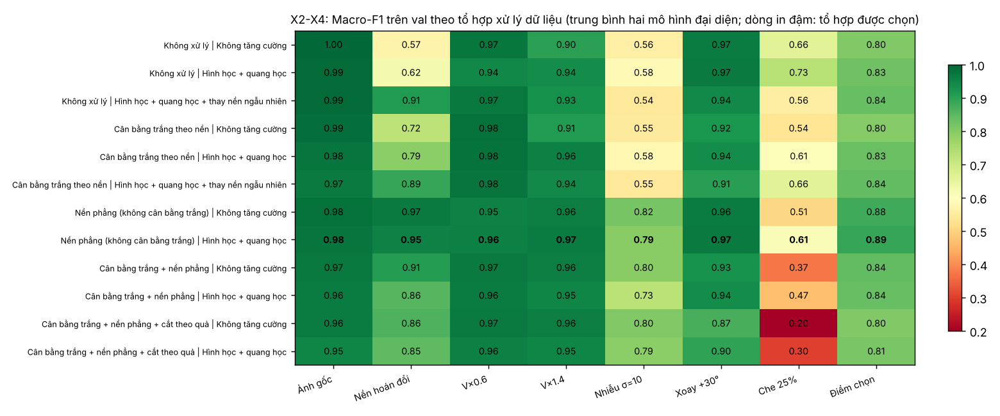

Hai tổ hợp được chạy lại đủ pipeline:

- **X-a — nền phẳng + tăng cường hình học/quang học:** điểm chọn cao nhất (0,889 ± 0,006), phân biệt được với mọi tổ hợp khác.
- **X-b — không xử lý ảnh lúc suy luận, tăng cường có thay nền ngẫu nhiên:** tổ hợp tốt nhất trong nhóm chỉ can thiệp vào tập train (0,835 ± 0,006). Chạy cho 6 cấu hình đại diện.

*Kết luận X2–X4.*

- So với không xử lý (0,804), tách nền là thay đổi có tác dụng lớn nhất: nền phẳng không tăng cường đạt 0,878, có tăng cường 0,889. Phần tăng đến chủ yếu từ phép nền hoán đổi (0,57 → 0,95–0,97 trung bình hai mô hình) và nhiễu.
- **Cân bằng trắng theo nền làm kết quả kém đi** (cân bằng trắng + nền phẳng: 0,843 so với nền phẳng: 0,878). Phép đo riêng cho thấy lý do: hệ số cân bằng trắng tính từ màu nền rồi nhân vào cả quả chuối, nên khi nền đổi thì màu quả cũng đổi theo.

| Tiền xử lý | Hist HSV + LogReg: val gốc | Hist HSV + LogReg: val nền hoán đổi | Sụt | Màu quả chuối lệch đi khi đổi nền (khoảng cách Lab trung bình) |
|---|---|---|---|---|
| Không xử lý | 0,997 | 0,718 | +0,278 | 0,0 |
| Nền phẳng (không cân bằng trắng) | 0,997 | 0,973 | +0,023 | 0,0 |
| Cân bằng trắng theo nền | 0,977 | 0,750 | +0,226 | 12,9 |
| Cân bằng trắng + nền phẳng | 0,983 | 0,632 | +0,351 | 12,9 |

- **Cắt theo quả không giúp** (0,804–0,813): nó xóa thông tin kích thước quả và làm phép che 25% tệ hẳn (0,20–0,30), vì ô đen bị coi là vật thể và khung cắt sai.
- Tăng cường hình học + quang học giúp ở 4/5 mức tiền xử lý (+0,009 đến +0,031); riêng với cân bằng trắng + nền phẳng thì giảm 0,006. Thay nền ngẫu nhiên nâng phép nền hoán đổi từ 0,57 lên 0,91 mà không cần tách nền lúc suy luận.

**Kết quả chạy lại pipeline.** X-a, 9 cấu hình (`results/E1_xu_ly/pipeline/table.md`):

| Nhóm | Mô hình | Macro-F1 val | Macro-F1 test | KTC 95% | Accuracy test | Số ảnh sai / 371 | Nền hoán đổi | V×0,6 | V×1,4 | Nhiễu σ=10 | Xoay +30° | Che 25% | Điểm bền |
|---|---|---|---|---|---|---|---|---|---|---|---|---|---|
| Truyền thống (màu) | Hist HSV (8,8,8) + LogReg C=0,1 | 0,990 | 0,993 | [0,981; 1,000] | 0,995 | 2 | 0,966 | 0,834 | 0,784 | 0,354 | 0,993 | 0,169 | 0,683 |
| Truyền thống (cạnh) | Cạnh Roberts + KNN k=1, Manhattan, ưu tiên điểm gần | 0,814 | 0,842 | [0,802; 0,878] | 0,849 | 56 | 0,838 | 0,799 | 0,820 | 0,792 | 0,686 | 0,381 | 0,719 |
| Truyền thống (HOG) | HOG 64×128 + LogReg C=0,1 | 0,836 | 0,828 | [0,790; 0,864] | 0,830 | 63 | 0,836 | 0,810 | 0,831 | 0,822 | 0,629 | 0,294 | 0,704 |
| Truyền thống (ghép) | Hist H-S + HOG + LogReg C=100, chuẩn hóa từng phần | 0,984 | 0,982 | [0,965; 0,996] | 0,987 | 5 | 0,951 | 0,978 | 0,979 | 0,651 | 0,974 | 0,805 | 0,890 |
| CNN hướng A | a_lenet | 0,947 | 0,922 | [0,892; 0,950] | 0,930 | 26 | 0,925 | 0,861 | 0,846 | 0,922 | 0,797 | 0,317 | 0,778 |
| CNN hướng A | a_dropout | 0,979 | 0,959 | [0,936; 0,978] | 0,960 | 15 | 0,959 | 0,880 | 0,942 | 0,962 | 0,946 | 0,207 | 0,816 |
| CNN hướng A | a_vgg16 | 0,982 | 0,958 | [0,936; 0,977] | 0,957 | 16 | 0,951 | 0,933 | 0,954 | 0,964 | 0,926 | 0,413 | 0,857 |
| CNN hướng B | b_mobilenetv3 | 1,000 | 0,995 | [0,987; 1,000] | 0,995 | 2 | 0,995 | 0,943 | 0,915 | 0,988 | 0,998 | 0,450 | 0,881 |
| CNN hướng B | b_resnet50 | 0,987 | 0,997 | [0,989; 1,000] | 0,997 | 1 | 0,997 | 0,983 | 0,956 | 0,985 | 0,990 | 0,397 | 0,885 |

X-b, 6 cấu hình đại diện (`results/E1_xu_ly/pipeline_b/table.md`):

| Nhóm | Mô hình | Macro-F1 val | Macro-F1 test | KTC 95% | Accuracy test | Số ảnh sai / 371 | Nền hoán đổi | V×0,6 | V×1,4 | Nhiễu σ=10 | Xoay +30° | Che 25% | Điểm bền |
|---|---|---|---|---|---|---|---|---|---|---|---|---|---|
| Truyền thống (màu) | Hist HSV (8,8,8) + LogReg C=0,1 | 0,980 | 0,988 | [0,974; 0,998] | 0,989 | 4 | 0,963 | 0,459 | 0,714 | 0,184 | 0,982 | 0,143 | 0,574 |
| Truyền thống (cạnh) | Cạnh Roberts + KNN k=1, Manhattan, ưu tiên điểm gần | 0,934 | 0,960 | [0,938; 0,979] | 0,962 | 14 | 0,799 | 0,691 | 0,892 | 0,179 | 0,708 | 0,617 | 0,648 |
| Truyền thống (HOG) | HOG 64×128 + LogReg C=0,1 | 0,946 | 0,953 | [0,931; 0,974] | 0,957 | 16 | 0,495 | 0,922 | 0,720 | 0,662 | 0,615 | 0,571 | 0,664 |
| Truyền thống (ghép) | Hist H-S + HOG + LogReg C=100, chuẩn hóa từng phần | 0,998 | 0,984 | [0,969; 0,995] | 0,984 | 6 | 0,853 | 0,977 | 0,930 | 0,128 | 0,908 | 0,842 | 0,773 |
| CNN hướng A | a_vgg16 | 0,987 | 0,977 | [0,960; 0,991] | 0,978 | 8 | 0,907 | 0,960 | 0,953 | 0,965 | 0,943 | 0,516 | 0,874 |
| CNN hướng B | b_mobilenetv3 | 1,000 | 1,000 | [1,000; 1,000] | 1,000 | 0 | 0,975 | 0,954 | 0,935 | 0,995 | 1,000 | 0,441 | 0,883 |

*Kết luận nhánh X.*

- **X-a khử được sự phụ thuộc vào nền.** Sau khi tách nền, điểm ở cột "nền hoán đổi" xấp xỉ điểm trên ảnh gốc ở cả 9 cấu hình (`b_mobilenetv3`: 0,995 và 0,995; nhánh G: 1,000 và 0,794). Điểm bền trung bình tăng từ 0,750 lên 0,801.
- **Cái giá của X-a.** Điểm trên ảnh gốc giảm ở những mô hình trước đó dựa nhiều vào nền: HOG 0,990 → 0,828, cạnh 0,964 → 0,842, `a_lenet` 0,978 → 0,922, `a_vgg16` 0,986 → 0,958; trung bình 9 cấu hình 0,983 → 0,942. Các mô hình mạnh nhất gần như giữ nguyên (`b_resnet50` 0,997; `b_mobilenetv3` 0,995; Hist HSV 0,993). Phép che 25% là điểm yếu (0,17–0,45 ở 8/9 cấu hình), vì ô đen làm hỏng bước phân đoạn.
- **X-b đạt gần bằng mà không cần xử lý ảnh lúc dự đoán.** Chỉ thêm ảnh train có nền thay ngẫu nhiên: `b_mobilenetv3` vẫn đúng 371/371 ảnh gốc và đạt 0,975 ở phép nền hoán đổi; Hist H-S + HOG đạt 0,984 và 0,853 (G: 1,000 và 0,410).
- **Xử lý nào là tối ưu?** Không tổ hợp nào tốt hơn ở mọi mặt, và trên ảnh gốc không bước xử lý nào cải thiện được pipeline gốc (nó đã đúng 371/371 ảnh). Nếu mục tiêu là mô hình nhìn quả chuối thay vì nền, thì với mô hình tốt nhất (`b_mobilenetv3`) X-b là lựa chọn cân bằng nhất: không mất điểm trên ảnh gốc, nền hoán đổi từ 0,794 lên 0,975, không phụ thuộc vào bước phân đoạn. Mô hình này được thêm vào demo.
- **S2 chạy lại với mask mới** cho cùng kết luận: chỉ vùng nền vẫn đạt 0,933–0,983 với đặc trưng thủ công (`results/S2/table_mask_v2.md`).

#### 5.13.3 Nhánh T — bản Augmented của tác giả bộ dữ liệu

Bản Augmented là bản xuất từ Roboflow: mỗi ảnh gốc có đúng 3 file, gồm 1 bản gần như nguyên gốc và 2 bản tăng cường (lật, xoay bội số 90°, xoay nhỏ, đổi sáng ±15%, làm mờ, nhiễu trên tối đa 1,5% điểm ảnh, theo [17]). Tên file giữ tên ảnh gốc, nên ánh xạ được 7.413/7.413 file về ảnh gốc. Đồ án chạy pipeline theo hai cách:

- **T-kr (không rò rỉ):** train = 3 file của mỗi ảnh gốc thuộc tập train của G (5.187 ảnh); val và test là ảnh gốc của G. So được trực tiếp với G.
- **T-tl (theo thông lệ):** gộp 7.413 file rồi chia ngẫu nhiên phân tầng 70/15/15, không quan tâm ảnh gốc (5.189 / 1.112 / 1.112). Đây là cách dùng trực tiếp nhất và là cách của bài báo [18].

T-kr, chấm trên test gốc và bộ kiểm tra khó (`results/E2_aug_tac_gia/khong_ro_ri/table.md`):

| Nhóm | Mô hình | Macro-F1 val | Macro-F1 test | KTC 95% | Accuracy test | Số ảnh sai / 371 | Nền hoán đổi | V×0,6 | V×1,4 | Nhiễu σ=10 | Xoay +30° | Che 25% | Điểm bền |
|---|---|---|---|---|---|---|---|---|---|---|---|---|---|
| Truyền thống (màu) | Hist HSV (8,8,8) + LogReg C=0,1 | 0,993 | 0,997 | [0,989; 1,000] | 0,997 | 1 | 0,637 | 0,350 | 0,628 | 0,086 | 0,994 | 0,637 | 0,555 |
| Truyền thống (cạnh) | Cạnh Roberts + KNN k=1, Manhattan, ưu tiên điểm gần | 0,933 | 0,948 | [0,924; 0,969] | 0,951 | 18 | 0,825 | 0,659 | 0,890 | 0,340 | 0,736 | 0,682 | 0,689 |
| Truyền thống (HOG) | HOG 64×128 + LogReg C=0,1 | 0,950 | 0,972 | [0,952; 0,990] | 0,978 | 8 | 0,254 | 0,950 | 0,731 | 0,492 | 0,688 | 0,606 | 0,620 |
| Truyền thống (ghép) | Hist H-S + HOG + LogReg C=100, chuẩn hóa từng phần | 0,993 | 0,989 | [0,976; 0,998] | 0,989 | 4 | 0,255 | 0,989 | 0,971 | 0,313 | 0,982 | 0,963 | 0,745 |
| CNN hướng A | a_lenet | 0,959 | 0,966 | [0,944; 0,986] | 0,973 | 10 | 0,616 | 0,693 | 0,962 | 0,964 | 0,944 | 0,501 | 0,780 |
| CNN hướng A | a_dropout | 0,982 | 0,963 | [0,941; 0,982] | 0,965 | 13 | 0,910 | 0,750 | 0,721 | 0,963 | 0,949 | 0,483 | 0,796 |
| CNN hướng A | a_vgg16 | 0,994 | 0,985 | [0,970; 0,997] | 0,987 | 5 | 0,807 | 0,979 | 0,959 | 0,982 | 0,942 | 0,762 | 0,905 |
| CNN hướng B | b_mobilenetv3 | 1,000 | 0,998 | [0,991; 1,000] | 0,997 | 1 | 0,867 | 0,954 | 0,904 | 0,993 | 1,000 | 0,736 | 0,909 |
| CNN hướng B | b_resnet50 | 1,000 | 0,997 | [0,989; 1,000] | 0,997 | 1 | 0,817 | 0,925 | 0,971 | 0,991 | 0,997 | 0,844 | 0,924 |

T-tl, chấm trên tập test của chính cách chia này (`results/E2_aug_tac_gia/thong_le/table.md`; không chạy `a_dropout` và `b_resnet50`):

| Nhóm | Mô hình | Macro-F1 val | Macro-F1 test | KTC 95% | Accuracy test | Số ảnh sai / 1112 |
|---|---|---|---|---|---|---|
| Truyền thống (màu) | Hist HSV (8,8,8) + LogReg C=0,1 | 0,980 | 0,991 | [0,984; 0,997] | 0,993 | 8 |
| Truyền thống (cạnh) | Cạnh Roberts + KNN k=1, Manhattan, ưu tiên điểm gần | 0,590 | 0,620 | [0,589; 0,650] | 0,640 | 400 |
| Truyền thống (HOG) | HOG 64×128 + LogReg C=0,1 | 0,817 | 0,847 | [0,825; 0,868] | 0,854 | 162 |
| Truyền thống (ghép) | Hist H-S + HOG + LogReg C=100, chuẩn hóa từng phần | 0,978 | 0,976 | [0,966; 0,985] | 0,978 | 24 |
| CNN hướng A | a_lenet | 0,964 | 0,952 | [0,937; 0,965] | 0,960 | 44 |
| CNN hướng A | a_vgg16 | 0,971 | 0,967 | [0,956; 0,978] | 0,970 | 33 |
| CNN hướng B | b_mobilenetv3 | 0,999 | 0,995 | [0,990; 0,999] | 0,996 | 5 |

| Chỉ số | Giá trị |
|---|---|
| Số ảnh test | 1112 |
| Ảnh test có ít nhất 1 file cùng ảnh gốc trong train | 1008 (90,6%) |
| … có đúng 2 file cùng ảnh gốc trong train | 546 (49,1%) |
| Ảnh test không có file cùng ảnh gốc trong train | 104 |

| Mô hình | Accuracy (ảnh test có anh em trong train) | Số ảnh | Accuracy (ảnh test không có) | Số ảnh  |
|---|---|---|---|---|
| Hist HSV (8,8,8) + LogReg C=0,1 | 0,993 | 1008 | 0,990 | 104 |
| Cạnh Roberts + KNN k=1, Manhattan, ưu tiên điểm gần | 0,640 | 1008 | 0,644 | 104 |
| HOG 64×128 + LogReg C=0,1 | 0,859 | 1008 | 0,808 | 104 |
| Hist H-S + HOG + LogReg C=100, chuẩn hóa từng phần | 0,976 | 1008 | 1,000 | 104 |
| a_lenet | 0,959 | 1008 | 0,971 | 104 |
| a_vgg16 | 0,970 | 1008 | 0,971 | 104 |
| b_mobilenetv3 | 0,997 | 1008 | 0,981 | 104 |

*Kết luận.*

- **Trên ảnh gốc, bản Augmented của tác giả không cải thiện kết quả** so với G: trung bình 9 cấu hình 0,979 so với 0,983 (bảng ở mục 5.13.5). Các mô hình nhạy với hướng và vị trí giảm: HOG + LogReg từ 0,990 xuống 0,972, Hist H-S + HOG từ 1,000 xuống 0,989, `a_lenet` từ 0,978 xuống 0,966. Ảnh xoay 90° và lật thêm độ đa dạng mà các mô hình này không biểu diễn được, trong khi ảnh test gốc không bị xoay. `a_dropout` tăng (0,942 → 0,963), khớp N5. Hai mô hình hướng B gần như không đổi (chênh 1 ảnh).
- **Trên bộ kiểm tra khó, bản Augmented giúp một ít:** điểm bền trung bình 0,769 so với 0,750; các mô hình pretrained tăng 0,02–0,03. Phần tăng đến đúng từ các phép có trong công thức tăng cường (HOG với xoay +30°: 0,505 → 0,688); phép không có trong công thức thì không cải thiện (nền hoán đổi).
- **T-tl trái với suy đoán thông thường:** điểm của cách chia ngẫu nhiên không cao hơn mà thấp hơn T-kr ở phần lớn mô hình (HOG 0,847; `a_vgg16` 0,967), vì tập test của T-tl gồm cả ảnh đã xoay, lật, thêm nhiễu nên khó hơn tập test gốc. Hai con số không cùng thước đo. Mức rò rỉ phải đọc ở bảng tách nhóm: 90,6% ảnh test có file cùng ảnh gốc trong train; trên nhóm đó HOG đúng 0,859 so với 0,808 ở nhóm còn lại, `b_mobilenetv3` 0,997 so với 0,981, còn histogram màu gần như không chênh. Nhóm "không có" chỉ gồm 104 ảnh nên sai số lớn. Phép đo chặt hơn nằm ở nhánh B (5-fold có và không giữ nhóm).

#### 5.13.4 Nhánh B — phương pháp của bài báo trên chính bộ dữ liệu này

Hai bài báo:

- **Ferdaus và cộng sự (2025)** [17]: bài báo mô tả dữ liệu. Chuối được đặt trên giấy trắng dưới đèn LED trắng, mỗi quả chụp từ bốn mặt; ảnh được loại trùng, resize 256×256; bản Augmented gồm ảnh gốc và 2 bản tăng cường mỗi ảnh. Bài báo **không huấn luyện mô hình** và không công bố kết quả phân loại; phần xử lý dữ liệu của bài báo đã được kiểm chứng ở nhánh T.
- **Ergün (2025)** [18]: rút đặc trưng bằng Vision Transformer (ViT) pretrained rồi phân lớp bằng SVM; so với đặc trưng ResNet, SqueezeNet và các bộ phân lớp GBM, MLP, CNN. Dùng bản Augmented, ảnh 224×224, 5-fold cross-validation. Kết quả công bố tốt nhất trên BananaImageBD: ViT + SVM, accuracy 99,70%, F1 0,9965.

Cả hai bài báo đều không dùng YOLO. Đồ án chạy phương pháp của [18] theo hai hướng:

| Hướng | Bộ rút đặc trưng | Bộ phân lớp |
|---|---|---|
| **B1 — trong phạm vi môn học (tới mức CNN)** | CNN pretrained ImageNet: ResNet50, MobileNetV3-Small, SqueezeNet 1.1 (hai CNN đối chứng của bài báo là ResNet và SqueezeNet) | SVM (RBF và tuyến tính), Logistic Regression, KNN, MLP |
| **B2 — đúng như bài báo** | ViT-B/16 pretrained ImageNet, vector 768 chiều của token phân lớp. ViT nằm ngoài nội dung môn học; hướng này chỉ để đối chiếu | SVM (RBF và tuyến tính), MLP, GBM |

Bài báo không nêu tên checkpoint ViT, kernel và siêu tham số của SVM, biến thể ResNet/SqueezeNet; các lựa chọn của đồ án ghi ở `src/exp_papers.py`. Bộ phân lớp "CNN" trên vector đặc trưng không được tái hiện vì bài báo không mô tả kiến trúc.

Ba giao thức chấm: (i) như bài báo: bản Augmented (7.413 ảnh), 5-fold phân tầng; (ii) cùng dữ liệu nhưng giữ 3 file của cùng ảnh gốc trong một fold; (iii) giao thức của đồ án: học trên train+val gốc, chấm trên test gốc và bộ kiểm tra khó.

Giao thức (i) và (ii) (`results/E3_bai_bao/table_protocols.md`):

| Hướng | Bộ rút đặc trưng | Bộ phân lớp | Bài báo công bố: accuracy (%) | (i) Như bài báo: accuracy (%) | (i) Macro-F1 | (ii) Giữ nhóm theo ảnh gốc: accuracy (%) | (ii) Macro-F1 | Thổi phồng (i) − (ii), điểm % |
|---|---|---|---|---|---|---|---|---|
| B1 | ResNet50 (ImageNet), sau GAP, 2048 chiều | SVM (RBF, C=1) | 96,69 | 99,16 ± 0,15 | 0,9900 | 98,97 ± 0,38 | 0,9881 | +0,19 |
| B1 | ResNet50 (ImageNet), sau GAP, 2048 chiều | SVM tuyến tính (C=0,01) | — | 99,15 ± 0,16 | 0,9901 | 98,85 ± 0,33 | 0,9864 | +0,30 |
| B1 | ResNet50 (ImageNet), sau GAP, 2048 chiều | MLP (1 lớp ẩn 256) | 97,76 | 98,97 ± 0,28 | 0,9881 | 98,87 ± 0,20 | 0,9868 | +0,11 |
| B1 | ResNet50 (ImageNet), sau GAP, 2048 chiều | Logistic Regression | — | 99,12 ± 0,15 | 0,9894 | 98,96 ± 0,29 | 0,9876 | +0,16 |
| B1 | ResNet50 (ImageNet), sau GAP, 2048 chiều | KNN (k=5) | — | 93,96 ± 0,47 | 0,9356 | 93,05 ± 0,75 | 0,9258 | +0,90 |
| B1 | MobileNetV3-Small (ImageNet), sau GAP, 576 chiều | SVM (RBF, C=1) | — | 99,27 ± 0,21 | 0,9912 | 99,08 ± 0,31 | 0,9891 | +0,19 |
| B1 | MobileNetV3-Small (ImageNet), sau GAP, 576 chiều | SVM tuyến tính (C=0,01) | — | 98,80 ± 0,34 | 0,9858 | 98,60 ± 0,39 | 0,9836 | +0,20 |
| B1 | MobileNetV3-Small (ImageNet), sau GAP, 576 chiều | MLP (1 lớp ẩn 256) | — | 99,22 ± 0,11 | 0,9909 | 98,91 ± 0,32 | 0,9875 | +0,31 |
| B1 | MobileNetV3-Small (ImageNet), sau GAP, 576 chiều | Logistic Regression | — | 98,68 ± 0,22 | 0,9844 | 98,50 ± 0,36 | 0,9828 | +0,18 |
| B1 | MobileNetV3-Small (ImageNet), sau GAP, 576 chiều | KNN (k=5) | — | 96,07 ± 0,62 | 0,9572 | 95,55 ± 0,81 | 0,9516 | +0,53 |
| B1 | SqueezeNet 1,1 (ImageNet), sau GAP, 512 chiều | SVM (RBF, C=1) | 97,63 | 98,58 ± 0,42 | 0,9836 | 98,12 ± 0,29 | 0,9783 | +0,46 |
| B1 | SqueezeNet 1,1 (ImageNet), sau GAP, 512 chiều | SVM tuyến tính (C=0,01) | — | 98,03 ± 0,43 | 0,9772 | 97,65 ± 0,14 | 0,9726 | +0,38 |
| B1 | SqueezeNet 1,1 (ImageNet), sau GAP, 512 chiều | MLP (1 lớp ẩn 256) | 95,88 | 98,57 ± 0,20 | 0,9837 | 98,35 ± 0,24 | 0,9815 | +0,22 |
| B1 | SqueezeNet 1,1 (ImageNet), sau GAP, 512 chiều | Logistic Regression | — | 97,59 ± 0,41 | 0,9727 | 97,33 ± 0,40 | 0,9693 | +0,26 |
| B1 | SqueezeNet 1,1 (ImageNet), sau GAP, 512 chiều | KNN (k=5) | — | 91,73 ± 0,33 | 0,9079 | 91,61 ± 0,70 | 0,9064 | +0,12 |
| B2 | ViT-B/16 (ImageNet), token phân lớp, 768 chiều | SVM (RBF, C=1) | 99,70 | 99,49 ± 0,15 | 0,9937 | 99,20 ± 0,33 | 0,9905 | +0,28 |
| B2 | ViT-B/16 (ImageNet), token phân lớp, 768 chiều | SVM tuyến tính (C=0,01) | — | 99,41 ± 0,19 | 0,9929 | 99,12 ± 0,37 | 0,9895 | +0,28 |
| B2 | ViT-B/16 (ImageNet), token phân lớp, 768 chiều | MLP (1 lớp ẩn 256) | 99,29 | 99,50 ± 0,21 | 0,9942 | 99,03 ± 0,38 | 0,9886 | +0,47 |
| B2 | ViT-B/16 (ImageNet), token phân lớp, 768 chiều | GBM (HistGradientBoosting) | 97,39 | 97,71 ± 0,36 | 0,9734 | 97,14 ± 0,60 | 0,9666 | +0,57 |

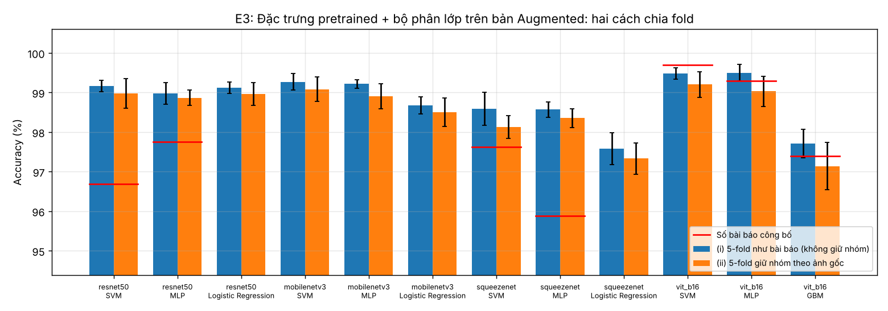

Giao thức (iii) (`results/E3_bai_bao/table_test.md`):

| Hướng | Bộ rút đặc trưng | Bộ phân lớp | Macro-F1 5-fold (train+val) | Macro-F1 test | KTC 95% | Số ảnh sai / 371 | Nền hoán đổi | V×0,6 | V×1,4 | Nhiễu σ=10 | Xoay +30° | Che 25% | Điểm bền |
|---|---|---|---|---|---|---|---|---|---|---|---|---|---|
| B1 | ResNet50 (ImageNet) | SVM (RBF, C=1) | 0,993 ± 0,003 | 0,997 | [0,988; 1,000] | 1 | 0,824 | 0,961 | 0,928 | 0,901 | 0,964 | 0,087 | 0,778 |
| B1 | ResNet50 (ImageNet) | SVM tuyến tính (C=0,01) | 0,994 ± 0,002 | 0,997 | [0,989; 1,000] | 1 | 0,718 | 0,969 | 0,908 | 0,977 | 0,972 | 0,502 | 0,841 |
| B1 | ResNet50 (ImageNet) | MLP (1 lớp ẩn 256) | 0,990 ± 0,004 | 0,997 | [0,988; 1,000] | 1 | 0,849 | 0,966 | 0,938 | 0,979 | 0,968 | 0,534 | 0,873 |
| B1 | ResNet50 (ImageNet) | Logistic Regression | 0,995 ± 0,003 | 0,997 | [0,988; 1,000] | 1 | 0,744 | 0,988 | 0,897 | 0,986 | 0,983 | 0,513 | 0,852 |
| B1 | ResNet50 (ImageNet) | KNN (k=5) | 0,971 ± 0,008 | 0,982 | [0,966; 0,995] | 6 | 0,921 | 0,933 | 0,978 | 0,977 | 0,956 | 0,572 | 0,890 |
| B1 | MobileNetV3-Small (ImageNet) | SVM (RBF, C=1) | 0,994 ± 0,006 | 0,990 | [0,976; 1,000] | 3 | 0,805 | 0,984 | 0,898 | 0,945 | 0,946 | 0,130 | 0,785 |
| B1 | MobileNetV3-Small (ImageNet) | SVM tuyến tính (C=0,01) | 0,996 ± 0,003 | 0,993 | [0,982; 1,000] | 2 | 0,742 | 0,965 | 0,856 | 0,897 | 0,981 | 0,575 | 0,836 |
| B1 | MobileNetV3-Small (ImageNet) | MLP (1 lớp ẩn 256) | 0,994 ± 0,003 | 0,993 | [0,982; 1,000] | 2 | 0,831 | 0,974 | 0,905 | 0,966 | 0,952 | 0,451 | 0,846 |
| B1 | MobileNetV3-Small (ImageNet) | Logistic Regression | 0,995 ± 0,001 | 0,997 | [0,989; 1,000] | 1 | 0,746 | 0,969 | 0,847 | 0,933 | 0,964 | 0,367 | 0,805 |
| B1 | MobileNetV3-Small (ImageNet) | KNN (k=5) | 0,975 ± 0,008 | 0,973 | [0,953; 0,990] | 9 | 0,887 | 0,950 | 0,956 | 0,962 | 0,958 | 0,569 | 0,880 |
| B1 | SqueezeNet 1,1 (ImageNet) | SVM (RBF, C=1) | 0,990 ± 0,004 | 0,997 | [0,988; 1,000] | 1 | 0,680 | 0,861 | 0,885 | 0,279 | 0,984 | 0,087 | 0,629 |
| B1 | SqueezeNet 1,1 (ImageNet) | SVM tuyến tính (C=0,01) | 0,993 ± 0,003 | 0,997 | [0,988; 1,000] | 1 | 0,647 | 0,939 | 0,827 | 0,906 | 0,986 | 0,409 | 0,786 |
| B1 | SqueezeNet 1,1 (ImageNet) | MLP (1 lớp ẩn 256) | 0,994 ± 0,005 | 0,997 | [0,988; 1,000] | 1 | 0,727 | 0,942 | 0,880 | 0,816 | 0,980 | 0,553 | 0,816 |
| B1 | SqueezeNet 1,1 (ImageNet) | Logistic Regression | 0,995 ± 0,003 | 0,997 | [0,988; 1,000] | 1 | 0,637 | 0,932 | 0,852 | 0,783 | 0,975 | 0,428 | 0,768 |
| B1 | SqueezeNet 1,1 (ImageNet) | KNN (k=5) | 0,962 ± 0,006 | 0,979 | [0,962; 0,992] | 8 | 0,713 | 0,939 | 0,923 | 0,835 | 0,921 | 0,405 | 0,789 |
| B2 | ViT-B/16 (ImageNet) | SVM (RBF, C=1) | 0,994 ± 0,004 | 0,997 | [0,989; 1,000] | 1 | 0,857 | 0,990 | 0,978 | 0,986 | 0,978 | 0,728 | 0,919 |
| B2 | ViT-B/16 (ImageNet) | SVM tuyến tính (C=0,01) | 0,996 ± 0,004 | 1,000 | [1,000; 1,000] | 0 | 0,827 | 0,994 | 0,977 | 0,990 | 0,983 | 0,854 | 0,937 |
| B2 | ViT-B/16 (ImageNet) | MLP (1 lớp ẩn 256) | 0,995 ± 0,004 | 0,994 | [0,984; 1,000] | 2 | 0,864 | 0,988 | 0,958 | 0,988 | 0,981 | 0,751 | 0,922 |
| B2 | ViT-B/16 (ImageNet) | GBM (HistGradientBoosting) | 0,975 ± 0,005 | 0,972 | [0,952; 0,988] | 9 | 0,849 | 0,958 | 0,942 | 0,939 | 0,943 | 0,658 | 0,881 |

*Kết luận.*

- **Tái hiện được kết quả chính của bài báo:** ViT + SVM đạt 99,49 ± 0,15% theo giao thức (i); bài báo công bố 99,70%. Thứ hạng bộ phân lớp trên đặc trưng ViT cũng khớp: SVM ≈ MLP > GBM.
- **Không tái hiện được khoảng cách lớn giữa ViT và CNN.** Bài báo công bố ViT + SVM hơn ResNet + SVM 3,01 điểm phần trăm; đo được chỉ 0,22–0,90 điểm (ResNet50 + SVM 99,16%, MobileNetV3 + SVM 99,27%, SqueezeNet + SVM 98,58%). CNN pretrained làm bộ rút đặc trưng, một kỹ thuật trong phạm vi môn học, gần như đạt cùng mức với ViT trên giao thức này.
- **Giao thức của bài báo có rò rỉ, mức thổi phồng nhỏ nhưng nhất quán:** (i) cao hơn (ii) ở cả 19/19 tổ hợp, từ +0,11 đến +0,90 điểm phần trăm (ViT + SVM: 99,49 → 99,20). Từng tổ hợp riêng lẻ thì chênh lệch xấp xỉ độ lệch chuẩn giữa các fold; dấu nhất quán ở 19/19 tổ hợp mới là bằng chứng. KNN bị thổi phồng nhiều nhất (+0,90), khớp D1.
- **Theo giao thức của đồ án:** trên ảnh gốc, phương pháp của bài báo ngang pipeline gốc (ViT + SVM RBF sai 1/371 ảnh; ViT + SVM tuyến tính đúng 371/371; nhánh G có hai cấu hình đúng 371/371). Trên bộ kiểm tra khó, đặc trưng ViT bền hơn mọi cấu hình của nhánh G: điểm bền 0,919–0,937 so với cao nhất 0,895, dù ViT không được fine-tune. Đổi lại, ViT-B/16 có khoảng 86 triệu tham số và rút đặc trưng chậm hơn MobileNetV3 khoảng 23 lần trên CPU (105,7 ms so với 4,5 ms mỗi ảnh).
- **Hướng B1 ngang ViT trên ảnh gốc nhưng kém bền hơn:** macro-F1 test 0,990–0,997 với SVM, LogReg, MLP; điểm bền 0,63–0,89. So với fine-tune cùng mạng ở nhánh G: MobileNetV3 đóng băng + SVM tuyến tính 0,836, MobileNetV3 fine-tune có tăng cường 0,875.
- **Ngoài dự đoán:** SVM kernel RBF sập khi ảnh bị che 25% trên đặc trưng CNN (0,087–0,130), còn SVM tuyến tính giữ 0,41–0,58. Với ảnh lệch xa phân bố huấn luyện, giá trị kernel RBF tới mọi vector hỗ trợ đều gần 0, nên mọi ảnh rơi vào cùng một lớp.

#### 5.13.5 So sánh bốn nhánh

Từng cấu hình qua các nhánh dữ liệu (`results/so_sanh_nhanh/table_models.md`; X-b chỉ có 6 cấu hình):

| Cấu hình | G: macro-F1 test | G: số ảnh sai | G: điểm bền | X-a: macro-F1 test | X-a: số ảnh sai | X-a: điểm bền | X-b: macro-F1 test | X-b: số ảnh sai | X-b: điểm bền | T: macro-F1 test | T: số ảnh sai | T: điểm bền |
|---|---|---|---|---|---|---|---|---|---|---|---|---|
| Hist HSV + LogReg | 0,994 | 2 | 0,487 | 0,993 | 2 | 0,683 | 0,988 | 4 | 0,574 | 0,997 | 1 | 0,555 |
| Cạnh Roberts + KNN | 0,964 | 12 | 0,654 | 0,842 | 56 | 0,719 | 0,960 | 14 | 0,648 | 0,948 | 18 | 0,689 |
| HOG + LogReg | 0,990 | 3 | 0,617 | 0,828 | 63 | 0,704 | 0,953 | 16 | 0,664 | 0,972 | 8 | 0,620 |
| Hist H-S + HOG + LogReg | 1,000 | 0 | 0,728 | 0,982 | 5 | 0,890 | 0,984 | 6 | 0,773 | 0,989 | 4 | 0,745 |
| a_lenet | 0,978 | 7 | 0,837 | 0,922 | 26 | 0,778 | — | — | — | 0,966 | 10 | 0,780 |
| a_dropout | 0,942 | 21 | 0,769 | 0,959 | 15 | 0,816 | — | — | — | 0,963 | 13 | 0,796 |
| a_vgg16 | 0,986 | 4 | 0,886 | 0,958 | 16 | 0,857 | 0,977 | 8 | 0,874 | 0,985 | 5 | 0,905 |
| b_mobilenetv3 | 1,000 | 0 | 0,875 | 0,995 | 2 | 0,881 | 1,000 | 0 | 0,883 | 0,998 | 1 | 0,909 |
| b_resnet50 | 0,997 | 1 | 0,895 | 0,997 | 1 | 0,885 | — | — | — | 0,997 | 1 | 0,924 |
| **Trung bình 9 cấu hình** | **0,983** | **5,6** | **0,750** | **0,942** | **20,7** | **0,801** | — | — | — | **0,979** | **6,8** | **0,769** |
| **Trung bình 6 cấu hình có ở mọi nhánh** | **0,989** | **3,5** | **0,708** | **0,933** | **24,0** | **0,789** | **0,977** | **8,0** | **0,736** | **0,981** | **6,2** | **0,737** |

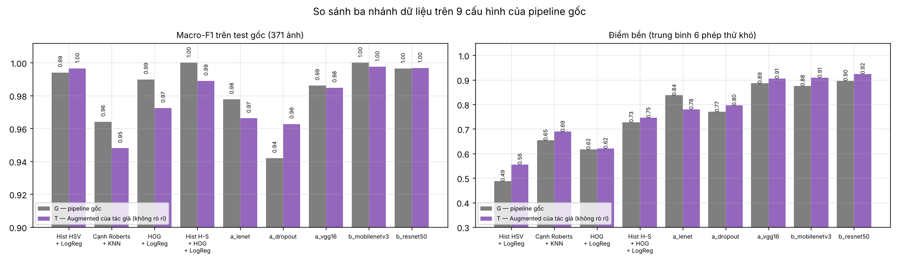

Cấu hình đại diện của mỗi nhánh, chọn theo điểm lúc phát triển (`results/so_sanh_nhanh/table_arms.md`, `results/so_sanh_nhanh/table_stress.md`):

| Nhánh | Cấu hình đại diện | Điểm lúc chọn | Macro-F1 test | KTC 95% | Số ảnh sai / 371 | Điểm bền |
|---|---|---|---|---|---|---|
| G — pipeline gốc | b_mobilenetv3 | 1,000 (macro-F1 trên val) | 1,000 | [1,000; 1,000] | 0 | 0,875 |
| X-a — xử lý dữ liệu: tiền xử lý lúc suy luận | b_mobilenetv3 | 1,000 (macro-F1 trên val) | 0,995 | [0,987; 1,000] | 2 | 0,881 |
| X-b — xử lý dữ liệu: tăng cường có thay nền | b_mobilenetv3 | 1,000 (macro-F1 trên val) | 1,000 | [1,000; 1,000] | 0 | 0,883 |
| T — Augmented của tác giả (không rò rỉ) | b_mobilenetv3 | 1,000 (macro-F1 trên val) | 0,998 | [0,991; 1,000] | 1 | 0,909 |
| B1 — bài báo, trong phạm vi môn học (CNN + bộ phân lớp) | MobileNetV3-Small + SVM tuyến tính | 0,996 (5-fold trên train+val) | 0,993 | [0,982; 1,000] | 2 | 0,836 |
| B2 — bài báo, đúng phương pháp (ViT + SVM) | ViT-B/16 + SVM | 0,994 (5-fold trên train+val) | 0,997 | [0,989; 1,000] | 1 | 0,919 |

| Nhánh | Cấu hình đại diện | Ảnh gốc | Nền hoán đổi | V×0,6 | V×1,4 | Nhiễu σ=10 | Xoay +30° | Che 25% | Điểm bền |
|---|---|---|---|---|---|---|---|---|---|
| G — pipeline gốc | b_mobilenetv3 | 1,000 | 0,794 | 0,919 | 0,890 | 0,989 | 1,000 | 0,659 | 0,875 |
| X-a — xử lý dữ liệu: tiền xử lý lúc suy luận | b_mobilenetv3 | 0,995 | 0,995 | 0,943 | 0,915 | 0,988 | 0,998 | 0,450 | 0,881 |
| X-b — xử lý dữ liệu: tăng cường có thay nền | b_mobilenetv3 | 1,000 | 0,975 | 0,954 | 0,935 | 0,995 | 1,000 | 0,441 | 0,883 |
| T — Augmented của tác giả (không rò rỉ) | b_mobilenetv3 | 0,998 | 0,867 | 0,954 | 0,904 | 0,993 | 1,000 | 0,736 | 0,909 |
| B1 — bài báo, trong phạm vi môn học (CNN + bộ phân lớp) | MobileNetV3-Small + SVM tuyến tính | 0,993 | 0,742 | 0,965 | 0,856 | 0,897 | 0,981 | 0,575 | 0,836 |
| B2 — bài báo, đúng phương pháp (ViT + SVM) | ViT-B/16 + SVM | 0,997 | 0,857 | 0,990 | 0,978 | 0,986 | 0,978 | 0,728 | 0,919 |

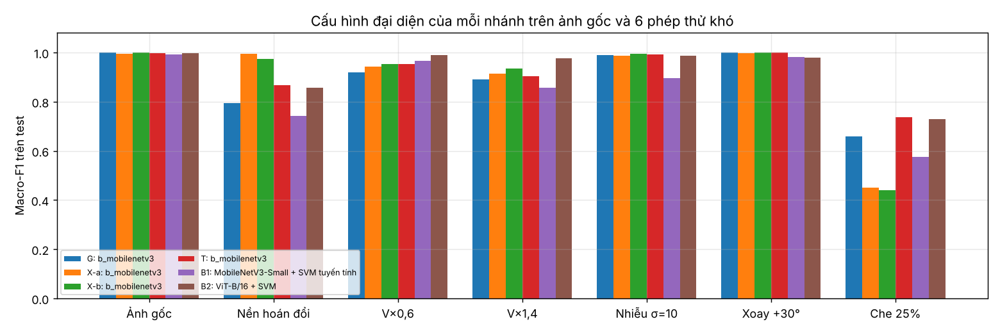

Phép che 25% tách theo mức quả chuối bị che (`results/so_sanh_nhanh/table_occlusion_split.md`):

| Nhánh | Cấu hình | Quả bị che ≥ 90% (40 ảnh) | Quả bị che 30–90% (286 ảnh) | Quả bị che < 30% (45 ảnh) |
|---|---|---|---|---|
| G | b_mobilenetv3 | 0,175 | 0,699 | 0,911 |
| G | Hist H-S + HOG + LogReg | 0,950 | 0,965 | 0,978 |
| X-a | b_mobilenetv3 | 0,125 | 0,451 | 0,667 |
| X-a | Hist H-S + HOG + LogReg | 0,750 | 0,850 | 0,844 |
| X-b | b_mobilenetv3 | 0,125 | 0,448 | 0,822 |
| X-b | Hist H-S + HOG + LogReg | 0,975 | 0,815 | 0,933 |
| T | b_mobilenetv3 | 0,550 | 0,717 | 1,000 |
| T | Hist H-S + HOG + LogReg | 0,975 | 0,962 | 1,000 |

*Kết luận chung của phần mở rộng.*

1. **Trên ảnh gốc, không nhánh nào hơn pipeline gốc.** Cấu hình đại diện của cả sáu dòng sai từ 0 đến 2 ảnh trên 371; khoảng tin cậy chồng lên nhau. Pipeline gốc đã ở mức trần của tập test này.
2. **Khác biệt nằm ở bộ kiểm tra khó, và mỗi nhánh mạnh ở một chỗ khác nhau.** Nhánh X gần như xóa được sự phụ thuộc vào nền (nền hoán đổi 0,975–0,995 so với 0,794 của G). Nhánh T tăng độ bền đều hơn ở các phép có trong công thức tăng cường của tác giả (điểm bền 0,909). Nhánh B2 (ViT + SVM) có điểm bền cao nhất (0,919) mà không cần huấn luyện mạng, đổi lại mô hình nặng và nằm ngoài môn học. Nhánh B1 (CNN đóng băng + SVM) kém bền nhất (0,836).
3. **Điểm bền trung bình che mất sự đánh đổi.** X-a và X-b có điểm bền (0,881; 0,883) chỉ nhỉnh hơn G (0,875) vì phần được ở nền hoán đổi bị trừ đi ở phép che 25% (0,44–0,45 so với 0,66). Một phần lợi thế của pipeline gốc ở phép che đến từ nền: ở 40 ảnh mà quả bị che gần hết, cấu hình truyền thống của nhánh G vẫn đúng 0,950 vì nhận ra Sabri Kola từ nền; với `b_mobilenetv3` thì chưa tách được nguyên nhân.
4. **Về dữ liệu tăng cường:** tăng cường chỉ có ích khi (a) áp dụng sau khi chia tập và (b) nhắm đúng loại biến đổi cần bền. Bản Augmented của tác giả không có phép nào liên quan tới nền nên không giảm được thiên lệch nền; phép thay nền ngẫu nhiên của nhánh X thì có.
5. **Về các con số đã công bố:** kết quả 99,70% của bài báo tái hiện được (99,49%) nhưng lạc quan khoảng 0,3 điểm do rò rỉ trong cách chia fold; và giống mọi kết quả chia ngẫu nhiên trên bộ dữ liệu này, nó còn chịu hai nguồn lạc quan mà đồ án đo được: thiên lệch nền (S2) và ảnh của cùng một quả nằm ở cả hai phía (X1).

## 6. Đánh giá ưu điểm và hạn chế

### 6.1 Ưu điểm

- So sánh đầy đủ các phương pháp đã học trên cùng một quy trình đánh giá: 30 thí nghiệm kiểm chứng và ba nhánh mở rộng, 968 dòng kết quả, mỗi nhận định dẫn tới một bảng hoặc hình.
- Quy trình đánh giá chặt: chia tập cố định, test dùng một lần, chọn siêu tham số bằng cross-validation, báo cáo độ lệch chuẩn và khoảng tin cậy, chỉ số chính là macro-F1.
- Ghi nhận cả các kết quả trái dự đoán và thử giải thích (D1 với HOG, M5, P1, C2, C4, N3, N8).
- Phát hiện và đo được thiên lệch theo bối cảnh chụp của bộ dữ liệu (S2), một điều mà chỉ nhìn con số accuracy sẽ không thấy.
- Có hai mô hình đúng 371/371 ảnh test, trong đó một mô hình chỉ 4,3 MB và dự đoán 12,5 ms mỗi ảnh trên CPU.
- Chạy lại được toàn bộ bằng một lệnh; seed cố định; checkpoint và `--resume` cho huấn luyện dài.
- Đối chiếu với bên ngoài: chạy lại phương pháp của bài báo trên cùng bộ dữ liệu (tái hiện 99,49% so với 99,70% công bố) và bản Augmented của tác giả, trên cùng tập test và cùng bộ kiểm tra khó (mục 5.13).

### 6.2 Hạn chế

- **Thiên lệch theo bối cảnh chụp (hạn chế lớn nhất).** Chỉ nhìn nền vẫn phân loại được với macro-F1 0,93–0,99 (S2). Con số 1,000 trên test là độ chính xác trên bộ dữ liệu này, không phải độ chính xác nhận diện giống chuối trong điều kiện bất kỳ. Với ảnh chụp ở bối cảnh khác, kết quả có thể thấp hơn nhiều; đồ án chưa có dữ liệu như vậy để đo.
- **Mỗi quả được chụp nhiều mặt, và cách chia ngẫu nhiên không tách theo quả.** Theo bài báo mô tả dữ liệu [17], mỗi quả chụp từ bốn mặt. Đo được: 20,0% số ảnh có láng giềng gần nhất mang số thứ tự liền kề (ngẫu nhiên: 1,0%), và cross-validation chia theo khối ảnh liên tiếp thấp hơn chia ngẫu nhiên 0,024–0,069 (mục 5.13.2). Mọi kết quả chia ngẫu nhiên, kể cả bảng ở mục 5.11, vì vậy lạc quan hơn so với khi gặp quả chuối chưa từng thấy. Dữ liệu không có nhãn "quả nào" nên đồ án chưa chia lại được theo quả.
- **Ảnh gần trùng:** 42 cặp ảnh gần như y hệt (Hamming ≤ 2), 7 ảnh test có bản gần trùng trong train. Đo được ảnh hưởng không đáng kể, nhưng pHash không bắt được cùng một quả chụp ở tư thế khác, nên con số này là cận dưới.
- Tập test và val nhỏ (371 ảnh); các mô hình tốt nhất đều trên 0,99 nên không phân biệt được bằng thống kê.
- CNN không dùng cross-validation (do giới hạn CPU); nhiễu giữa các lần huấn luyện mới ước lượng bằng 3 seed cho một mô hình (N3).
- Phân đoạn chưa có nhãn mask nên chưa tính được IoU và Dice. Mask của bước S1 tràn ra nền ở 5,2% số ảnh; phần mở rộng dùng mask khác, và S2 chạy lại với mask mới cho cùng kết luận.
- Bộ kiểm tra khó là các phép biến đổi tổng hợp, không thay được ảnh chụp thật ở bối cảnh khác. Biến thể X-b mới chạy 6/9 cấu hình; cách chia ngẫu nhiên của bản Augmented (T-tl) mới chạy 7/9 cấu hình.
- Chưa làm phần mở rộng tùy chọn (sliding window + NMS) vì dữ liệu không có nhãn vị trí.
- `app/variety_info.json` còn nhiều mục "TODO" do chưa tìm được nguồn tin cậy về đặc điểm từng giống.

### 6.3 Hướng phát triển

- Thu thêm ảnh của cả 4 giống trong cùng một bối cảnh chụp, hoặc một tập test chụp ở bối cảnh khác, để đo đúng khả năng nhận diện giống.
- Chia lại dữ liệu theo quả (cần nhãn "quả nào" từ người thu thập) để đo đúng khả năng nhận diện quả chưa từng thấy.
- Phần mở rộng đã thử tách nền và thay nền ngẫu nhiên (nhánh X); bước tiếp theo là kiểm tra hai cách này trên ảnh chụp thật ở bối cảnh khác.
- Gán nhãn mask cho khoảng 20 ảnh để tính IoU/Dice cho phần phân đoạn.

## 7. Tài liệu tham khảo

1. Ferdaus, M. H., Prito, R. H., Rasel, A. A. S., Ahmed, M., Saykot, M. J. H., Shanta, S. S., Akter, S., Das, A. C., Islam, M. M., Hasan, M., Ali, M. S. (2024). *BananaImageBD: A Comprehensive Image Dataset of Common Banana Varieties with Different Ripeness Stages in Bangladesh* (Version 2) [Data set]. Mendeley Data. DOI: 10.17632/ptfscwtnyz.2. Giấy phép CC BY 4.0.
2. Bài giảng môn CS231 — Nhập môn Thị giác máy tính: ảnh số, đặc trưng màu, phân loại ảnh, KNN và bộ phân lớp tuyến tính, đặc trưng cạnh, HOG, CNN, phân đoạn ảnh, xác định vị trí và phát hiện đối tượng.
3. Swain, M. J., Ballard, D. H. (1991). Color Indexing. *International Journal of Computer Vision*, 7(1), 11–32.
4. Stricker, M., Orengo, M. (1995). Similarity of Color Images. *Proc. SPIE Storage and Retrieval for Image and Video Databases III*.
5. Pass, G., Zabih, R., Miller, J. (1996). Comparing Images Using Color Coherence Vectors. *Proc. ACM Multimedia*.
6. Dalal, N., Triggs, B. (2005). Histograms of Oriented Gradients for Human Detection. *CVPR*.
7. Otsu, N. (1979). A Threshold Selection Method from Gray-Level Histograms. *IEEE Trans. Systems, Man, and Cybernetics*, 9(1), 62–66.
8. Cover, T., Hart, P. (1967). Nearest Neighbor Pattern Classification. *IEEE Trans. Information Theory*, 13(1), 21–27.
9. LeCun, Y., Bottou, L., Bengio, Y., Haffner, P. (1998). Gradient-Based Learning Applied to Document Recognition. *Proceedings of the IEEE*, 86(11).
10. Simonyan, K., Zisserman, A. (2015). Very Deep Convolutional Networks for Large-Scale Image Recognition. *ICLR*.
11. He, K., Zhang, X., Ren, S., Sun, J. (2016). Deep Residual Learning for Image Recognition. *CVPR*.
12. Howard, A. et al. (2019). Searching for MobileNetV3. *ICCV*.
13. Srivastava, N., Hinton, G., Krizhevsky, A., Sutskever, I., Salakhutdinov, R. (2014). Dropout: A Simple Way to Prevent Neural Networks from Overfitting. *JMLR*, 15.
14. Ioffe, S., Szegedy, C. (2015). Batch Normalization: Accelerating Deep Network Training by Reducing Internal Covariate Shift. *ICML*.
15. Telea, A. (2004). An Image Inpainting Technique Based on the Fast Marching Method. *Journal of Graphics Tools*, 9(1).
16. Pedregosa, F. et al. (2011). Scikit-learn: Machine Learning in Python. *JMLR*, 12. Tài liệu TensorFlow/Keras, OpenCV, scikit-image.
17. Ferdaus, M. H., Prito, R. H., Rasel, A. A. S., Ahmed, M., Saykot, M. J. H., Shanta, S. S., Akter, S., Das, A. C., Islam, M. M., Hasan, M., Ali, M. S. (2025). BananaImageBD: A comprehensive banana image dataset for classification of banana varieties and detection of ripeness stages in Bangladesh. *Data in Brief*, 58, 111239. DOI: 10.1016/j.dib.2024.111239.
18. Ergün, E. (2025). High precision banana variety identification using vision transformer based feature extraction and support vector machine. *Scientific Reports*, 15, 10366. DOI: 10.1038/s41598-025-95466-0.
19. Dosovitskiy, A. et al. (2021). An Image is Worth 16x16 Words: Transformers for Image Recognition at Scale. *ICLR*.
20. Iandola, F. N. et al. (2016). SqueezeNet: AlexNet-level accuracy with 50x fewer parameters and <0.5MB model size. *arXiv:1602.07360*.
