<!-- File mẫu của báo cáo. Sửa nội dung ở đây rồi chạy: python -m src.build_report (sinh report/report.md, report/report.docx và report/report.pdf). Các chỗ {{T:...}} được thay bằng bảng số liệu trong results/. -->

<!-- cover -->

ĐẠI HỌC QUỐC GIA THÀNH PHỐ HỒ CHÍ MINH

TRƯỜNG ĐẠI HỌC CÔNG NGHỆ THÔNG TIN

## BÁO CÁO ĐỒ ÁN MÔN HỌC

## CS231.R12: NHẬP MÔN THỊ GIÁC MÁY TÍNH

# NHẬN DIỆN GIỐNG CHUỐI TỪ ẢNH

Nhóm sinh viên thực hiện:

| STT | Họ và tên | MSSV |
|---|---|---|
| 1 | Hoàng Quốc Duy | 24520373 |
| 2 | Nguyễn Thái Duy | 24520390 |
| 3 | Nguyễn Anh Khoa | 24520819 |

Mã nguồn: https://github.com/Rod-HD/banana-classification

TP. Hồ Chí Minh, năm 2026

<!-- /cover -->

## Mục lục

1. Thông tin thành viên và mức độ hoàn thành
2. Lý do chọn đề tài và tầm quan trọng của bài toán
3. Phát biểu bài toán
4. Phương pháp giải quyết
5. Kết quả thực nghiệm
6. Đánh giá, nhận xét và kết luận
7. Tài liệu tham khảo

Quy ước trong báo cáo: số thập phân viết bằng dấu chấm (ví dụ 0.994). Kích thước ảnh ghi theo thứ tự chiều rộng × chiều cao. Mọi con số lấy từ các file trong thư mục `results/` do code của đồ án sinh ra, mỗi bảng và hình đều ghi đường dẫn tới file gốc. Cách chạy lại toàn bộ thí nghiệm: `bash scripts/run_all.sh` (xem file README trong mã nguồn).

<!-- pagebreak -->

## 1. Thông tin thành viên và mức độ hoàn thành

Lớp CS231.R12, môn Nhập môn Thị giác máy tính.

| STT | Họ và tên | MSSV | Công việc phụ trách | Mức độ hoàn thành |
|---|---|---|---|---|
| 1 | Hoàng Quốc Duy | 24520373 |  |  |
| 2 | Nguyễn Thái Duy | 24520390 |  |  |
| 3 | Nguyễn Anh Khoa | 24520819 |  |  |

Mức độ hoàn thành chung của đồ án:

Các thành phần của đồ án:

| Thành phần | Vị trí |
|---|---|
| Báo cáo tổng kết | file này (`report/report.pdf`, `report/report.docx`) |
| Mã nguồn | https://github.com/Rod-HD/banana-classification |
| Slide trình bày | `slides/bao-cao-do-an.pdf` (Beamer LaTeX, nguồn ở `slides/bao-cao-do-an.tex`) |
| Chương trình demo | `app/app.py` (chạy bằng lệnh `python app/app.py`) |
| Kết quả thực nghiệm | thư mục `results/` (bảng, hình, số liệu thô) |
| Nhật ký thực nghiệm | `docs/nhat-ky-thuc-nghiem.md` |

## 2. Lý do chọn đề tài và tầm quan trọng của bài toán

### 2.1 Bối cảnh

Chuối có nhiều giống, mỗi giống khác nhau về hình dáng, màu vỏ, giá bán và cách dùng. Ở chợ đầu mối và cửa hàng trái cây, việc nhận ra giống chuối hiện vẫn dựa vào mắt và kinh nghiệm của người bán. Người không quen thì khó phân biệt, nhất là khi các giống có kích thước gần nhau hoặc khi quả đã chín và vỏ ngả cùng một màu vàng.

Bộ dữ liệu BananaImageBD do nhóm tác giả của East West University (Bangladesh) thu thập từ chính các chợ đầu mối và cửa hàng bán lẻ ở Dhaka và Rangpur. Theo mô tả của tác giả, bốn giống trong bộ dữ liệu là bốn giống chuối phổ biến nhất ở Bangladesh, và bộ dữ liệu nhắm tới các ứng dụng nông nghiệp chính xác, chế biến thực phẩm và quản lý chuỗi cung ứng [1], [17]. Một chương trình nhận ra giống chuối từ ảnh chụp có thể dùng ở khâu phân loại hàng, kiểm tra hàng nhập, hoặc giúp người mua tra cứu.

### 2.2 Lý do nhóm chọn đề tài

Trong các bài toán thuộc phạm vi môn học (phân loại ảnh, xác định vị trí, phát hiện đối tượng, phân đoạn), nhóm chọn phân loại ảnh vì đây là bài toán mà hầu hết kiến thức của môn học đều áp dụng được: đặc trưng màu, đặc trưng cạnh, HOG, KNN, bộ phân lớp tuyến tính và CNN. Bộ ảnh giống chuối phù hợp để so sánh các phương pháp đó vì ba lý do:

- Bốn giống khác nhau cả về màu vỏ lẫn hình dạng quả, nên có thể trả lời bằng thực nghiệm câu hỏi "đặc trưng màu hay đặc trưng hình dạng quan trọng hơn".
- Dữ liệu nhỏ (2471 ảnh) và mất cân bằng (lớp nhiều ảnh nhất gấp 2.2 lần lớp ít ảnh nhất). Đây là hoàn cảnh mà các hiện tượng đã học như quá khớp, lợi ích của transfer learning và ảnh hưởng của mất cân bằng dữ liệu thể hiện rõ.
- Mỗi ảnh chụp một quả trên nền trơn, nên áp dụng được cả các kỹ thuật phân đoạn tách nền, và kiểm tra được mô hình đang dựa vào quả chuối hay dựa vào nền ảnh.

### 2.3 Cơ sở thực hiện

- **Dữ liệu:** bộ BananaImageBD được công bố công khai trên Mendeley Data với giấy phép CC BY 4.0, có bài báo mô tả cách thu thập [1], [17].
- **Kết quả đối chiếu:** đã có một bài báo công bố kết quả phân loại trên chính bộ dữ liệu này (Vision Transformer kết hợp SVM, accuracy 99.70%) [18], nên nhóm có mốc để so sánh.
- **Kiến thức:** các phương pháp dùng trong đồ án đều nằm trong nội dung bài giảng của môn học [2]. Riêng Vision Transformer nằm ngoài nội dung môn học, nhóm chỉ dùng ở một nhánh đối chiếu (mục 5.13.4).
- **Tài nguyên:** nhóm chỉ có máy CPU. Với 2471 ảnh kích thước 256 × 256, mọi thí nghiệm, kể cả fine-tune CNN, chạy được trên CPU trong thời gian chấp nhận được.

### 2.4 Mục tiêu của đồ án

1. Xây dựng chương trình nhận một ảnh quả chuối và trả về giống chuối cùng xác suất của từng giống.
2. Thử các phương pháp đã học áp dụng được cho phân loại ảnh, so sánh chúng trên cùng một quy trình đánh giá, và giải thích kết quả bằng tính chất của từng phương pháp.
3. Kiểm tra mức độ đáng tin của kết quả: mô hình có dựa vào quả chuối không, kết quả có bị thổi phồng do cách chia dữ liệu không.

## 3. Phát biểu bài toán

### 3.1 Mô tả

Đây là bài toán phân loại ảnh nhiều lớp (multi-class image classification): mỗi ảnh thuộc đúng một trong bốn lớp, tương ứng bốn giống chuối Bangla Kola, Champa Kola, Sabri Kola và Sagor Kola.

### 3.2 Phát biểu hình thức

**Cho:**

- Tập nhãn C = {Bangla Kola, Champa Kola, Sabri Kola, Sagor Kola}, số lớp K = 4.
- Tập huấn luyện D = {(x_i, y_i)}, i = 1, ..., N, trong đó x_i là ảnh màu RGB kích thước W × H = 256 × 256 (mỗi điểm ảnh gồm 3 giá trị nguyên từ 0 đến 255) chụp một quả chuối, và y_i ∈ C là giống của quả chuối trong ảnh.

**Tìm:** hàm phân loại f nhận một ảnh x và trả về vector xác suất p = f(x) = (p_1, p_2, p_3, p_4), với p_k ≥ 0 và p_1 + p_2 + p_3 + p_4 = 1, sao cho nhãn dự đoán ŷ = argmax_k p_k trùng với nhãn thật y trên những ảnh không nằm trong tập huấn luyện.

Khi chương trình đã có f, việc sử dụng gồm:

- **Input:** một ảnh màu x chụp một quả chuối. Ảnh có kích thước bất kỳ, chương trình tự đưa về 256 × 256.
- **Output:** nhãn ŷ ∈ C (tên giống chuối) và vector xác suất p của 4 lớp.

Chất lượng của f được đo trên tập kiểm tra (test) tách riêng, bằng macro-F1 là chính, kèm accuracy, precision, recall của từng lớp và ma trận nhầm lẫn (mục 5.2).

### 3.3 Hình minh họa

![Minh họa bài toán: mỗi hàng là một ảnh trong tập test của bộ BananaImageBD [1] đi qua mô hình f (ở đây là MobileNetV3-Small của đồ án), cho ra xác suất của 4 lớp và nhãn dự đoán](../results/figures/problem_io.png)

### 3.4 Ràng buộc và phạm vi

- **Ảnh vào chụp một quả chuối** đã tách khỏi nải, đặt trên nền trơn, giống điều kiện thu thập của bộ dữ liệu.
- **Quả chuối thuộc một trong 4 giống** của tập nhãn C. Đầu ra của f chỉ gồm 4 lớp, không có lớp "khác". Vì vậy với một ảnh nằm ngoài phạm vi (giống chuối khác, một loại quả khác, hoặc ảnh không có chuối), chương trình vẫn chạy và vẫn trả về một trong 4 giống. Kết quả đó đúng với ràng buộc của bài toán nhưng không có ý nghĩa sử dụng. Muốn chương trình từ chối ảnh ngoài phạm vi thì phải phát biểu lại bài toán với lớp thứ năm "không thuộc 4 giống" và thu thêm dữ liệu cho lớp đó, phần này đồ án chưa làm.
- **Không xác định vị trí quả chuối** trong ảnh (không phải bài toán xác định vị trí hay phát hiện đối tượng), **không phân loại độ chín** và không xác định hàm lượng dinh dưỡng.

## 4. Phương pháp giải quyết

### 4.1 Tổng quan

Đồ án giải bài toán theo hai hướng, dùng chung một cách chia dữ liệu và một bộ độ đo để so sánh được với nhau:

- **Hướng truyền thống:** rút từ mỗi ảnh một feature vector do con người thiết kế (màu, cạnh, HOG), rồi đưa vào một bộ phân lớp (KNN, Logistic Regression, Linear SVM).
- **Hướng học sâu:** dùng mạng nơ-ron tích chập (CNN), mạng tự học đặc trưng từ dữ liệu. Phần này tách thành hướng A (các mô hình đúng như ví dụ trong bài giảng) và hướng B (mạng lớn hơn huấn luyện sẵn trên ImageNet, fine-tune lại).

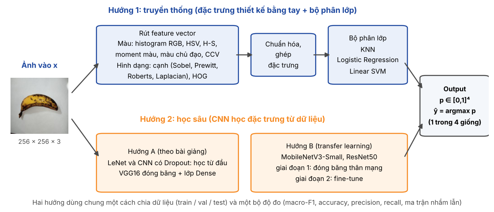

Phần lớn các phương pháp trong đồ án là phương pháp đã có. Với mỗi phương pháp, báo cáo trình bày hai ý: (1) phương pháp đó là gì và được đề xuất trong tài liệu nào, (2) nhóm dùng nó như thế nào trong đồ án (phiên bản, tham số, số chiều của đặc trưng). Chi tiết bên trong của từng phương pháp có trong tài liệu được dẫn.

Ngoài việc xây dựng mô hình, nhóm kiểm chứng từng tính chất đã học bằng thí nghiệm, theo ba bước: nêu tính chất của phương pháp, nêu dự đoán, rồi làm thí nghiệm để xem dự đoán có đúng không. Tổng cộng có 30 thí nghiệm kiểu này (mục 5.4 đến 5.10), kết quả nào trái dự đoán cũng được ghi lại.

**Thuật ngữ dùng thống nhất trong báo cáo** (theo bài giảng [2]):

- *Feature vector* (vector đặc trưng thủ công): biết rõ phần tử thứ i có ý nghĩa gì và được tính ra sao. Ví dụ phần tử thứ i của histogram màu là tỉ lệ điểm ảnh có màu rơi vào khoảng thứ i.
- *Embedding*: vector lấy ra từ một mạng học sâu. Từng phần tử không có ý nghĩa giải thích được trực tiếp.
- *Đặc trưng toàn cục*: mỗi phần tử được tính từ toàn bộ ảnh (ví dụ histogram màu). *Đặc trưng cục bộ*: mỗi phần tử được tính từ một vùng nhỏ của ảnh (ví dụ mỗi cell của HOG, hoặc mỗi cửa sổ tích chập của CNN).

### 4.2 Hướng truyền thống: feature vector và bộ phân lớp

#### 4.2.1 Histogram màu

**Là gì.** Histogram màu đếm số điểm ảnh rơi vào từng khoảng giá trị màu (bin), không quan tâm điểm ảnh nằm ở đâu trong ảnh. Cách dùng histogram màu để so sánh ảnh được giới thiệu trong bài báo Color Indexing của Swain và Ballard [3].

**Nhóm dùng như thế nào** (`src/features/color.py`):

- Histogram RGB: mỗi kênh 32 bin, ghép 3 kênh thành vector 96 chiều.
- Histogram HSV 3 chiều với (8, 8, 8) bin cho (H, S, V), thành 512 chiều.
- Histogram H-S: chỉ dùng hai kênh H và S với (8, 8) bin, thành 64 chiều, bỏ hẳn kênh độ sáng V.
- Mỗi histogram được chia cho tổng số điểm ảnh để tổng các phần tử bằng 1.

#### 4.2.2 Moment màu

**Là gì.** Thay vì lưu cả histogram, moment màu tóm tắt phân bố màu của mỗi kênh bằng ba con số: trung bình, độ lệch chuẩn và độ lệch (skewness). Phương pháp do Stricker và Orengo đề xuất [4].

**Nhóm dùng như thế nào.** Tính trên 3 kênh H, S, V (đã chia về đoạn [0, 1]), được vector 9 chiều.

#### 4.2.3 Màu chủ đạo

**Là gì.** Gom các điểm ảnh thành k cụm màu bằng thuật toán k-means [21], mỗi cụm đại diện cho một màu chủ đạo của ảnh.

**Nhóm dùng như thế nào.** k = 3 trên giá trị RGB của điểm ảnh. Mỗi cụm cho 4 số (tỉ lệ điểm ảnh, R, G, B), các cụm sắp theo tỉ lệ giảm dần, được vector 12 chiều.

#### 4.2.4 Color Coherence Vector (CCV)

**Là gì.** CCV do Pass, Zabih và Miller đề xuất [5] để bổ sung thông tin không gian cho histogram: với mỗi màu, điểm ảnh được chia thành hai loại là "liên kết" (thuộc một vùng liên thông đủ lớn cùng màu) và "không liên kết".

**Nhóm dùng như thế nào.** Lượng tử hóa ảnh về 64 màu. Vùng liên thông có diện tích từ 1% ảnh trở lên được coi là liên kết. Mỗi màu cho 2 số nên vector có 128 chiều.

#### 4.2.5 Đặc trưng cạnh

**Là gì.** Cạnh là nơi mức xám thay đổi mạnh. Các toán tử Roberts (mặt nạ 2 × 2), Prewitt và Sobel (mặt nạ 3 × 3) xấp xỉ đạo hàm bậc nhất của ảnh, còn Laplacian xấp xỉ đạo hàm bậc hai [2], [22], [39].

**Nhóm dùng như thế nào** (`src/features/edge.py`). Chuyển ảnh sang xám 256 × 256, tính độ lớn gradient bằng từng toán tử, rồi cộng độ lớn gradient theo từng hàng và từng cột. Vector đặc trưng gồm 256 tổng theo hàng và 256 tổng theo cột, tức 512 chiều.

#### 4.2.6 HOG (Histogram of Oriented Gradients)

**Là gì.** HOG do Dalal và Triggs đề xuất cho bài toán phát hiện người đi bộ [6]. Ảnh được chia thành các ô nhỏ (cell), mỗi cell có một histogram của hướng gradient, các cell kề nhau được gom thành khối (block) và chuẩn hóa. HOG mô tả hình dạng của vật thể qua phân bố hướng cạnh ở từng vùng.

**Nhóm dùng như thế nào** (`src/features/hog.py`). Nhóm tự cài đặt HOG theo đúng các bước của bài giảng:

1. Chuyển ảnh sang xám và resize về 64 × 128 (rộng 64, cao 128).
2. Tính gradient bằng mặt nạ [-1, 0, 1] theo hai chiều, suy ra độ lớn và hướng.
3. Trên mỗi cell 8 × 8, lập histogram 9 bin cho hướng không dấu (0° đến 180°), độ lớn gradient được chia cho hai bin gần nhất.
4. Gom 2 × 2 cell thành block 16 × 16, block trượt mỗi lần 1 cell, chuẩn hóa L2 từng block.
5. Ghép tất cả block thành vector 7 × 15 × 36 = 3780 chiều.

Nhóm tự cài đặt thay vì gọi thư viện để có thể bỏ bước chuẩn hóa block trong thí nghiệm C2. Khi đối chiếu với hàm `skimage.feature.hog` của thư viện scikit-image [29], hai kết quả lệch nhau nhiều nhất 2.2·10⁻⁷.

#### 4.2.7 Chuẩn hóa, ghép đặc trưng và độ đo khoảng cách

- **Chuẩn hóa trước khi đo khoảng cách.** Hai vector cùng hướng nhưng khác độ lớn có độ tương đồng cosine bằng 1, trong khi khoảng cách Euclidean giữa chúng lại khác 0. Để khoảng cách phản ánh đúng mức giống nhau, vector được chuẩn hóa trước khi đo. Đồ án dùng hai cách: z-score từng chiều (trừ trung bình, chia độ lệch chuẩn tính trên tập huấn luyện) và chuẩn hóa về vector đơn vị. Thí nghiệm P2 kiểm chứng rằng sau khi chuẩn hóa về vector đơn vị, Euclidean và cosine cho cùng thứ hạng láng giềng.
- **Độ đo khoảng cách:** Euclidean, Manhattan, cosine và Hellinger (Euclidean trên căn bậc hai của histogram).
- **Ghép đặc trưng màu với HOG:** mỗi phần được chuẩn hóa z-score rồi chia cho căn bậc hai số chiều của phần đó. Nhờ vậy phần màu (64 chiều) và phần HOG (3780 chiều) đóng góp ngang nhau vào khoảng cách, thay vì phần nhiều chiều lấn át phần ít chiều.

#### 4.2.8 Bộ phân lớp

- **KNN (k láng giềng gần nhất)** [8]: ảnh cần phân loại được gán nhãn theo k ảnh huấn luyện gần nó nhất. Nhóm khảo sát số láng giềng k, độ đo khoảng cách, cách bình chọn (đa số, hoặc ưu tiên điểm gần) và thuật toán tìm láng giềng (Brute Force, K-D Tree, Ball Tree).
- **Logistic Regression:** bộ phân lớp tuyến tính, học một trọng số cho mỗi chiều của đặc trưng và mỗi lớp [23]. Nhóm khảo sát hệ số điều chuẩn C.
- **Linear SVM** [24]: môn học nhắc tới SVM như bộ phân lớp đi kèm HOG, nên đồ án dùng Linear SVM làm bộ phân lớp bổ sung để đối chiếu.

Cả ba bộ phân lớp dùng cài đặt của thư viện scikit-learn [16].

### 4.3 Hướng học sâu: CNN

#### 4.3.1 Hướng A: CNN theo ví dụ của bài giảng

**LeNet.** LeNet-5 do LeCun và cộng sự đề xuất cho nhận dạng chữ số viết tay [9], gồm hai cặp lớp tích chập và lấy mẫu rồi tới các lớp kết nối đầy đủ. Mô hình `a_lenet` của đồ án giữ cấu trúc đó, đổi ảnh vào thành ảnh màu 64 × 64 và lớp ra thành 4 lớp. Mô hình có 337976 tham số, huấn luyện từ đầu.

**CNN có Dropout.** Dropout do Srivastava và cộng sự đề xuất [13]: trong lúc huấn luyện, mỗi nơ-ron bị tắt ngẫu nhiên với một xác suất cho trước để giảm quá khớp. Mô hình `a_dropout` là CNN hai lớp tích chập với Dropout(0.5) đặt giữa hai lớp kết nối đầy đủ, ảnh vào 128 × 128, có 1746260 tham số, huấn luyện từ đầu.

**VGG16 với transfer learning.** VGG16 do Simonyan và Zisserman đề xuất [10], gồm 13 lớp tích chập 3 × 3 và 3 lớp kết nối đầy đủ, được huấn luyện trên ImageNet với 1000 lớp [26]. Bài toán của nhóm chỉ có 4 lớp, nên mô hình `a_vgg16` bỏ 3 lớp kết nối đầy đủ của VGG16, giữ nguyên và đóng băng phần tích chập để làm bộ rút đặc trưng (ảnh 224 × 224 cho ra bản đồ đặc trưng 7 × 7 × 512), rồi thêm phần đầu mới gồm Flatten, Dense(1024), Dense(256) và Softmax(4), đúng như ví dụ transfer learning trong bài giảng. Chỉ phần đầu mới được huấn luyện.

| Mô hình | Kiến trúc | Ảnh vào | Số tham số | Huấn luyện |
|---|---|---|---|---|
| `a_lenet` | Conv(6, 5×5) → MaxPool → Conv(16, 5×5) → MaxPool → Flatten → Dense(120) → Dense(84) → Softmax(4) | 64 × 64 × 3 | 337976 | từ đầu |
| `a_dropout` | Conv(32, 5×5) → MaxPool → Conv(16, 5×5) → MaxPool → Flatten → Dense(128) → Dropout(0.5) → Dense(64) → Softmax(4) | 128 × 128 × 3 | 1746260 | từ đầu |
| `a_vgg16` | VGG16 ImageNet (đóng băng phần tích chập) → Flatten → Dense(1024) → Dense(256) → Softmax(4) | 224 × 224 × 3 | 40669252 (huấn luyện 25954564) | chỉ phần đầu mới |

#### 4.3.2 Hướng B: mạng huấn luyện sẵn trên ImageNet, fine-tune

**MobileNetV3-Small.** MobileNetV3 do Howard và cộng sự đề xuất [12], là họ mạng thiết kế cho thiết bị di động, có hai phiên bản Large và Small. Đồ án dùng phiên bản **Small** với trọng số ImageNet có sẵn trong Keras [28], ảnh vào 224 × 224. Bỏ lớp phân loại 1000 lớp của mạng gốc, lấy đầu ra của phần thân qua GlobalAveragePooling được embedding **576 chiều**, rồi thêm Dropout(0.2) và Softmax(4). Mô hình `b_mobilenetv3` có 941428 tham số.

**ResNet50.** ResNet do He và cộng sự đề xuất [11], dùng kết nối tắt để huấn luyện được mạng rất sâu. Đồ án dùng phiên bản **ResNet50** (50 lớp) với trọng số ImageNet, ảnh vào 224 × 224, embedding sau GlobalAveragePooling có **2048 chiều**, phần đầu giống MobileNetV3. Mô hình `b_resnet50` có 23595908 tham số.

**Cách fine-tune, gồm hai giai đoạn:**

- Giai đoạn 1: đóng băng toàn bộ phần thân, chỉ huấn luyện lớp Softmax(4) mới thêm (2308 tham số với MobileNetV3, 8196 tham số với ResNet50).
- Giai đoạn 2: mở băng phần thân (toàn bộ mạng với MobileNetV3, riêng khối tích chập cuối conv5 với ResNet50 vì máy chỉ có CPU) và huấn luyện tiếp với learning rate nhỏ, có tăng cường ảnh (lật, xoay trong khoảng ±30°, phóng to hoặc thu nhỏ trong khoảng ±10%).

Khi fine-tune, các lớp Batch Normalization [14] được giữ đóng băng. Lý do được đo ở thí nghiệm N4 (mục 5.8.2).

#### 4.3.3 Cấu hình huấn luyện chung

Tất cả CNN dùng bộ tối ưu Adam [25], hàm mất mát cross-entropy, lô 32 ảnh, seed cố định. Sau mỗi epoch, mô hình được chấm trên tập val, quá trình huấn luyện dừng sớm khi macro-F1 trên val không tăng sau một số epoch, và trọng số được giữ lại là trọng số của epoch tốt nhất. Cài đặt bằng TensorFlow và Keras [27], [28] (`src/cnn/`).

### 4.4 Phân đoạn tách nền

Nhóm dùng các phương pháp phân đoạn đã học: ngưỡng toàn cục, ngưỡng Otsu [7], ngưỡng thích nghi và gom cụm k-means [21] (`src/segmentation.py`), cộng thêm Otsu trên khoảng cách màu tới màu nền ở viền ảnh. Trong đồ án, phân đoạn không phải là một bước của mô hình phân loại. Nó được dùng để tách ảnh thành "chỉ quả chuối" và "chỉ nền", từ đó kiểm tra mô hình dựa vào phần nào của ảnh (thí nghiệm S2).

### 4.5 Điểm khác biệt giữa các phương pháp

| Phương pháp | Loại biểu diễn | Toàn cục hay cục bộ | Số chiều | Giữ thông tin vị trí | Thông tin chính | Cần huấn luyện bộ rút đặc trưng |
|---|---|---|---|---|---|---|
| Histogram màu (RGB, HSV, H-S) | feature vector | toàn cục | 64 đến 512 | không | màu | không |
| Moment màu | feature vector | toàn cục | 9 | không | màu | không |
| Màu chủ đạo (k-means) | feature vector | toàn cục | 12 | không | màu | không |
| CCV | feature vector | toàn cục | 128 | một phần (tính liên thông) | màu | không |
| Vector cạnh (tổng theo hàng, cột) | feature vector | cục bộ theo hàng và cột | 512 | có | cạnh | không |
| HOG | feature vector | cục bộ theo cell 8 × 8 | 3780 | có | hình dạng | không |
| CNN học từ đầu (`a_lenet`, `a_dropout`) | embedding | cục bộ theo cửa sổ tích chập | 84, 64 (lớp áp chót) | có | do mạng tự học | có, trên ảnh chuối |
| CNN ImageNet đóng băng (`a_vgg16`) | embedding | cục bộ theo cửa sổ tích chập | 7 × 7 × 512 | có | học từ ImageNet | không (chỉ huấn luyện phần đầu) |
| CNN ImageNet fine-tune (`b_mobilenetv3`, `b_resnet50`) | embedding | cục bộ theo cửa sổ tích chập | 576, 2048 | mất sau GlobalAveragePooling | học từ ImageNet rồi chỉnh trên ảnh chuối | có |

Từ bảng này, nhóm rút ra các dự đoán để kiểm chứng ở mục 5: đặc trưng không giữ vị trí sẽ không đổi khi xáo trộn các mảnh ảnh (M1), đặc trưng màu sẽ mất tác dụng trên ảnh xám còn HOG thì không (M6), đặc trưng cục bộ chịu được che khuất tốt hơn đặc trưng toàn cục (C4), CNN học từ đầu cần nhiều dữ liệu hơn CNN dùng trọng số ImageNet (N2).

Về bộ phân lớp: KNN không có bước huấn luyện nhưng dự đoán chậm vì phải so với mọi ảnh đã lưu, kết quả phụ thuộc vào độ đo và cách chuẩn hóa. Logistic Regression và Linear SVM huấn luyện lâu hơn nhưng dự đoán nhanh, và biên quyết định là tuyến tính nên cần đặc trưng nhiều chiều để tách được các lớp (thí nghiệm P5, P6).

### 4.6 Phần mở rộng: ba nhánh so sánh độc lập

Pipeline ở các mục trên được gọi là nhánh G (gốc). Sau khi hoàn tất, nhóm chạy thêm ba nhánh, mỗi nhánh chỉ thay một thứ so với nhánh G (mục 5.13):

- **Nhánh X:** thêm các bước xử lý dữ liệu do nhóm thiết kế (làm sạch, tiền xử lý, tăng cường).
- **Nhánh T:** huấn luyện bằng bản Augmented do chính tác giả bộ dữ liệu cung cấp.
- **Nhánh B:** chạy lại phương pháp của bài báo đã công bố trên bộ dữ liệu này [18] (đặc trưng từ mạng huấn luyện sẵn kết hợp SVM). Hướng B1 chỉ dùng CNN, nằm trong phạm vi môn học. Hướng B2 dùng Vision Transformer [19] đúng như bài báo, nằm ngoài nội dung môn học và chỉ để đối chiếu.

### 4.7 Quy trình đánh giá

- Chia dữ liệu một lần, cố định: 70% train, 15% val, 15% test, giữ nguyên tỉ lệ các lớp ở mỗi tập (stratified), `seed = 42` (file trong `data/splits/`).
- **Tập test chỉ dùng một lần ở cuối**, cho các cấu hình đã chốt (mục 5.11).
- Nhóm truyền thống: gộp train và val (2100 ảnh), chọn siêu tham số bằng 5-fold stratified cross-validation, báo cáo trung bình ± độ lệch chuẩn qua 5 fold. Chênh lệch nhỏ hơn độ lệch chuẩn được kết luận là "chưa đủ cơ sở phân biệt".
- Nhóm CNN: huấn luyện trên train, chọn epoch và siêu tham số theo val.
- Các thí nghiệm biến đổi ảnh (xáo trộn, đổi độ sáng, nhiễu, che, xoay) chỉ áp phép biến đổi lên ảnh dùng để chấm. Mô hình luôn học trên ảnh sạch.
- Chỉ số chính là **macro-F1** vì dữ liệu mất cân bằng, báo cáo kèm accuracy, precision và recall từng lớp, ma trận nhầm lẫn.

## 5. Kết quả thực nghiệm

### 5.1 Dataset

Nhóm dùng bộ **BananaImageBD**, Version 2, phần ảnh gốc dành cho phân loại giống [1]. Đây là bộ dữ liệu có sẵn, không phải do nhóm thu thập.

- **Nguồn:** Mendeley Data, DOI 10.17632/ptfscwtnyz.2, giấy phép CC BY 4.0. Bài báo mô tả dữ liệu: Ferdaus và cộng sự, Data in Brief, 2025 [17].
- **Cách thu thập (theo [17]):** chuối mua ở chợ đầu mối và cửa hàng bán lẻ tại Dhaka và Rangpur (Bangladesh). Mỗi quả được tách khỏi nải, đặt trên giấy trắng dưới đèn LED trắng và chụp từ bốn mặt bằng camera sau của điện thoại iPhone 13 Pro Max. Ảnh được resize về 256 × 256.
- **Quy mô:** 2471 ảnh JPEG của 4 giống. 2469 ảnh có kích thước 256 × 256, 2 ảnh lệch kích thước nên code luôn resize. Không có file nào trùng nhau tuyệt đối (kiểm tra bằng md5).
- **Mất cân bằng:** Champa Kola có 994 ảnh, gấp 2.2 lần Bangla Kola (444 ảnh).

![Ảnh mẫu của 4 giống chuối trong bộ BananaImageBD [1]](../results/figures/data_samples.png)

Số ảnh mỗi lớp trong từng tập sau khi chia (`data/splits/`):

| Tập | Bangla Kola | Champa Kola | Sabri Kola | Sagor Kola | Tổng |
|---|---|---|---|---|---|
| train | 311 | 695 | 356 | 367 | 1729 |
| val | 66 | 150 | 76 | 79 | 371 |
| test | 67 | 149 | 77 | 78 | 371 |
| Tổng | 444 | 994 | 509 | 524 | 2471 |

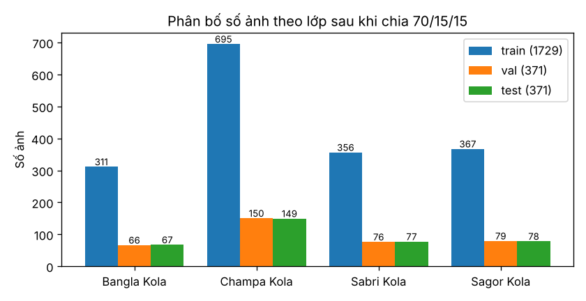

**Ảnh gần trùng.** Nhóm dùng perceptual hash (pHash 64 bit) [30], [31] để tìm ảnh gần giống nhau. Có 42 cặp ảnh cách nhau khoảng cách Hamming không quá 2, tức cùng một quả chụp lại gần như y hệt, và 7 ảnh test có bản gần trùng trong train. Chia lại dữ liệu sao cho các ảnh gần trùng nằm cùng một fold không làm macro-F1 đổi quá ±0.007, nhỏ hơn độ lệch chuẩn giữa các fold (`results/D1/table_near_duplicates.md`). Trên tập test, hai mô hình tốt nhất cũng đúng 100% ở các ảnh không có bản gần trùng (`results/final/table_near_duplicates.md`).

Ngoài bản ảnh gốc, tác giả còn cung cấp bản Augmented (7413 ảnh). Đồ án không dùng bản này cho pipeline chính, lý do được đo ở thí nghiệm D1 (mục 5.4), và chỉ dùng ở nhánh mở rộng T và B.

### 5.2 Độ đo

Đồ án dùng các độ đo cơ bản của bài toán phân loại đã học trong môn học [2]. Với một lớp c, coi c là lớp dương và ba lớp còn lại là âm:

- TP: số ảnh lớp c được đoán đúng là c. FP: số ảnh lớp khác bị đoán thành c. FN: số ảnh lớp c bị đoán thành lớp khác.
- Precision = TP / (TP + FP): trong các ảnh mô hình gọi là c, bao nhiêu phần đúng.
- Recall = TP / (TP + FN): trong các ảnh thật sự là c, mô hình tìm ra bao nhiêu phần.
- F1 = 2 · Precision · Recall / (Precision + Recall).
- Accuracy = số ảnh đoán đúng / tổng số ảnh.
- **Macro-F1** = trung bình cộng F1 của 4 lớp. Mỗi lớp có trọng số như nhau dù số ảnh khác nhau, nên một lớp ít ảnh bị nhận kém sẽ kéo macro-F1 xuống rõ, trong khi accuracy có thể vẫn cao. Vì dữ liệu mất cân bằng, đồ án chọn macro-F1 làm chỉ số chính (thí nghiệm I1 ở mục 5.9 minh họa lý do này bằng số liệu).
- **Ma trận nhầm lẫn (confusion matrix):** hàng là lớp thật, cột là lớp dự đoán.

Với kết quả cuối trên test, nhóm báo cáo thêm khoảng tin cậy 95% tính bằng bootstrap [32].

**Ví dụ tính tay 1: precision và recall từ ma trận nhầm lẫn.** Ma trận nhầm lẫn của `a_vgg16` trên tập test (`results/hand_calc/table_cm_a_vgg16.md`):

{{T:results/hand_calc/table_cm_a_vgg16.md}}

Với lớp Bangla Kola: TP = 65 (ô trên đường chéo). FP = tổng cột Bangla trừ TP = (65 + 0 + 2 + 0) - 65 = 2, là hai ảnh Sabri bị đoán thành Bangla. FN = tổng hàng Bangla trừ TP = (65 + 0 + 0 + 2) - 65 = 2, là hai ảnh Bangla bị đoán thành Sagor. Precision = 65 / (65 + 2) = 0.970, Recall = 65 / (65 + 2) = 0.970, F1 = 0.970. Kết quả khớp với `classification_report` trong `results/final/a_vgg16/`.

**Cách đọc ma trận nhầm lẫn theo tỉ lệ.** Chia mỗi ô cho tổng của hàng thì được tỉ lệ, và tổng mỗi hàng bằng 1. Hàng Bangla Kola có 67 ảnh: 65 / 67 = 0.970 và 2 / 67 = 0.030. Nghĩa là 97.0% số ảnh Bangla Kola được đoán đúng (đây chính là recall của lớp Bangla Kola), và 3.0% số ảnh Bangla Kola bị đoán nhầm thành Sagor Kola. Tương tự, hàng Sabri Kola có 77 ảnh: 2 / 77 = 0.026, tức 2.6% số ảnh Sabri Kola bị đoán nhầm thành Bangla Kola.

**Ví dụ tính tay 2: khoảng cách giữa hai feature vector.** Vector moment màu 9 chiều (HSV đã chia về [0, 1]) của ảnh x = `Bangla_Kola_1.jpg` và y = `Champa_Kola_1.jpg` (`results/hand_calc/`):

{{T:results/hand_calc/table_moments.md}}

- Euclidean: d = √(Σ(x - y)²) = √0.157561 = 0.3969.
- Manhattan: d = Σ|x - y| = 0.8006.
- Cosine: x·y = 0.99805, ‖x‖ = 1.09546, ‖y‖ = 0.97654, nên cos = 0.99805 / (1.09546 × 0.97654) = 0.9330.
- Sau khi chuẩn hóa hai vector về vector đơn vị, khoảng cách Euclidean bằng √(2 - 2·cos) = √(2 - 2 × 0.9330) = 0.3662, khớp với kết quả tính trực tiếp (0.3662). Vì khoảng cách Euclidean trên vector đơn vị chỉ phụ thuộc vào cosine, hai độ đo cho cùng thứ hạng láng giềng. Thí nghiệm P2 kiểm chứng điều này trên toàn bộ dữ liệu.

Ví dụ tính tay 3 (số tham số của một lớp CNN) nằm ở mục 5.8, thí nghiệm N1.

### 5.3 Lập trình

- **Ngôn ngữ và thư viện:** Python 3.13, OpenCV 5.0 [33], scikit-image 0.26 [29], scikit-learn 1.9 [16], imbalanced-learn 0.14 [34], TensorFlow 2.21 và Keras 3.15 bản CPU [27], [28], NumPy [40], Matplotlib [35] để vẽ hình, Gradio [36] cho chương trình demo. Phiên bản đầy đủ ghi trong `results/environment.txt`.
- **Máy chạy:** CPU 4 nhân, 16 GB RAM, không có GPU. Đặc trưng thủ công và đầu ra của các thân mạng đóng băng chỉ tính một lần rồi lưu lại để dùng cho các thí nghiệm sau.
- **Mã nguồn:** https://github.com/Rod-HD/banana-classification. File README mô tả cách cài đặt, cách chạy lại và cấu trúc thư mục.

| Thư mục | Nội dung |
|---|---|
| `src/features/` | rút đặc trưng màu, cạnh, HOG |
| `src/cnn/` | định nghĩa mô hình CNN, huấn luyện, dự đoán |
| `src/exp_*.py` | các thí nghiệm, mỗi file ứng với một nhóm thí nghiệm ở mục 5.4 đến 5.13 |
| `src/final_eval.py` | đánh giá cuối trên tập test |
| `app/` | chương trình demo |
| `scripts/run_all.sh` | chạy lại toàn bộ theo thứ tự |
| `results/` | bảng, hình và số liệu thô do code sinh ra |
| `checkpoints/`, `models/` | trọng số của 54 lần huấn luyện CNN và mô hình dùng cho demo |

- Mỗi bước là một module chạy được từ dòng lệnh (`python -m src.<module> --help`). Trọng số đã huấn luyện có sẵn trong mã nguồn, nên chạy lại `scripts/run_all.sh` không phải huấn luyện lại CNN và cho ra đúng các con số trong báo cáo (trừ số đo thời gian, vốn phụ thuộc máy).
- Kết quả từng thí nghiệm nằm ở `results/<mã thí nghiệm>/` (bảng `table*.md`, số liệu thô `metrics.json`), hình ở `results/figures/`, bảng tổng hợp ở `results/summary.csv` (968 dòng, gồm cả phần mở rộng).

### 5.4 Thí nghiệm dữ liệu D1: rò rỉ do tăng cường ảnh trước khi chia tập

**Tính chất.** Tăng cường ảnh trước khi chia tập làm bản sao của cùng một ảnh rơi vào cả train lẫn test.
**Dự đoán.** Kết quả trên test bị thổi phồng; đây là lý do không dùng bản "Augmented" có sẵn của bộ dữ liệu.
**Thí nghiệm.** Trong tập train+val, tạo 2 bản tăng cường cho mỗi ảnh (lật ngang, xoay từ ±10° đến ±30°). So ba cách: (a) tăng cường rồi chia ngẫu nhiên 80/20; (b) chia trước, chỉ tăng cường phần huấn luyện; (c) chia theo ảnh gốc rồi tăng cường cả hai phía. (c) có tập chấm cùng thành phần với (a), nên (a) - (c) là phần thổi phồng thuần do rò rỉ. Lặp 5 lần.

{{T:results/D1/table.md}}

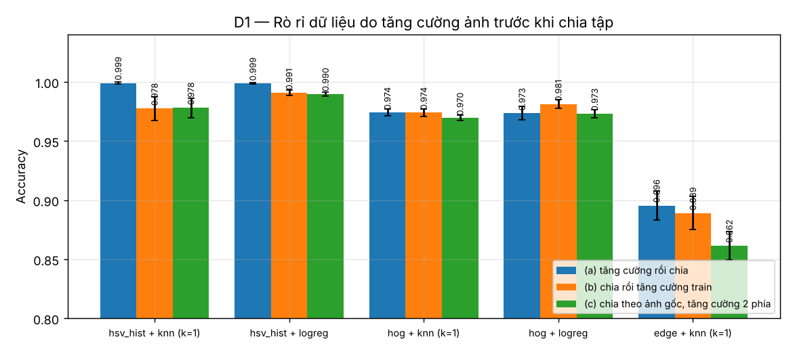

**Kết luận.** Khớp dự đoán với đặc trưng màu: histogram HSV gần như không đổi khi lật hay xoay, nên bản sao trong train là "đáp án có sẵn". Accuracy bị đẩy lên 0.999, thổi phồng +0.021 (KNN k = 1) và +0.009 (LogReg). **Trái dự đoán với HOG:** mức thổi phồng ≈ 0 (+0.005 ± 0.004 và +0.000 ± 0.004), vì HOG mã hóa hướng cạnh theo vị trí nên bản lật hay xoay có vector khác hẳn ảnh gốc. Rò rỉ chỉ gây hại khi đặc trưng bất biến với phép tăng cường.

### 5.5 Thí nghiệm đặc trưng màu: M1-M6

Mọi số liệu dưới đây là macro-F1, 5-fold CV trên train+val; phép biến đổi chỉ áp lên fold giữ lại.

**M1: Histogram bỏ thông tin vị trí.** *Dự đoán:* xáo trộn ảnh chấm thành lưới 4×4 thì histogram giữ nguyên, HOG giảm.

{{T:results/M1/table.md}}

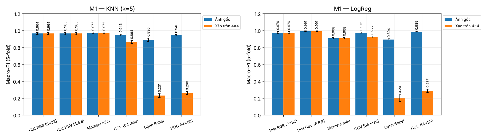

*Kết luận:* khớp. Histogram và moment màu không đổi đúng đến chữ số cuối (độ sụt 0.000); HOG và vector cạnh rơi về mức đoán mò (0.20 đến 0.29); CCV sụt 0.05 đến 0.08 vì có thông tin liên kết không gian.

**M2: HSV tách độ sáng khỏi sắc màu.** *Dự đoán:* khi nhân kênh V với 0.6 hoặc 1.4, histogram RGB sụt nhiều nhất, HSV ít hơn, H-S bền nhất.

{{T:results/M2/table.md}}

*Kết luận:* khớp một phần. Chỉ histogram H-S (bỏ hẳn kênh V) là bền (sụt ≤ 0.027). Histogram HSV đủ 3 kênh vẫn sụt 0.33 đến 0.67 vì kênh V vẫn nằm trong đặc trưng: tách V ra thành một trục riêng thôi chưa đủ, phải bỏ nó khỏi vector.

**M3: Số bin.** *Dự đoán:* ít bin thì mất khả năng phân biệt, nhiều bin thì vector thưa và nhạy nhiễu.

{{T:results/M3/table.md}}

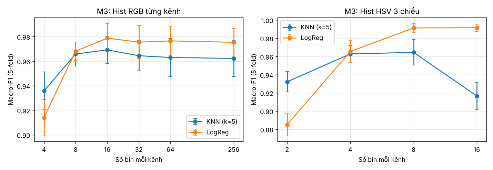

*Kết luận:* vế "ít bin" khớp (4 bin mỗi kênh: 0.914 đến 0.936). Vế "nhiều bin" chỉ thấy ở KNN trên histogram 3 chiều: 16³ = 4096 chiều, 87% phần tử bằng 0, KNN giảm còn 0.917, trong khi LogReg vẫn 0.992. Histogram RGB từng kênh từ 8 đến 256 bin cho kết quả ngang nhau (chênh nhỏ hơn độ lệch chuẩn).

**M4: Moment màu gọn nhưng thô.** *Dự đoán:* 9 chiều nhanh nhưng kém histogram.

{{T:results/M4/table.md}}

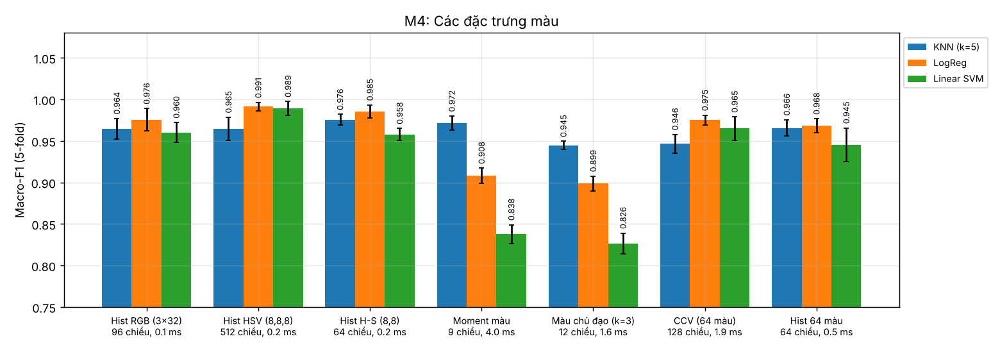

*Kết luận:* khớp với bộ phân lớp tuyến tính (LogReg 0.908, Linear SVM 0.838). **Trái dự đoán với KNN** (0.972, ngang histogram) và về thời gian: rút moment màu (khoảng 4 ms/ảnh) chậm hơn rút histogram (0.2 ms/ảnh) vì phải tính lũy thừa trên từng điểm ảnh. Giải thích ở P6: 9 con số đủ tách 4 lớp nếu biên quyết định được phép cong.

**M5: CCV bổ sung thông tin liên kết không gian.** *Dự đoán:* CCV tốt hơn histogram cùng mức lượng tử hóa và nhạy với bố cục.

{{T:results/M5/table.md}}

*Kết luận:* vế "nhạy với bố cục" khớp (xáo trộn làm CCV sụt 0.05 đến 0.08, histogram ≤ 0.003). Vế "tốt hơn histogram" không được xác nhận: với LogReg 0.975 so với 0.968 (chênh nhỏ hơn độ lệch chuẩn), với KNN còn kém hơn. Trên ảnh một quả chuối nền trơn, hầu hết điểm ảnh cùng màu nằm trong vùng liên thông lớn, nên phần "không liên kết" gần như rỗng và mang ít thông tin.

**M6: Giống chuối khác nhau ở màu hay ở hình dạng?** *Dự đoán:* chuyển ảnh sang xám thì đặc trưng màu mất tác dụng, đặc trưng cạnh và HOG gần như không đổi.

{{T:results/M6/table.md}}

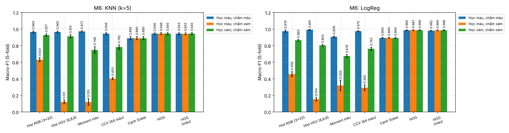

*Kết luận:* khớp. Khi học lại trên ảnh xám, đặc trưng màu sụt 0.04 đến 0.23; cạnh và HOG đổi ≤ 0.005, và HOG trên ảnh xám vẫn đạt 0.986. Bốn giống phân biệt được bằng cả màu (hist HSV 0.991) lẫn hình dạng (HOG 0.986). Mục 5.10 (S2) cho thấy một phần của cả hai con số này đến từ nền ảnh.

### 5.6 Thí nghiệm đặc trưng cạnh và HOG: C1-C5

**C1: Toán tử cạnh và nhiễu.** *Tính chất:* Roberts dùng mặt nạ 2×2 nên nhạy nhiễu; Prewitt và Sobel có làm trơn; Laplacian là đạo hàm bậc hai nên nhạy nhiễu nhất. *Dự đoán:* thêm nhiễu Gauss thì độ sụt xếp theo thứ tự Prewitt ≈ Sobel < Roberts < Laplacian. Nhóm thêm mức σ = 2 vì từ σ = 10 mọi toán tử đều rơi về mức đoán mò.

{{T:results/C1/table.md}}

{{T:results/C1/table_feature_change.md}}

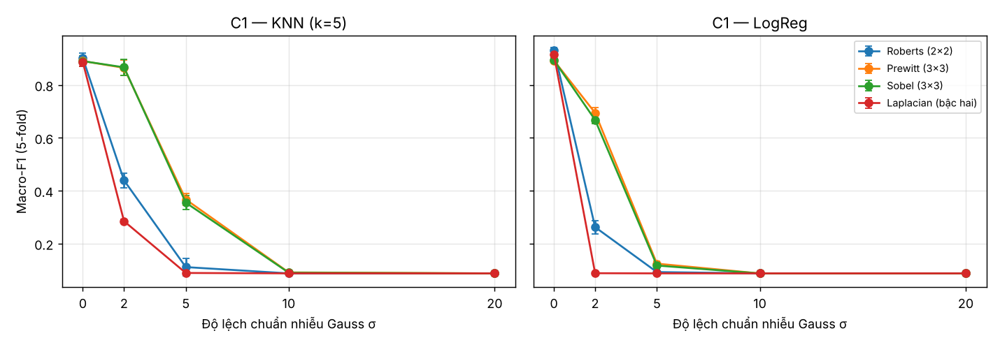

*Kết luận:* khớp. Ở σ = 5, vector đặc trưng thay đổi 43 đến 46% với Prewitt/Sobel, 100% với Roberts và 216% với Laplacian. Ngoài dự đoán: vector "tổng theo hàng/cột" kém bền với mọi toán tử, sập hoàn toàn từ σ = 10, vì nhiễu cộng thêm gradient ở mọi điểm ảnh nền và tổng theo hàng/cột cộng dồn hết phần đó.

**C2: HOG chuẩn hóa block bền với độ sáng.** *Dự đoán:* lặp lại M2 với HOG; bản có chuẩn hóa bền hơn bản không chuẩn hóa.

{{T:results/C2/table.md}}

{{T:results/C2/table_saturation.md}}

*Kết luận:* khớp khi làm tối (V×0.6: sụt 0.004 đến 0.009 so với 0.08 đến 0.39). **Trái dự đoán khi làm sáng** (V×1.4: bản chuẩn hóa sụt 0.16 đến 0.22, bản không chuẩn hóa chỉ -0.03 đến +0.06). Nguyên nhân: V×1.4 làm 68.7% điểm ảnh bão hòa ở 255 và 14.1% số cell mất hẳn gradient. Đây không còn là phép đổi độ sáng tuyến tính mà chuẩn hóa khử được. Chuẩn hóa L2 còn khuếch đại các block nền có gradient yếu lên độ dài đơn vị, nên khi nền bão hòa thì vector đã chuẩn hóa đổi nhiều hơn.

**C3: Tham số HOG.** *Dự đoán:* kích thước ảnh, cell và số bin quyết định mức chi tiết.

{{T:results/C3/table.md}}

*Kết luận:* khớp một phần. Chỉ tỉ lệ kích thước cell so với kích thước ảnh tạo khác biệt đo được: cell 16×16 trên ảnh 64×128 còn 0.959. Với LogReg, 9/12 cấu hình nằm trong khoảng 0.982 đến 0.986 và số bin (6, 9, 12) không tạo khác biệt vượt độ lệch chuẩn. Đồ án giữ cấu hình của bài giảng (64×128, cell 8, 9 bin, 3780 chiều).

**C4: Đặc trưng toàn cục và cục bộ khi bị che.** *Dự đoán:* che một hình vuông 25% diện tích thì histogram (toàn cục) sụt nhiều hơn HOG (ghép từ đặc trưng cục bộ).

{{T:results/C4/table.md}}

{{T:results/C4/table_hist_scaling.md}}

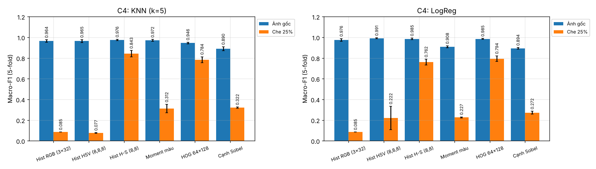

*Kết luận:* với cấu hình mặc định (z-score) thì khớp: Hist RGB/HSV rơi về 0.08 đến 0.22, HOG còn 0.78 đến 0.79. Nhưng phép đo phụ cho thấy **nguyên nhân chính là bước chuẩn hóa z-score**, không phải tính "toàn cục". Hình vuông đen dồn 25% khối lượng histogram vào một bin hầu như luôn bằng 0 trên ảnh huấn luyện; z-score chia cho độ lệch chuẩn rất nhỏ của bin đó nên một chiều chi phối khoảng cách. Dùng Hellinger thì Hist HSV chỉ sụt 0.012.

**C5: Màu và hình dạng bổ sung cho nhau.** *Dự đoán:* ghép màu + HOG (chuẩn hóa từng phần) tốt hơn từng đặc trưng riêng lẻ.

{{T:results/C5/table.md}}

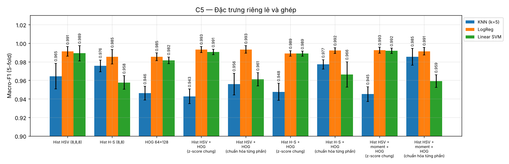

*Kết luận:* khớp với KNN: chuẩn hóa từng phần nâng Hist H-S + HOG từ 0.948 (ghép thẳng) lên 0.977. Sau khi chọn siêu tham số (mục 5.7), cấu hình ghép đạt 0.996 ± 0.003, hơn HOG riêng 0.010 (lớn hơn độ lệch chuẩn) và hơn màu riêng 0.005 (bằng độ lệch chuẩn, chưa đủ cơ sở phân biệt).

### 5.7 Thí nghiệm bộ phân lớp: P1-P6 và cấu hình truyền thống đã chốt

**P1: Chọn k.** *Dự đoán:* k nhỏ nhạy nhiễu, k lớn kém nhạy với đặc điểm cục bộ; so quy tắc k = số lớp + 1 với k chọn bằng cross-validation.

{{T:results/P1/table.md}}

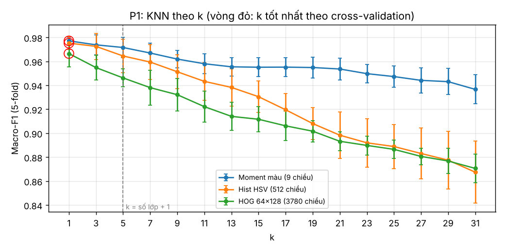

*Kết luận:* vế "k lớn" khớp (k = 31 thấp nhất). Vế "k nhỏ nhạy nhiễu" **không xuất hiện**: k = 1 tốt nhất với cả ba đặc trưng, hơn quy tắc k = 5 từ 0.006 đến 0.020. Các lớp tách nhau rõ và mỗi quả thường có nhiều ảnh gần giống nhau, nên láng giềng gần nhất hầu như luôn cùng lớp; tăng k chỉ kéo thêm điểm ở xa, phần nhiều thuộc lớp đông nhất.

**P2: Độ đo và thang đo.** *Dự đoán:* KNN phụ thuộc độ đo và chuẩn hóa; sau khi chuẩn hóa về vector đơn vị, Euclidean và cosine cho cùng thứ hạng láng giềng.

{{T:results/P2/table.md}}

{{T:results/P2/table_rank_agreement.md}}

*Kết luận:* khớp. Sau chuẩn hóa đơn vị, 100% ảnh truy vấn có cùng tập 10 láng giềng theo Euclidean và theo cosine (trước chuẩn hóa: 11% với moment, 18% với hist HSV); macro-F1 của hai cách trùng nhau. Manhattan tốt nhất trên HOG (0.978 so với 0.954 của Euclidean).

**P3: Ưu tiên điểm gần.** *Dự đoán:* `weights='distance'` giúp khi các lớp chồng lấn, nhất là với lớp ít ảnh.

{{T:results/P3/table.md}}

*Kết luận:* chưa đủ cơ sở phân biệt. Macro-F1 đổi ≤ 0.006; recall của Bangla Kola (lớp ít ảnh nhất) đổi từ -0.003 đến +0.026, nhỏ hơn hoặc xấp xỉ độ lệch chuẩn giữa các fold.

**P4: K-D Tree và Ball Tree.** *Dự đoán:* chỉ tăng tốc, không đổi kết quả, và kém hiệu quả khi nhiều chiều.

{{T:results/P4/table.md}}

{{T:results/P4/table_scaling.md}}

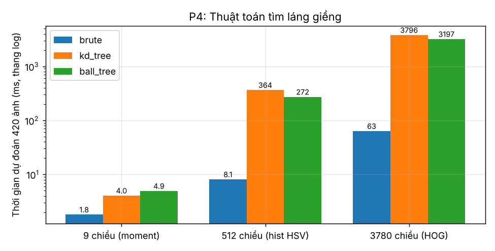

*Kết luận:* khớp, kèm điều kiện. Kết quả trùng Brute Force trong mọi trường hợp. Với 3780 chiều, K-D Tree chậm hơn Brute Force khoảng 60 lần. Ngay cả với 9 chiều, khi chỉ có 1680 ảnh tham chiếu thì cây vẫn chậm hơn; từ 8400 điểm trở lên K-D Tree mới nhanh hơn (6.1 ms so với 22.3 ms). Cây chỉ có lợi khi **ít chiều và tập tham chiếu đủ lớn**.

**P5: Thời gian huấn luyện và dự đoán.** *Dự đoán:* KNN không tốn thời gian huấn luyện nhưng dự đoán chậm; mô hình tuyến tính thì ngược lại.

{{T:results/P5/table.md}}

*Kết luận:* khớp. Trên HOG, KNN "huấn luyện" 0.07 s (chỉ lưu dữ liệu) nhưng dự đoán 0.22 ms/ảnh; LogReg huấn luyện 1.2 s nhưng dự đoán chỉ 0.02 ms/ảnh.

**P6: Biên quyết định tuyến tính.** *Dự đoán:* LogReg kém KNN khi đặc trưng ít chiều, tốt hơn khi nhiều chiều.

{{T:results/P6/table.md}}

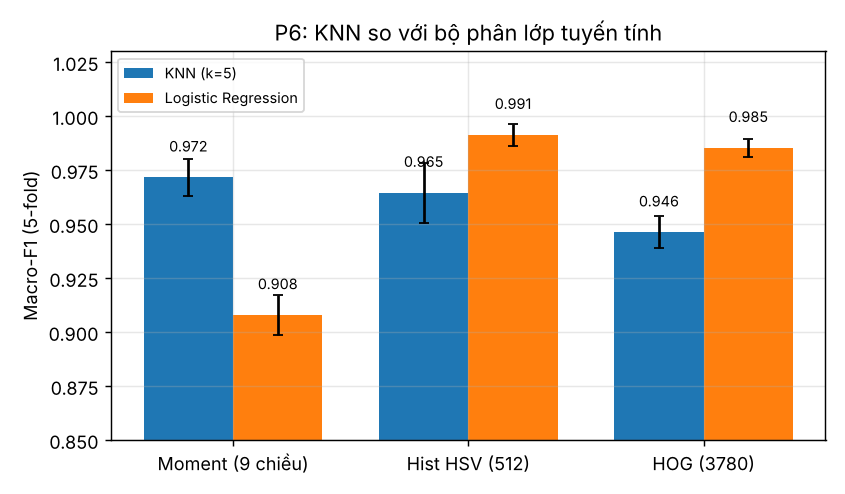

*Kết luận:* khớp. Với 9 chiều, LogReg kém KNN 0.064; với 512 và 3780 chiều thì hơn 0.027 và 0.039. Trong không gian nhiều chiều, các lớp dễ tách tuyến tính hơn.

**Cấu hình truyền thống đã chốt.** Quét k ∈ {1, 3, 5}, độ đo (Euclidean, Manhattan, Hellinger) cho KNN và tham số C cho LogReg, Linear SVM (`results/select_traditional/table.md`):

{{T:results/select_traditional/table_selected.md}}

### 5.8 CNN hướng A và hướng B: N1-N8

Hai hướng được trình bày riêng (5.8.1, 5.8.2) trước khi so sánh (5.8.3). Số liệu CNN trong mục này chấm trên val (371 ảnh); kết quả trên test ở mục 5.11.

#### 5.8.1 Hướng A: CNN theo bài giảng

**N1: Số tham số tính được từ kiến trúc.** Lớp tích chập có (F×F×C + 1)×K tham số, lớp kết nối đầy đủ có (N_in + 1)×N_out tham số.

**Ví dụ tính tay 3.** Lớp `conv2` của `a_lenet`: kernel 5×5, đầu vào 6 kênh, 16 bộ lọc, nên có (5×5×6 + 1) × 16 = 151 × 16 = 2416 tham số. Lớp `fc1`: ảnh 64×64 qua Conv 5×5 còn 60×60, qua MaxPool còn 30×30, qua Conv 5×5 còn 26×26, qua MaxPool còn 13×13; Flatten cho 13 × 13 × 16 = 2704 giá trị, nên lớp này có (2704 + 1) × 120 = 324600 tham số.

{{T:results/N1/table.md}}

{{T:results/N1/table_totals.md}}

*Kết luận:* 10/10 lớp khớp đúng `model.summary()`. Lớp Dense đầu tiên chiếm 96% số tham số của `a_lenet` và 99% của `a_dropout`.

Kết quả huấn luyện của hướng A trên val: `a_lenet` 0.973 (ảnh vào 64×64; 32×32 cho 0.954; 128×128 cho 0.956), `a_dropout` 0.940 (0.948 khi có tăng cường ảnh), `a_vgg16` 0.984 với learning rate 1e-4 và 0.990 với 1e-3 (`results/cnn/table_runs.md`).

**N2: Lượng dữ liệu.** *Tính chất:* CNN học đặc trưng từ dữ liệu nên cần nhiều dữ liệu; transfer learning tận dụng đặc trưng đã học. *Dự đoán:* khi giảm dữ liệu, `a_lenet` sụt nhiều hơn `a_vgg16` và `b_mobilenetv3`.

{{T:results/N2/table.md}}

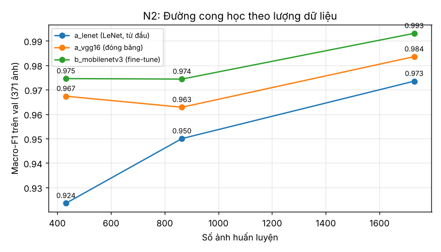

*Kết luận:* khớp. Từ 25% lên 100% train, `a_lenet` tăng 0.050, hai mô hình pretrained chỉ tăng 0.016 đến 0.018. Với 25% train (432 ảnh), `a_vgg16` (0.967) và `b_mobilenetv3` (0.975) đã ngang hoặc hơn `a_lenet` dùng đủ 1729 ảnh (0.973).

**N3: Dropout giảm quá khớp.** *Dự đoán:* `a_dropout` có Dropout có khoảng cách train-val nhỏ hơn và kết quả trên val tốt hơn bản không Dropout.

{{T:results/N3/table_seeds.md}}

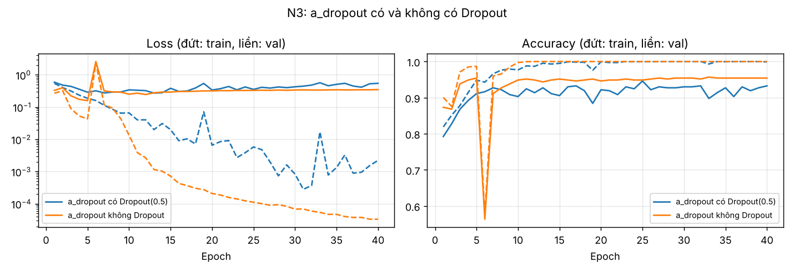

*Kết luận:* **trái dự đoán**. Qua 3 seed khởi tạo, bản có Dropout(0.5) kém hơn 0.012 (0.941 ± 0.005 so với 0.953 ± 0.006), và khoảng cách loss val - train không nhỏ hơn. Giải thích của nhóm: 99% tham số nằm ở lớp Dense ngay sau Flatten, trước lớp Dropout; lớp này vẫn khớp tập train đến accuracy 0.999 ở cả hai cấu hình. Dropout chỉ làm nhiễu 128 đầu ra của lớp đó nên không chặn được quá khớp ở nơi nó xảy ra, lại làm quá trình tối ưu ồn hơn.

**N5: Tăng cường ảnh giảm quá khớp.** (Hướng A và B chung một bảng.)

{{T:results/N5/table.md}}

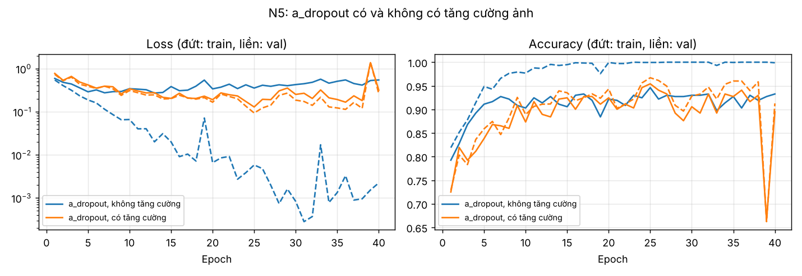

*Kết luận:* khớp với mô hình học từ đầu. Với `a_dropout`, khoảng cách loss val - train giảm từ 0.542 xuống 0.054 và macro-F1 tăng từ 0.940 lên 0.948; tăng cường tác động vào đầu vào nên hiệu quả hơn Dropout rõ rệt. Với `b_mobilenetv3` pretrained, quá khớp vốn đã nhỏ nên tăng cường không tăng điểm trên val (0.993 so với 0.997), nhưng làm mô hình bền hơn với phép xoay ±30°: 0.987 đến 0.993 so với 0.958 đến 0.978 (bảng N8).

#### 5.8.2 Hướng B: CNN lớn hơn, fine-tune

**N4: Đóng băng và fine-tune.** *Tính chất:* đóng băng giữ nguyên đặc trưng đã học; fine-tune thích nghi đặc trưng với dữ liệu mới, nhưng learning rate lớn sẽ phá trọng số đã học. *Dự đoán:* giai đoạn 2 tốt hơn giai đoạn 1; lr 1e-3 kém và kém ổn định hơn lr 1e-5.

{{T:results/N4/table.md}}

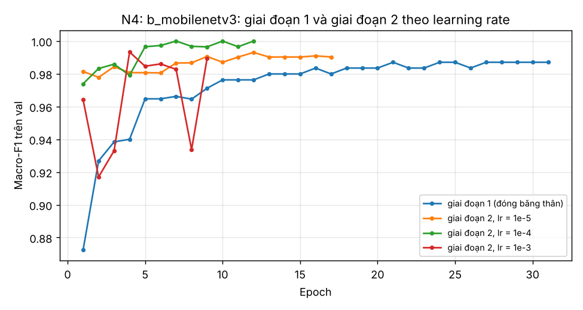

*Kết luận:* vế đầu khớp, nhưng mức tăng nhỏ vì giai đoạn 1 đã rất cao: MobileNetV3 từ 0.987 lên 0.993 đến 1.000, ResNet50 từ 0.996 lên 0.998. Vế learning rate: lr 1e-3 làm quá trình huấn luyện mất ổn định (macro-F1 tụt xuống 0.917 ở epoch 2 và dao động tới cuối, trong khi lr 1e-5 không xuống dưới 0.978). Tuy vậy, nhờ dừng sớm theo val, kết quả cuối không kém. ResNet50 chạy được giai đoạn 2 trên CPU (mở băng khối conv5, khoảng 61 s mỗi epoch, 8 epoch).

**Một chi tiết cài đặt quan trọng.** Lần fine-tune đầu để các lớp BatchNormalization mở băng: accuracy trên train ở epoch 1 chỉ 0.356. Phép đo lặp lại được cho thấy nguyên nhân:

{{T:results/N4/table_batchnorm.md}}

Khi BN ở chế độ huấn luyện, nó dùng thống kê của từng lô thay cho thống kê đã học trên ImageNet. Embedding đổi 82 đến 84%, và đầu phân lớp học ở giai đoạn 1 chỉ còn đoán đúng 4.7 đến 12.5% ảnh. Giữ BN đóng băng khi fine-tune thì vấn đề biến mất.

#### 5.8.3 So sánh hai hướng

**N6: Mạng lớn hơn, pretrained, tốt hơn nhưng tốn tài nguyên hơn.**

{{T:results/N6/table.md}}

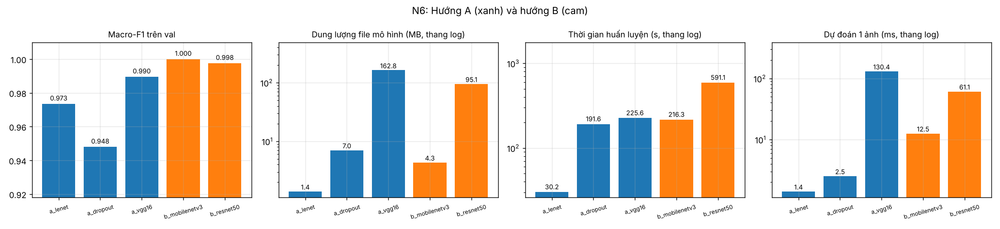

*Kết luận:* vế "tốt hơn" khớp: hướng B đạt 0.998 đến 1.000 trên val, hướng A 0.948 đến 0.990. Vế "tốn tài nguyên hơn" chỉ đúng với ResNet50. MobileNetV3-Small có 0.94 triệu tham số, file 4.3 MB, dự đoán 12.5 ms mỗi ảnh; trong khi `a_vgg16` của hướng A có 40.7 triệu tham số, file 163 MB, dự đoán 130 ms mỗi ảnh. Dung lượng là của file `.keras` chỉ gồm kiến trúc và trọng số (khoảng 4 byte mỗi tham số), không kèm trạng thái của bộ tối ưu. Một kiến trúc được thiết kế cho thiết bị di động có thể vừa chính xác hơn vừa nhẹ hơn mô hình theo bài giảng.

**N7: Feature vector thủ công và embedding.** *Dự đoán:* embedding do mạng học tốt hơn đặc trưng thủ công với cùng bộ phân lớp.

{{T:results/N7/table.md}}

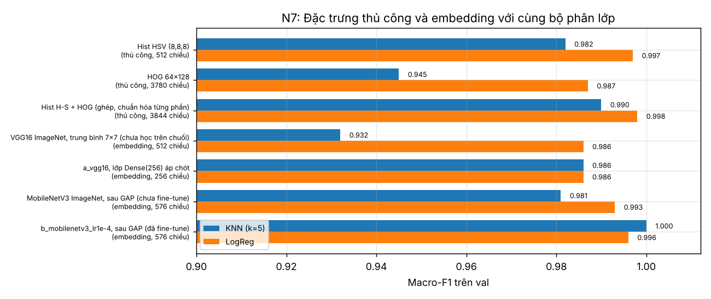

*Kết luận:* khớp với KNN (embedding MobileNetV3 đã fine-tune: 1.000; đặc trưng thủ công tốt nhất: 0.990). Với LogReg thì ngang nhau (0.996 so với 0.998). Embedding ImageNet **chưa học trên chuối** (VGG16) cho KNN chỉ 0.932, kém histogram HSV (0.982). Embedding chỉ vượt trội sau khi được học trên chính dữ liệu này.

**N8: CNN có bền với thay đổi hơn đặc trưng thủ công không?**

{{T:results/N8/table.md}}

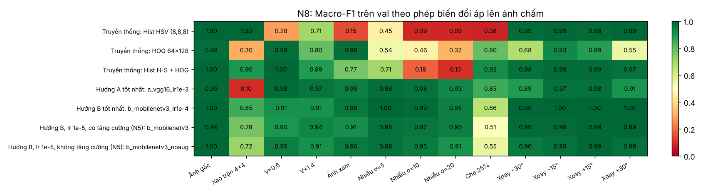

*Kết luận:* CNN bền hơn hẳn với **nhiễu** (MobileNetV3 0.953 ở σ = 20, histogram và H-S + HOG ≤ 0.101), **xoay** và **ảnh xám**. **Trái dự đoán** với phép che 25%: MobileNetV3 còn 0.659, kém HOG (0.801) và H-S + HOG (0.918). Với xáo trộn 4×4, `a_vgg16` sập về 0.097 vì dùng Flatten, mỗi trọng số gắn với một vị trí cố định; MobileNetV3 dùng GlobalAveragePooling nên giữ được 0.850. Không có phương pháp nào bền với mọi phép biến đổi; mỗi phương pháp bền với đúng loại thay đổi mà cấu trúc của nó bất biến.

### 5.9 Mất cân bằng dữ liệu: I1-I2

**I1: Accuracy che khuất lớp bị nhận kém.**

{{T:results/I1/table.md}}

*Kết luận:* khớp. Bộ phân lớp "luôn đoán Champa Kola" đạt accuracy 0.402 nhưng macro-F1 chỉ 0.143. KNN k = 31 trên HOG đạt accuracy 0.884 nhưng recall Sagor Kola chỉ 0.552. Ở các mô hình tốt, accuracy và macro-F1 chênh ≤ 0.003. Lớp bị nhận kém nhất thường là Sagor Kola (524 ảnh) chứ không phải lớp ít ảnh nhất (Bangla Kola, 444 ảnh).

**I2: Các cách xử lý mất cân bằng.** Mọi phép lấy mẫu lại chỉ áp dụng trên phần huấn luyện.

{{T:results/I2/table.md}}

*Kết luận:* ở mô hình yếu (cạnh Sobel + LogReg), các cách xử lý **đổi precision lấy recall** của lớp ít: tăng cường lớp ít nâng recall Bangla từ 0.822 lên 0.857 nhưng hạ precision Bangla từ 0.849 xuống 0.776. Ở các mô hình mạnh không đo được tác động (truyền thống tốt nhất: cả bốn cách 0.995 đến 0.996; `b_mobilenetv3`: cả bốn cách 1.000 trên val). Với tỉ lệ mất cân bằng 2.2 lần, mất cân bằng không phải vấn đề chính của bộ dữ liệu này, nên cấu hình cuối không thêm bước xử lý.

### 5.10 Phân đoạn tách nền: S1-S2

**S1: Các phương pháp phân đoạn.** *Tính chất:* ngưỡng toàn cục chỉ tốt khi nền và vật tách biệt về mức xám; Otsu tự chọn ngưỡng; k-means gom theo màu. Dữ liệu không có nhãn mask, nên nhóm đánh giá định tính bằng hình, kèm hai chỉ số không cần nhãn: số mảnh rời và tỉ lệ lỗ thủng.

{{T:results/S1/table.md}}

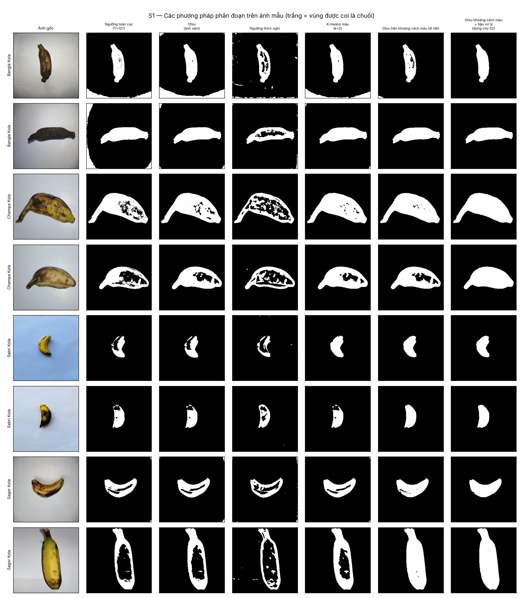

*Kết luận:* khớp. Ngưỡng toàn cục và ngưỡng thích nghi tách cả vết thâm trên vỏ thành nền (lỗ thủng 0.085 và 0.282). Ngưỡng thích nghi chỉ bắt được viền và vân. Các cách dựa trên màu (k-means, Otsu trên khoảng cách màu tới nền) cho mask liền nhất, vì nền trơn sáng khác quả chuối về màu rõ hơn về mức xám.

**S2: Mô hình dựa vào quả chuối hay vào nền?** *Dự đoán:* nếu chỉ dùng vùng nền mà vẫn phân loại tốt thì dữ liệu có thiên lệch theo bối cảnh chụp.

{{T:results/S2/table.md}}

{{T:results/S2/table_corners.md}}

{{T:results/S2/table_extreme.md}}

{{T:results/S2/table_background_stats.md}}

{{T:results/S2/table_cnn.md}}

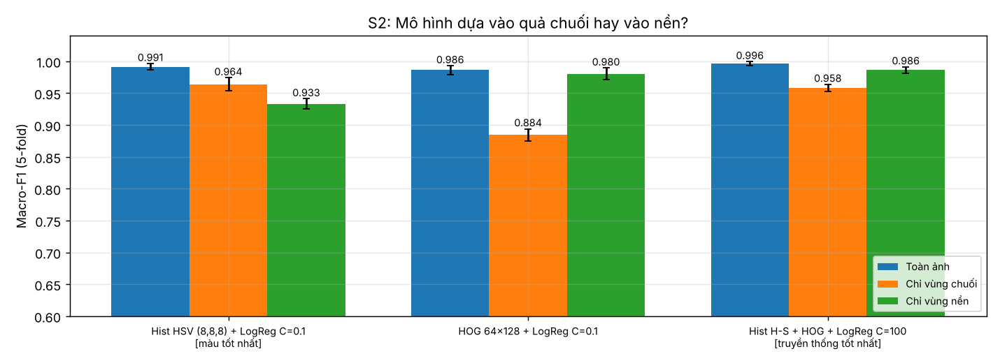

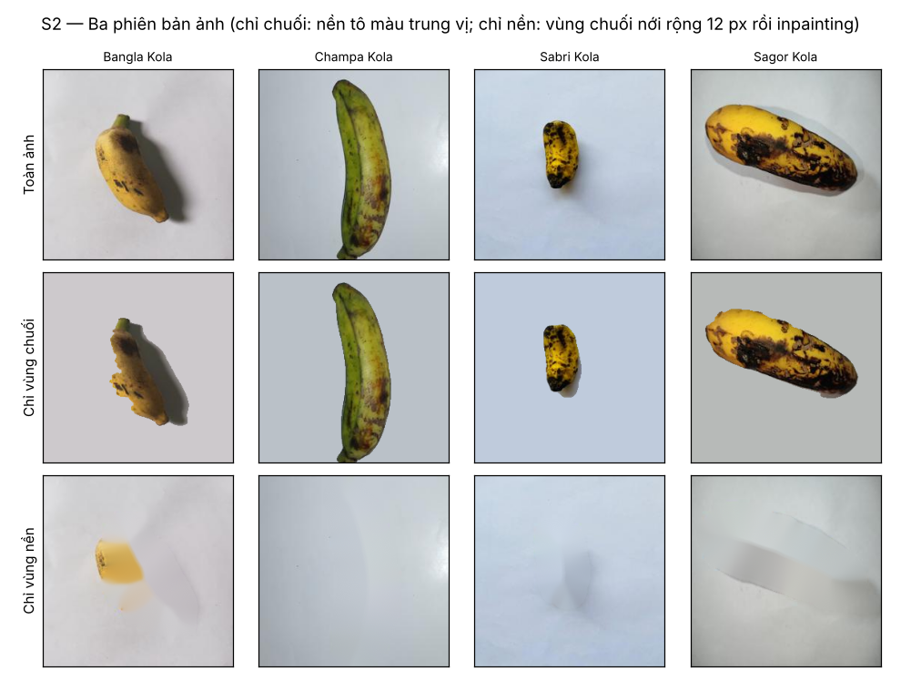

*Kết luận:* **dữ liệu có thiên lệch theo bối cảnh chụp.** Chỉ dùng 4 góc ảnh 64×64, nơi trung bình chỉ 2.5% điểm ảnh thuộc vùng chuối, HOG vẫn đạt 0.968 và histogram màu 0.939. Chỉ 3 con số là màu trung bình của nền đã cho KNN đạt 0.937. CNN học trên ảnh đầy đủ, khi đoán trên ảnh đã xóa quả chuối, vẫn đạt 0.683 đến 0.792 (đoán mò ≈ 0.25). Mỗi lớp được chụp trong điều kiện riêng: nền Sabri Kola xanh hơn (b = 119.9 so với 123.6 đến 128.3 ở các lớp khác), quả Sabri chiếm 5.4% diện tích ảnh so với 22.0% ở Sagor. Khi chỉ nhìn quả chuối, cấu hình truyền thống tốt nhất còn 0.958 và CNN còn 0.926 đến 0.952; các con số này gần với khả năng phân biệt giống bằng chính quả chuối hơn.

### 5.11 Đánh giá cuối trên tập test

Tập test (371 ảnh) chỉ dùng ở bước này, cho 9 cấu hình đã chốt. Nhóm truyền thống học lại trên train+val; CNN học trên train. Khoảng tin cậy 95% tính bằng bootstrap (2000 lần lấy mẫu lại).

{{T:results/final/table.md}}

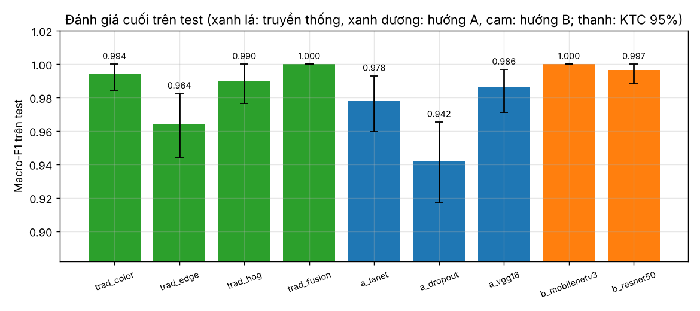

**Mô hình tốt nhất của từng nhóm (chọn theo CV/val, kết quả trên test):**

- Truyền thống: **Hist H-S + HOG + Logistic Regression** (C = 100, chuẩn hóa từng phần): macro-F1 1.000, đúng 371/371 ảnh.
- CNN hướng A: **`a_vgg16`** (VGG16 đóng băng, lr 1e-3): macro-F1 0.986, sai 4 ảnh.
- CNN hướng B: **`b_mobilenetv3`** (MobileNetV3-Small fine-tune, lr 1e-4): macro-F1 1.000, đúng 371/371 ảnh.

Hai cấu hình đúng toàn bộ tập test không phân biệt được với nhau. Khoảng tin cậy của các cấu hình từ 0.986 trở lên chồng lên nhau; chỉ kết luận được rằng `a_dropout` (0.942), cạnh Roberts + KNN (0.964) và `a_lenet` (0.978) kém hơn nhóm dẫn đầu. Với 0/371 ảnh sai, cận trên 95% của tỉ lệ lỗi thật xấp xỉ 3/371 ≈ 0.8% (quy tắc ba). Điểm trên test bằng hoặc cao hơn điểm lúc chọn ở 6/9 cấu hình; 3 cấu hình còn lại giảm trong khoảng 1 đến 2 ảnh. Không thấy dấu hiệu quá khớp vào tập chọn siêu tham số.

**Phân tích lỗi.** Gộp trên 9 mô hình, có 41 ảnh test bị ít nhất một mô hình đoán sai.

{{T:results/final/table_error_pairs.md}}

{{T:results/final/table_error_context.md}}

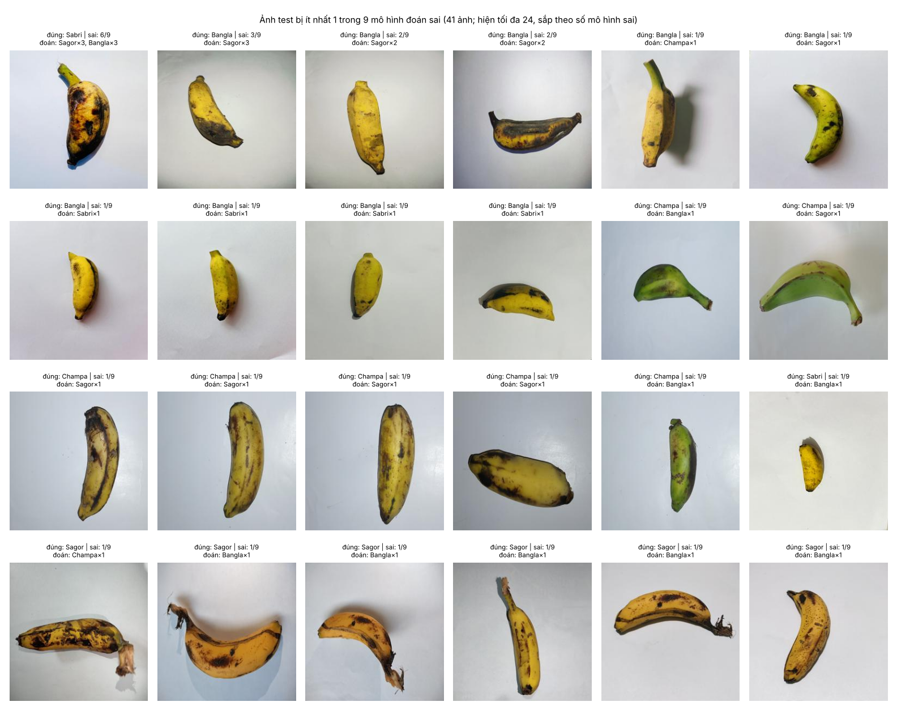

Lỗi tập trung ở Sagor Kola: 23/78 ảnh bị ít nhất một mô hình đoán sai, chủ yếu bị nhầm thành Champa Kola. Ảnh Sagor bị sai có quả nhỏ hơn trung bình của lớp (diện tích 0.181 so với 0.244). Ảnh bị nhiều mô hình đoán sai nhất (`Sabri_Kola_5.jpg`, 6/9 mô hình) là một quả Sabri to trên nền trắng, không giống ảnh Sabri điển hình (quả nhỏ, nền xanh nhạt). Cả hai quan sát khớp với thiên lệch theo kích thước quả và nền đã đo ở S2.

### 5.12 Demo

`app/app.py` (Gradio, chạy bằng `python app/app.py`) có 7 tab. (1) **Dự đoán**: tải ảnh, chụp webcam hoặc dán ảnh, chọn mô hình (`b_mobilenetv3`, bản X-b có thay nền, `a_lenet` hoặc cấu hình truyền thống tốt nhất), nhận giống dự đoán, xác suất 4 lớp, thời gian dự đoán và thông tin giống. (2) **So sánh mô hình**: một ảnh qua cả 4 mô hình. (3) **Giải thích**: Grad-CAM [37] trên lớp tích chập cuối của CNN. (4) **Thử độ bền**: áp đúng các phép của bộ kiểm tra khó (độ sáng, nhiễu, xoay, che, thay nền) lên một ảnh rồi so dự đoán trước và sau. (5) **Nhiều ảnh**: dự đoán hàng loạt, tải CSV. (6) **Đánh giá theo metric**: tính lại accuracy, precision, recall, F1 từng lớp, macro, weighted, ma trận nhầm lẫn và ảnh bị đoán sai trên val hoặc test, với ảnh gốc hoặc từng phép thử khó; kết quả trùng với số đã ghi ở mục 5.10 và 5.13. (7) **Kết quả thực nghiệm**: xem các bảng và hình trong `results/`. Thông tin về giống trong `app/variety_info.json` chỉ ghi những gì có nguồn dẫn; chỗ chưa có nguồn thì để trống.

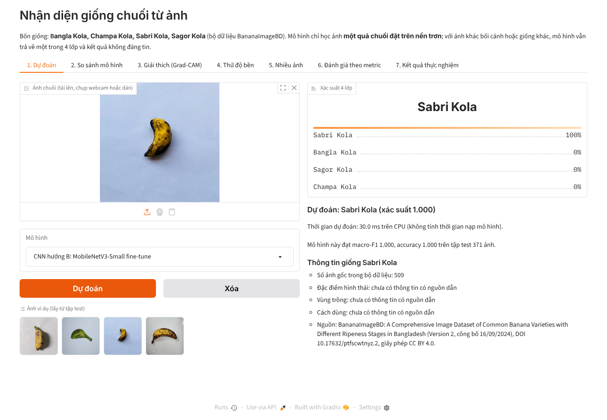

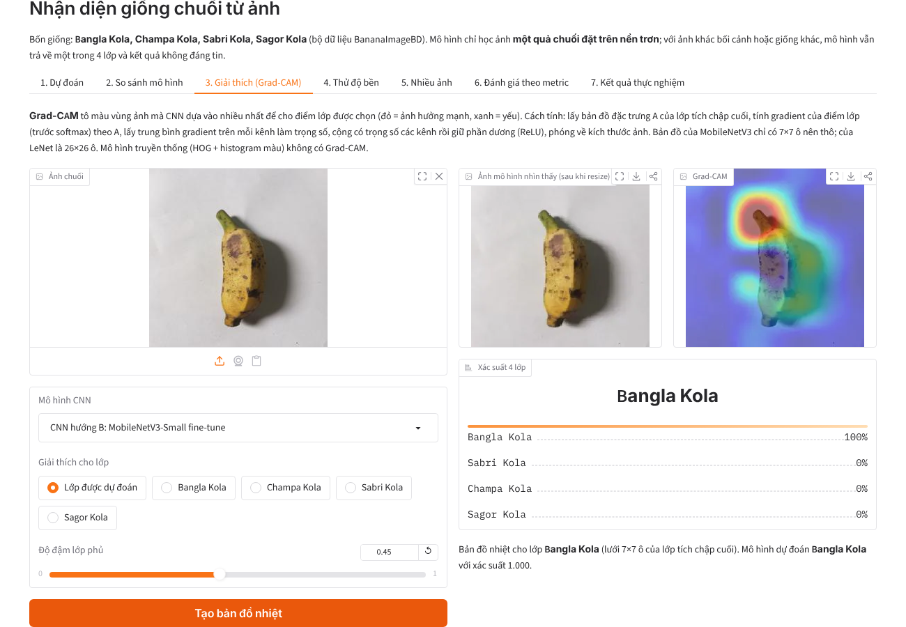

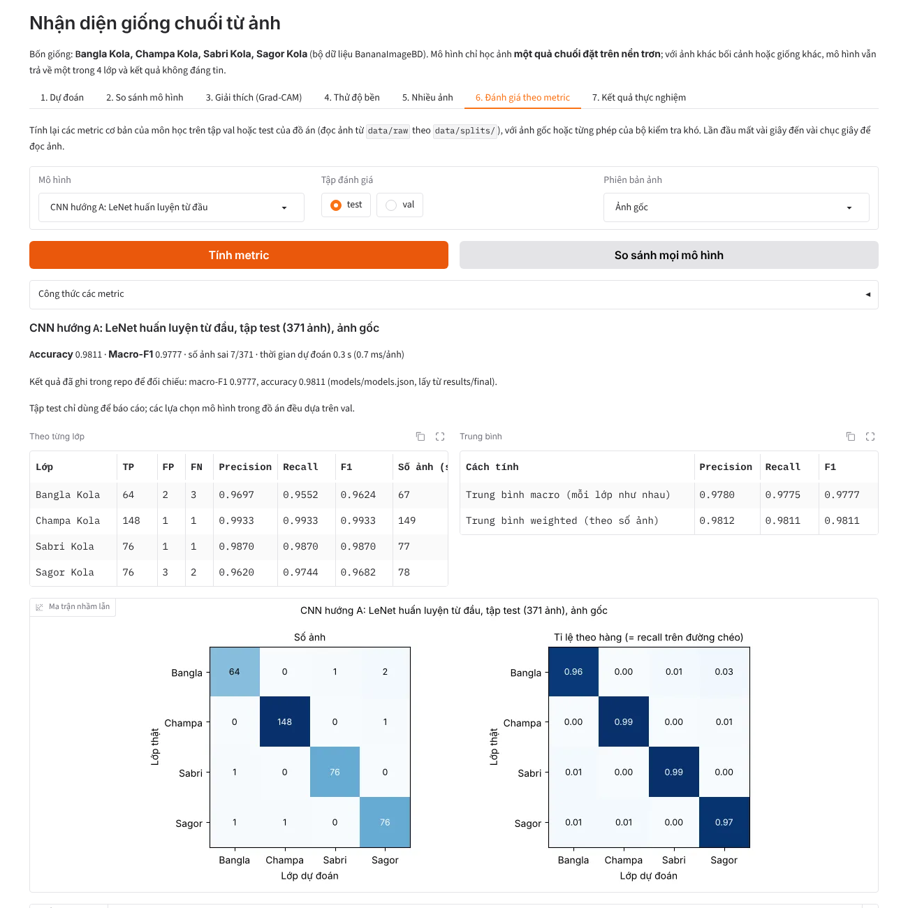

### 5.13 Phần mở rộng: ba nhánh so sánh độc lập với pipeline gốc

Sau khi hoàn tất 30 thí nghiệm, đồ án thêm ba nhánh (mục 12 của kế hoạch). Mỗi nhánh chỉ đổi **một thứ** so với pipeline gốc và được so sánh độc lập với nhau và với pipeline gốc; các nhánh không chồng lên nhau.

| Nhánh | Thay đổi so với pipeline gốc | Giữ nguyên |
|---|---|---|
| **G**: gốc | (mốc so sánh: ảnh gốc resize 256×256, 9 cấu hình đã chốt ở mục 5.11) | - |
| **X**: xử lý dữ liệu | Thêm làm sạch, tiền xử lý và tăng cường dữ liệu do nhóm thiết kế | 9 cấu hình, siêu tham số, cách chia tập |
| **T**: bản Augmented của tác giả | Tập huấn luyện lấy từ bản "Augmented Banana Classification Dataset" (7413 ảnh) của tác giả bộ dữ liệu [1] | 9 cấu hình, siêu tham số |
| **B**: phương pháp của bài báo | Phương pháp phân loại lấy từ bài báo của Ergün [18] trên chính bộ dữ liệu này | Dữ liệu và cách chia tập |

**Cùng một tập chấm.** Mọi nhánh báo cáo trên 371 ảnh test gốc; mọi lựa chọn bên trong một nhánh chỉ dùng train và val.

**Bộ kiểm tra khó.** Hai cấu hình của nhánh G đã đúng 371/371 ảnh test gốc, nên điểm trên ảnh gốc không còn chỗ để phân biệt các nhánh. Mỗi mô hình được chấm thêm trên 6 phiên bản biến đổi của tập test: **nền hoán đổi** (quả chuối được ghép lên nền của một ảnh thuộc lớp khác, nền đó có được bằng cách xóa quả chuối khỏi ảnh bằng inpainting [15]), V×0.6, V×1.4, nhiễu Gauss σ = 10, xoay +30°, che 25%. Phép biến đổi áp lên ảnh thô, trước mọi bước tiền xử lý riêng của nhánh. **Điểm bền** là trung bình macro-F1 trên 6 phiên bản này. Các phép này là biến đổi tổng hợp; chúng không thay được một tập ảnh chụp thật ở bối cảnh khác.

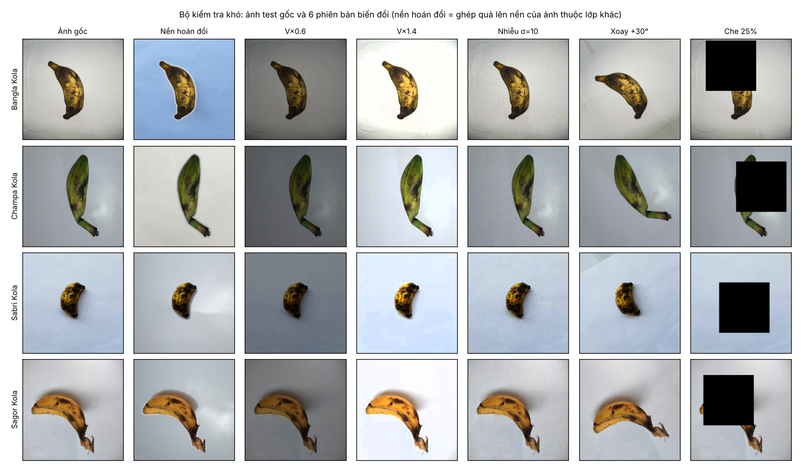

#### 5.13.1 Nhánh G trên bộ kiểm tra khó

{{T:results/so_sanh_nhanh/G/table.md}}

Macro-F1 trên ảnh gốc là 0.94 đến 1.00, nhưng điểm bền chỉ 0.49 đến 0.90, và thứ hạng thay đổi: `b_resnet50` (0.895) và `a_vgg16` (0.886) bền hơn `b_mobilenetv3` (0.875), dù `b_mobilenetv3` đúng 371/371 ảnh gốc. Phép **nền hoán đổi** làm mọi cấu hình tụt: HOG còn 0.145, cấu hình truyền thống tốt nhất còn 0.410, các CNN còn 0.66 đến 0.86. Đây là xác nhận thứ hai, bằng một phép đo khác, cho kết luận của S2: các mô hình dựa một phần vào nền ảnh.

#### 5.13.2 Nhánh X: xử lý dữ liệu do nhóm thiết kế

**Pipeline gốc xử lý dữ liệu tới đâu?** Chỉ resize ảnh về 256×256 và chuẩn hóa giá trị điểm ảnh bên trong mô hình. Không có bước làm sạch, không cân bằng trắng, không tách nền. Tăng cường ảnh chỉ bật lúc huấn luyện cho các CNN có tăng cường (`a_dropout`, hướng B); nhóm truyền thống không có. Nhánh X bổ sung cả ba phần: làm sạch, tiền xử lý, tăng cường, và chọn tổ hợp bằng số liệu trên val.

**X1: Làm sạch và kiểm tra dữ liệu** (`results/E1_xu_ly/table_cleaning.md`):

{{T:results/E1_xu_ly/table_cleaning.md}}

Không có ảnh nào bị cả hai mô hình kiểm tra (truyền thống tốt nhất, embedding CNN) cùng đoán sai ngoài phần học, nên không có ảnh nghi sai nhãn. Bài báo mô tả dữ liệu [17] cho biết **mỗi quả chuối được chụp từ bốn mặt**. Điều này để lại dấu vết trong dữ liệu:

{{T:results/E1_xu_ly/table_adjacent.md}}

{{T:results/E1_xu_ly/table_blocked_cv.md}}

*Kết luận X1.* Làm sạch chỉ loại 35/1729 ảnh train. Quan trọng hơn là phát hiện về cách chia tập: ảnh mang số thứ tự liền kề giống nhau gấp khoảng 20 lần mức ngẫu nhiên (20.0% so với 1.0%), và cross-validation chia theo khối ảnh liên tiếp cho macro-F1 thấp hơn chia ngẫu nhiên 0.024 đến 0.069. Ảnh của cùng một quả hoặc cùng một đợt chụp nằm ở cả train lẫn test khi chia ngẫu nhiên, nên mọi con số chấm bằng cách chia ngẫu nhiên (kể cả bảng ở mục 5.11) lạc quan hơn so với khi gặp quả chuối chưa từng thấy. pHash không bắt được hiện tượng này (mục 5.1) vì các mặt của một quả không giống nhau từng điểm ảnh.

**X2: Tiền xử lý.** Năm mức, áp dụng giống nhau cho ảnh train và ảnh cần dự đoán:

| Mức | Nội dung |
|---|---|
| Không xử lý | Chỉ resize (như pipeline gốc) |
| Cân bằng trắng theo nền | Chia ảnh cho mô hình nền bậc hai (màu giấy trắng ước lượng tại từng vị trí), khử sắc màu nguồn sáng và độ sáng không đều |
| Nền phẳng | Tách quả chuối bằng mask (mô hình nền bậc hai + Otsu), giữ nguyên màu quả, thay toàn bộ nền bằng một màu trắng |
| Cân bằng trắng + nền phẳng | Cả hai bước trên |
| Cân bằng trắng + nền phẳng + cắt theo quả | Thêm: cắt theo khung bao của quả, đệm thành hình vuông, resize |

Mask của bước S1 không dùng lại được: nó tràn ra nền ở 5.2% số ảnh (những ảnh có vệt sáng của đèn quanh quả). Nhánh X dùng mask mới: khớp một mặt bậc hai theo (x, y) cho màu nền rồi tách ngưỡng Otsu trên khoảng cách màu tới mặt đó.

**X3: Tăng cường dữ liệu (chỉ trên train).** Ba mức: không; hình học + quang học (lật, xoay bội số 90°, xoay ±15°, độ sáng ±15%, làm mờ, nhiễu muối tiêu; 2 bản mỗi ảnh, cùng loại phép với công thức của tác giả [17]); thêm **thay nền ngẫu nhiên** (ghép quả chuối lên nền của một ảnh train bất kỳ, để màu và kết cấu nền không còn đi kèm với nhãn).

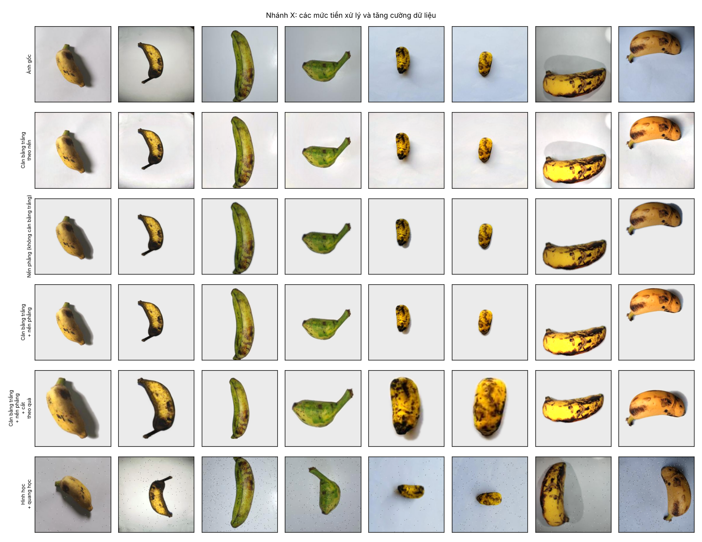

**X4: Chọn tổ hợp trên val.** Điểm chọn là trung bình macro-F1 trên val của 7 phép thử (ảnh gốc và 6 phép của bộ kiểm tra khó), lấy trung bình hai mô hình đại diện: TT = cấu hình truyền thống tốt nhất, CNN = embedding MobileNetV3 đóng băng + Logistic Regression. Sai số là độ lệch chuẩn bootstrap trên ảnh val (`results/E1_xu_ly/table_selection.md`):

{{T:results/E1_xu_ly/table_selection.md}}

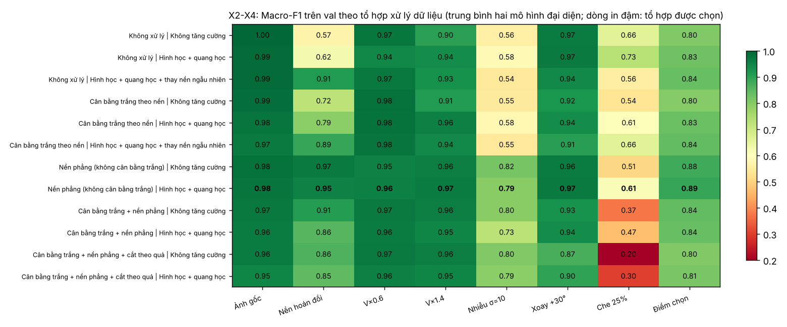

Hai tổ hợp được chạy lại đủ pipeline:

- **X-a: nền phẳng + tăng cường hình học/quang học:** điểm chọn cao nhất (0.889 ± 0.006), phân biệt được với mọi tổ hợp khác.
- **X-b: không xử lý ảnh lúc suy luận, tăng cường có thay nền ngẫu nhiên:** tổ hợp tốt nhất trong nhóm chỉ can thiệp vào tập train (0.835 ± 0.006). Chạy cho 6 cấu hình đại diện.

*Kết luận X2-X4.*

- So với không xử lý (0.804), tách nền là thay đổi có tác dụng lớn nhất: nền phẳng không tăng cường đạt 0.878, có tăng cường 0.889. Phần tăng đến chủ yếu từ phép nền hoán đổi (từ 0.57 lên 0.95 đến 0.97, trung bình hai mô hình) và nhiễu.
- **Cân bằng trắng theo nền làm kết quả kém đi** (cân bằng trắng + nền phẳng: 0.843 so với nền phẳng: 0.878). Phép đo riêng cho thấy lý do: hệ số cân bằng trắng tính từ màu nền rồi nhân vào cả quả chuối, nên khi nền đổi thì màu quả cũng đổi theo.

{{T:results/E1_xu_ly/table_wb_leak.md}}

- **Cắt theo quả không giúp** (0.804 đến 0.813): nó xóa thông tin kích thước quả và làm phép che 25% tệ hẳn (0.20 đến 0.30), vì ô đen bị coi là vật thể và khung cắt sai.
- Tăng cường hình học + quang học giúp ở 4/5 mức tiền xử lý (+0.009 đến +0.031); riêng với cân bằng trắng + nền phẳng thì giảm 0.006. Thay nền ngẫu nhiên nâng phép nền hoán đổi từ 0.57 lên 0.91 mà không cần tách nền lúc suy luận.

**Kết quả chạy lại pipeline.** X-a, 9 cấu hình (`results/E1_xu_ly/pipeline/table.md`):

{{T:results/E1_xu_ly/pipeline/table.md}}

X-b, 6 cấu hình đại diện (`results/E1_xu_ly/pipeline_b/table.md`):

{{T:results/E1_xu_ly/pipeline_b/table.md}}

*Kết luận nhánh X.*

- **X-a khử được sự phụ thuộc vào nền.** Sau khi tách nền, điểm ở cột "nền hoán đổi" xấp xỉ điểm trên ảnh gốc ở cả 9 cấu hình (`b_mobilenetv3`: 0.995 và 0.995; nhánh G: 1.000 và 0.794). Điểm bền trung bình tăng từ 0.750 lên 0.801.
- **Cái giá của X-a.** Điểm trên ảnh gốc giảm ở những mô hình trước đó dựa nhiều vào nền: HOG từ 0.990 xuống 0.828, cạnh từ 0.964 xuống 0.842, `a_lenet` từ 0.978 xuống 0.922, `a_vgg16` từ 0.986 xuống 0.958; trung bình 9 cấu hình từ 0.983 xuống 0.942. Các mô hình mạnh nhất gần như giữ nguyên (`b_resnet50` 0.997; `b_mobilenetv3` 0.995; Hist HSV 0.993). Phép che 25% là điểm yếu (0.17 đến 0.45 ở 8/9 cấu hình), vì ô đen làm hỏng bước phân đoạn.
- **X-b đạt gần bằng mà không cần xử lý ảnh lúc dự đoán.** Chỉ thêm ảnh train có nền thay ngẫu nhiên: `b_mobilenetv3` vẫn đúng 371/371 ảnh gốc và đạt 0.975 ở phép nền hoán đổi; Hist H-S + HOG đạt 0.984 và 0.853 (G: 1.000 và 0.410).
- **Xử lý nào là tối ưu?** Không tổ hợp nào tốt hơn ở mọi mặt, và trên ảnh gốc không bước xử lý nào cải thiện được pipeline gốc (nó đã đúng 371/371 ảnh). Nếu mục tiêu là mô hình nhìn quả chuối thay vì nền, thì với mô hình tốt nhất (`b_mobilenetv3`) X-b là lựa chọn cân bằng nhất: không mất điểm trên ảnh gốc, nền hoán đổi từ 0.794 lên 0.975, không phụ thuộc vào bước phân đoạn. Mô hình này được thêm vào demo.
- **S2 chạy lại với mask mới** cho cùng kết luận: chỉ vùng nền vẫn đạt 0.933 đến 0.983 với đặc trưng thủ công (`results/S2/table_mask_v2.md`).

#### 5.13.3 Nhánh T: bản Augmented của tác giả bộ dữ liệu

Bản Augmented là bản xuất từ Roboflow: mỗi ảnh gốc có đúng 3 file, gồm 1 bản gần như nguyên gốc và 2 bản tăng cường (lật, xoay bội số 90°, xoay nhỏ, đổi sáng ±15%, làm mờ, nhiễu trên tối đa 1.5% điểm ảnh, theo [17]). Tên file giữ tên ảnh gốc, nên ánh xạ được 7413/7413 file về ảnh gốc. Đồ án chạy pipeline theo hai cách:

- **T-kr (không rò rỉ):** train = 3 file của mỗi ảnh gốc thuộc tập train của G (5187 ảnh); val và test là ảnh gốc của G. So được trực tiếp với G.
- **T-tl (theo thông lệ):** gộp 7413 file rồi chia ngẫu nhiên phân tầng 70/15/15, không quan tâm ảnh gốc (5189 / 1112 / 1112). Đây là cách dùng trực tiếp nhất và là cách của bài báo [18].

T-kr, chấm trên test gốc và bộ kiểm tra khó (`results/E2_aug_tac_gia/khong_ro_ri/table.md`):

{{T:results/E2_aug_tac_gia/khong_ro_ri/table.md}}

T-tl, chấm trên tập test của chính cách chia này (`results/E2_aug_tac_gia/thong_le/table.md`; không chạy `a_dropout` và `b_resnet50`):

{{T:results/E2_aug_tac_gia/thong_le/table.md}}

{{T:results/E2_aug_tac_gia/table_leak_stats.md}}

{{T:results/E2_aug_tac_gia/table_leak_accuracy.md}}

*Kết luận.*

- **Trên ảnh gốc, bản Augmented của tác giả không cải thiện kết quả** so với G: trung bình 9 cấu hình 0.979 so với 0.983 (bảng ở mục 5.13.5). Các mô hình nhạy với hướng và vị trí giảm: HOG + LogReg từ 0.990 xuống 0.972, Hist H-S + HOG từ 1.000 xuống 0.989, `a_lenet` từ 0.978 xuống 0.966. Ảnh xoay 90° và lật thêm độ đa dạng mà các mô hình này không biểu diễn được, trong khi ảnh test gốc không bị xoay. `a_dropout` tăng (từ 0.942 lên 0.963), khớp N5. Hai mô hình hướng B gần như không đổi (chênh 1 ảnh).
- **Trên bộ kiểm tra khó, bản Augmented giúp một ít:** điểm bền trung bình 0.769 so với 0.750; các mô hình pretrained tăng 0.02 đến 0.03. Phần tăng đến đúng từ các phép có trong công thức tăng cường (HOG với xoay +30°: từ 0.505 lên 0.688); phép không có trong công thức thì không cải thiện (nền hoán đổi).
- **T-tl trái với suy đoán thông thường:** điểm của cách chia ngẫu nhiên không cao hơn mà thấp hơn T-kr ở phần lớn mô hình (HOG 0.847; `a_vgg16` 0.967), vì tập test của T-tl gồm cả ảnh đã xoay, lật, thêm nhiễu nên khó hơn tập test gốc. Hai con số không cùng thước đo. Mức rò rỉ phải đọc ở bảng tách nhóm: 90.6% ảnh test có file cùng ảnh gốc trong train; trên nhóm đó HOG đúng 0.859 so với 0.808 ở nhóm còn lại, `b_mobilenetv3` 0.997 so với 0.981, còn histogram màu gần như không chênh. Nhóm "không có" chỉ gồm 104 ảnh nên sai số lớn. Phép đo chặt hơn nằm ở nhánh B (5-fold có và không giữ nhóm).

#### 5.13.4 Nhánh B: phương pháp của bài báo trên chính bộ dữ liệu này

Hai bài báo:

- **Ferdaus và cộng sự (2025)** [17]: bài báo mô tả dữ liệu. Chuối được đặt trên giấy trắng dưới đèn LED trắng, mỗi quả chụp từ bốn mặt; ảnh được loại trùng, resize 256×256; bản Augmented gồm ảnh gốc và 2 bản tăng cường mỗi ảnh. Bài báo **không huấn luyện mô hình** và không công bố kết quả phân loại; phần xử lý dữ liệu của bài báo đã được kiểm chứng ở nhánh T.
- **Ergün (2025)** [18]: rút đặc trưng bằng Vision Transformer (ViT) pretrained rồi phân lớp bằng SVM; so với đặc trưng ResNet, SqueezeNet và các bộ phân lớp GBM, MLP, CNN. Dùng bản Augmented, ảnh 224×224, 5-fold cross-validation. Kết quả công bố tốt nhất trên BananaImageBD: ViT + SVM, accuracy 99.70%, F1 0.9965.

Cả hai bài báo đều không dùng YOLO. Đồ án chạy phương pháp của [18] theo hai hướng:

| Hướng | Bộ rút đặc trưng | Bộ phân lớp |
|---|---|---|
| **B1: trong phạm vi môn học (tới mức CNN)** | CNN pretrained ImageNet: ResNet50, MobileNetV3-Small, SqueezeNet 1.1 [20] (hai CNN đối chứng của bài báo là ResNet và SqueezeNet) | SVM (RBF và tuyến tính), Logistic Regression, KNN, MLP |
| **B2: đúng như bài báo** | ViT-B/16 [19] pretrained ImageNet (trọng số của torchvision [38]), vector 768 chiều của token phân lớp. ViT nằm ngoài nội dung môn học; hướng này chỉ để đối chiếu | SVM (RBF và tuyến tính), MLP, GBM |

Bài báo không nêu tên checkpoint ViT, kernel và siêu tham số của SVM, biến thể ResNet/SqueezeNet; các lựa chọn của đồ án ghi ở `src/exp_papers.py`. Bộ phân lớp "CNN" trên vector đặc trưng không được tái hiện vì bài báo không mô tả kiến trúc.

Ba giao thức chấm: (i) như bài báo: bản Augmented (7413 ảnh), 5-fold phân tầng; (ii) cùng dữ liệu nhưng giữ 3 file của cùng ảnh gốc trong một fold; (iii) giao thức của đồ án: học trên train+val gốc, chấm trên test gốc và bộ kiểm tra khó.

Giao thức (i) và (ii) (`results/E3_bai_bao/table_protocols.md`):

{{T:results/E3_bai_bao/table_protocols.md}}

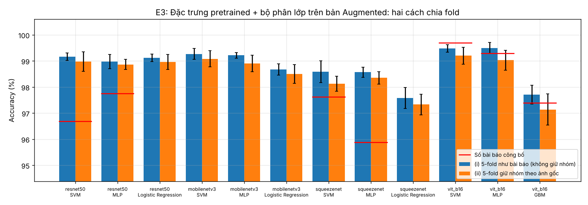

Giao thức (iii) (`results/E3_bai_bao/table_test.md`):

{{T:results/E3_bai_bao/table_test.md}}

*Kết luận.*

- **Tái hiện được kết quả chính của bài báo:** ViT + SVM đạt 99.49 ± 0.15% theo giao thức (i); bài báo công bố 99.70%. Thứ hạng bộ phân lớp trên đặc trưng ViT cũng khớp: SVM ≈ MLP > GBM.
- **Không tái hiện được khoảng cách lớn giữa ViT và CNN.** Bài báo công bố ViT + SVM hơn ResNet + SVM 3.01 điểm phần trăm; đo được chỉ 0.22 đến 0.90 điểm (ResNet50 + SVM 99.16%, MobileNetV3 + SVM 99.27%, SqueezeNet + SVM 98.58%). CNN pretrained làm bộ rút đặc trưng, một kỹ thuật trong phạm vi môn học, gần như đạt cùng mức với ViT trên giao thức này.
- **Giao thức của bài báo có rò rỉ, mức thổi phồng nhỏ nhưng nhất quán:** (i) cao hơn (ii) ở cả 19/19 tổ hợp, từ +0.11 đến +0.90 điểm phần trăm (ViT + SVM: từ 99.49 xuống 99.20). Từng tổ hợp riêng lẻ thì chênh lệch xấp xỉ độ lệch chuẩn giữa các fold; dấu nhất quán ở 19/19 tổ hợp mới là bằng chứng. KNN bị thổi phồng nhiều nhất (+0.90), khớp D1.
- **Theo giao thức của đồ án:** trên ảnh gốc, phương pháp của bài báo ngang pipeline gốc (ViT + SVM RBF sai 1/371 ảnh; ViT + SVM tuyến tính đúng 371/371; nhánh G có hai cấu hình đúng 371/371). Trên bộ kiểm tra khó, đặc trưng ViT bền hơn mọi cấu hình của nhánh G: điểm bền 0.919 đến 0.937 so với cao nhất 0.895, dù ViT không được fine-tune. Đổi lại, ViT-B/16 có khoảng 86 triệu tham số và rút đặc trưng chậm hơn MobileNetV3 khoảng 23 lần trên CPU (105.7 ms so với 4.5 ms mỗi ảnh).
- **Hướng B1 ngang ViT trên ảnh gốc nhưng kém bền hơn:** macro-F1 test 0.990 đến 0.997 với SVM, LogReg, MLP; điểm bền 0.63 đến 0.89. So với fine-tune cùng mạng ở nhánh G: MobileNetV3 đóng băng + SVM tuyến tính 0.836, MobileNetV3 fine-tune có tăng cường 0.875.
- **Ngoài dự đoán:** SVM kernel RBF sập khi ảnh bị che 25% trên đặc trưng CNN (0.087 đến 0.130), còn SVM tuyến tính giữ 0.41 đến 0.58. Với ảnh lệch xa phân bố huấn luyện, giá trị kernel RBF tới mọi vector hỗ trợ đều gần 0, nên mọi ảnh rơi vào cùng một lớp.

#### 5.13.5 So sánh bốn nhánh

Từng cấu hình qua các nhánh dữ liệu (`results/so_sanh_nhanh/table_models.md`; X-b chỉ có 6 cấu hình):

{{T:results/so_sanh_nhanh/table_models.md}}

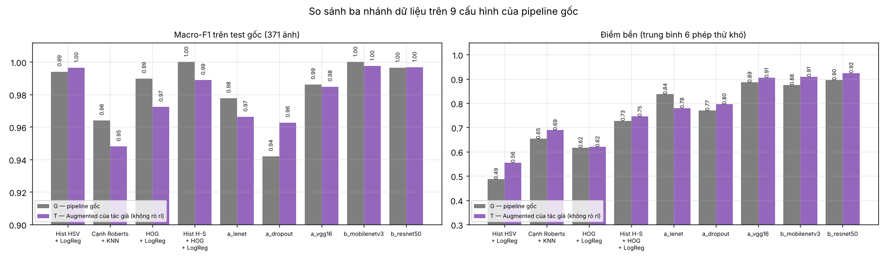

Cấu hình đại diện của mỗi nhánh, chọn theo điểm lúc phát triển (`results/so_sanh_nhanh/table_arms.md`, `results/so_sanh_nhanh/table_stress.md`):

{{T:results/so_sanh_nhanh/table_arms.md}}

{{T:results/so_sanh_nhanh/table_stress.md}}

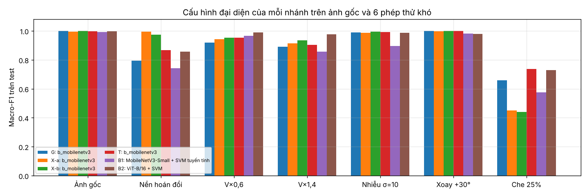

Phép che 25% tách theo mức quả chuối bị che (`results/so_sanh_nhanh/table_occlusion_split.md`):

{{T:results/so_sanh_nhanh/table_occlusion_split.md}}

*Kết luận chung của phần mở rộng.*

1. **Trên ảnh gốc, không nhánh nào hơn pipeline gốc.** Cấu hình đại diện của cả sáu dòng sai từ 0 đến 2 ảnh trên 371; khoảng tin cậy chồng lên nhau. Pipeline gốc đã ở mức trần của tập test này.
2. **Khác biệt nằm ở bộ kiểm tra khó, và mỗi nhánh mạnh ở một chỗ khác nhau.** Nhánh X gần như xóa được sự phụ thuộc vào nền (nền hoán đổi 0.975 đến 0.995 so với 0.794 của G). Nhánh T tăng độ bền đều hơn ở các phép có trong công thức tăng cường của tác giả (điểm bền 0.909). Nhánh B2 (ViT + SVM) có điểm bền cao nhất (0.919) mà không cần huấn luyện mạng, đổi lại mô hình nặng và nằm ngoài môn học. Nhánh B1 (CNN đóng băng + SVM) kém bền nhất (0.836).
3. **Điểm bền trung bình che mất sự đánh đổi.** X-a và X-b có điểm bền (0.881; 0.883) chỉ nhỉnh hơn G (0.875) vì phần được ở nền hoán đổi bị trừ đi ở phép che 25% (0.44 đến 0.45 so với 0.66). Một phần lợi thế của pipeline gốc ở phép che đến từ nền: ở 40 ảnh mà quả bị che gần hết, cấu hình truyền thống của nhánh G vẫn đúng 0.950 vì nhận ra Sabri Kola từ nền; với `b_mobilenetv3` thì chưa tách được nguyên nhân.
4. **Về dữ liệu tăng cường:** tăng cường chỉ có ích khi (a) áp dụng sau khi chia tập và (b) nhắm đúng loại biến đổi cần bền. Bản Augmented của tác giả không có phép nào liên quan tới nền nên không giảm được thiên lệch nền; phép thay nền ngẫu nhiên của nhánh X thì có.
5. **Về các con số đã công bố:** kết quả 99.70% của bài báo tái hiện được (99.49%) nhưng lạc quan khoảng 0.3 điểm do rò rỉ trong cách chia fold; và giống mọi kết quả chia ngẫu nhiên trên bộ dữ liệu này, nó còn chịu hai nguồn lạc quan mà đồ án đo được: thiên lệch nền (S2) và ảnh của cùng một quả nằm ở cả hai phía (X1).

### 5.14 Những thực nghiệm khác với tài liệu tham khảo

Bài báo đã công bố trên bộ dữ liệu này [18] báo cáo một con số accuracy theo 5-fold cross-validation trên bản Augmented. So với tài liệu tham khảo, đồ án có các thực nghiệm sau do nhóm tự thiết kế:

| Thực nghiệm | Tài liệu tham khảo | Đồ án |
|---|---|---|
| Cách chia dữ liệu | Chia fold ngẫu nhiên trên bản Augmented, ảnh gốc và bản tăng cường của nó có thể nằm ở hai phía [18] | Chia trên ảnh gốc trước, chỉ tăng cường phần huấn luyện. Đo được mức thổi phồng của cách chia trong bài báo (mục 5.4, 5.13.4) |
| Phương pháp so sánh | ViT, ResNet, SqueezeNet kết hợp SVM, GBM, MLP [18] | Thêm toàn bộ đặc trưng thủ công (màu, cạnh, HOG), KNN, bộ phân lớp tuyến tính và CNN huấn luyện từ đầu, fine-tune (mục 5.5 đến 5.8) |
| Kiểm chứng tính chất của phương pháp | Không có | 30 thí nghiệm theo kiểu dự đoán rồi kiểm chứng (mục 5.4 đến 5.10) |
| Mô hình dựa vào quả hay vào nền | Không có | Thí nghiệm S2 và phép nền hoán đổi của bộ kiểm tra khó (mục 5.10, 5.13) |
| Độ bền khi ảnh thay đổi | Không có | Bộ kiểm tra khó gồm 6 phép biến đổi trên tập test (mục 5.13) |
| Ảnh của cùng một quả ở cả train và test | Không đề cập | Đo bằng cross-validation chia theo khối ảnh liên tiếp (mục 5.13.2) |
| Chương trình demo | Không có | Giao diện 7 tab, có Grad-CAM và tính lại các độ đo (mục 5.12) |

## 6. Đánh giá, nhận xét và kết luận

### 6.1 Nhận xét về kết quả

- **Bài toán trên bộ dữ liệu này được giải gần như trọn vẹn.** Hai cấu hình đúng 371/371 ảnh test: Hist H-S + HOG + Logistic Regression (hướng truyền thống) và MobileNetV3-Small fine-tune (hướng học sâu). Với 0 ảnh sai trên 371 ảnh, tỉ lệ lỗi thật vẫn có thể lên tới khoảng 0.8%, nên nhóm không kết luận mô hình nào hơn mô hình nào trong nhóm dẫn đầu.
- **Giống chuối phân biệt được bằng cả màu lẫn hình dạng.** Histogram HSV đạt macro-F1 0.991, HOG trên ảnh xám đạt 0.986 (5-fold). Ghép hai loại đặc trưng cho kết quả tốt nhất trong hướng truyền thống (0.996).
- **Đặc trưng thủ công chọn đúng vẫn cạnh tranh được với CNN** trên dữ liệu nhỏ và sạch như bộ này. CNN huấn luyện từ đầu (`a_lenet` 0.978, `a_dropout` 0.942 trên test) còn kém cấu hình truyền thống tốt nhất. CNN chỉ vượt lên khi dùng trọng số huấn luyện sẵn trên ImageNet.
- **Transfer learning là yếu tố quyết định với CNN.** Với 25% dữ liệu huấn luyện, mô hình dùng trọng số ImageNet đã ngang `a_lenet` dùng đủ dữ liệu (thí nghiệm N2). MobileNetV3-Small vừa chính xác hơn vừa nhẹ hơn VGG16 nhiều lần (4.3 MB so với 163 MB).
- **Một số kết quả trái với dự đoán ban đầu**, và nhóm đã tìm được lời giải thích bằng phép đo phụ: Dropout không giảm quá khớp ở `a_dropout` (N3), HOG có chuẩn hóa block lại kém bền khi ảnh bị làm sáng tới mức bão hòa (C2), histogram sập khi bị che là do bước chuẩn hóa z-score chứ không phải do tính toàn cục (C4), k = 1 là lựa chọn tốt nhất cho KNN (P1).
- **Con số gần 100% phải đọc kèm điều kiện.** Chỉ dùng vùng nền của ảnh vẫn phân loại được với macro-F1 từ 0.93 đến 0.99 (S2). Mỗi giống được chụp trong một điều kiện riêng, nên mô hình học được cả đặc điểm của nền. Khi ghép quả chuối lên nền của ảnh thuộc lớp khác, macro-F1 của MobileNetV3 giảm từ 1.000 xuống 0.794.

### 6.2 Ưu điểm

- So sánh đầy đủ các phương pháp đã học trên cùng một quy trình đánh giá: 30 thí nghiệm kiểm chứng và ba nhánh mở rộng, 968 dòng kết quả, mỗi nhận định dẫn tới một bảng hoặc hình.
- Quy trình đánh giá chặt: chia tập cố định, tập test chỉ dùng một lần, chọn siêu tham số bằng cross-validation, báo cáo độ lệch chuẩn và khoảng tin cậy, chỉ số chính là macro-F1.
- Ghi nhận cả các kết quả trái dự đoán và tìm cách giải thích (D1 với HOG, M5, P1, C2, C4, N3, N8).
- Phát hiện và đo được thiên lệch theo bối cảnh chụp của bộ dữ liệu (S2), điều mà chỉ nhìn con số accuracy sẽ không thấy.
- Có hai mô hình đúng 371/371 ảnh test, trong đó một mô hình chỉ 4.3 MB và dự đoán 12.5 ms mỗi ảnh trên CPU.
- Chạy lại được toàn bộ bằng một lệnh, seed cố định, trọng số đã huấn luyện có sẵn trong mã nguồn.
- Đối chiếu với bên ngoài: chạy lại phương pháp của bài báo trên cùng bộ dữ liệu (tái hiện 99.49% so với 99.70% công bố) và bản Augmented của tác giả, trên cùng tập test và cùng bộ kiểm tra khó (mục 5.13).
- Chương trình demo cho phép kiểm tra lại các con số trong báo cáo ngay trên giao diện.

### 6.3 Hạn chế

- **Thiên lệch theo bối cảnh chụp (hạn chế lớn nhất).** Chỉ nhìn nền vẫn phân loại được với macro-F1 từ 0.93 đến 0.99 (S2). Con số 1.000 trên test là độ chính xác trên bộ dữ liệu này, không phải độ chính xác nhận diện giống chuối trong điều kiện bất kỳ. Với ảnh chụp ở bối cảnh khác, kết quả có thể thấp hơn nhiều. Đồ án chưa có dữ liệu như vậy để đo.
- **Mỗi quả được chụp nhiều mặt, và cách chia ngẫu nhiên không tách theo quả.** Theo bài báo mô tả dữ liệu [17], mỗi quả chụp từ bốn mặt. Đo được: 20.0% số ảnh có láng giềng gần nhất mang số thứ tự liền kề (nếu ngẫu nhiên thì chỉ 1.0%), và cross-validation chia theo khối ảnh liên tiếp thấp hơn chia ngẫu nhiên từ 0.024 đến 0.069 (mục 5.13.2). Mọi kết quả chia ngẫu nhiên, kể cả bảng ở mục 5.11, vì vậy lạc quan hơn so với khi gặp quả chuối chưa từng thấy. Dữ liệu không có nhãn "quả nào" nên đồ án chưa chia lại được theo quả.
- **Chương trình không từ chối được ảnh ngoài phạm vi.** Đầu ra chỉ có 4 lớp, nên ảnh của giống khác hoặc ảnh không phải chuối vẫn được gán vào một trong 4 giống (mục 3.4).
- **Ảnh gần trùng:** 42 cặp ảnh gần như y hệt, 7 ảnh test có bản gần trùng trong train. Đo được ảnh hưởng không đáng kể, nhưng pHash không bắt được cùng một quả chụp ở tư thế khác, nên con số này là cận dưới.
- Tập test và val nhỏ (371 ảnh). Các mô hình tốt nhất đều trên 0.99 nên không phân biệt được bằng thống kê.
- CNN không dùng cross-validation do giới hạn CPU. Nhiễu giữa các lần huấn luyện mới ước lượng bằng 3 seed cho một mô hình (N3).
- Phân đoạn chưa có nhãn mask nên chưa tính được IoU và Dice. Mask của bước S1 tràn ra nền ở 5.2% số ảnh. Phần mở rộng dùng mask khác, và S2 chạy lại với mask mới cho cùng kết luận.
- Bộ kiểm tra khó là các phép biến đổi tổng hợp, không thay được ảnh chụp thật ở bối cảnh khác. Biến thể X-b mới chạy 6/9 cấu hình, cách chia ngẫu nhiên của bản Augmented (T-tl) mới chạy 7/9 cấu hình.
- Thông tin về từng giống chuối trong demo (`app/variety_info.json`) còn nhiều mục để trống vì nhóm chưa tìm được nguồn tin cậy.

### 6.4 Hướng phát triển

- Thu thêm ảnh của cả 4 giống trong cùng một bối cảnh chụp, hoặc một tập test chụp ở bối cảnh khác, để đo đúng khả năng nhận diện giống.
- Chia lại dữ liệu theo quả (cần nhãn "quả nào" từ người thu thập) để đo khả năng nhận diện quả chưa từng thấy.
- Thêm lớp "không thuộc 4 giống" để chương trình từ chối được ảnh ngoài phạm vi.
- Kiểm tra hai cách giảm phụ thuộc vào nền đã thử ở nhánh X (tách nền, thay nền ngẫu nhiên) trên ảnh chụp thật ở bối cảnh khác.
- Gán nhãn mask cho khoảng 20 ảnh để tính IoU và Dice cho phần phân đoạn.

### 6.5 Kết luận

Đồ án đã xây dựng được chương trình nhận diện 4 giống chuối từ ảnh và so sánh các phương pháp đã học trong môn CS231 trên cùng một quy trình đánh giá. Trên tập test 371 ảnh, cấu hình truyền thống tốt nhất (Hist H-S + HOG + Logistic Regression) và CNN tốt nhất (MobileNetV3-Small fine-tune) đều đạt macro-F1 1.000.

Qua đồ án, nhóm rút ra ba điều. Thứ nhất, một phương pháp tốt hay không phụ thuộc vào việc tính chất của nó có khớp với dữ liệu không: histogram không biết vị trí, HOG không biết màu, CNN học từ đầu cần nhiều dữ liệu, và các thí nghiệm đều cho thấy đúng những điểm đó. Thứ hai, cách đánh giá quan trọng không kém mô hình: tăng cường ảnh trước khi chia tập, hoặc để ảnh của cùng một quả nằm ở cả hai phía, đều làm kết quả đẹp hơn thực tế. Thứ ba, độ chính xác cao trên một bộ dữ liệu chưa nói lên mô hình đã học đúng thứ cần học: ở đây mô hình dựa một phần vào nền ảnh.

Nhóm đã cố gắng làm đầy đủ và kiểm tra kỹ từng kết quả, tuy vậy đồ án vẫn còn những phần chưa đạt như mong muốn. Chỗ còn thiếu rõ nhất là chưa đánh giá được trên ảnh chụp thật ngoài bộ dữ liệu, và chương trình chưa xử lý được ảnh ngoài phạm vi 4 giống.

## 7. Tài liệu tham khảo

### 7.1 Danh mục tài liệu

1. Ferdaus, M. H., Prito, R. H., Rasel, A. A. S., Ahmed, M., Saykot, M. J. H., Shanta, S. S., Akter, S., Das, A. C., Islam, M. M., Hasan, M., Ali, M. S. (2024). *BananaImageBD: A Comprehensive Image Dataset of Common Banana Varieties with Different Ripeness Stages in Bangladesh* (Version 2) [Data set]. Mendeley Data. DOI: 10.17632/ptfscwtnyz.2. Giấy phép CC BY 4.0. https://data.mendeley.com/datasets/ptfscwtnyz/2
2. Bài giảng môn CS231, Nhập môn Thị giác máy tính, Trường Đại học Công nghệ Thông tin, ĐHQG-HCM: ảnh số, đặc trưng màu, phân loại ảnh, KNN và bộ phân lớp tuyến tính, đặc trưng cạnh, HOG, CNN, phân đoạn ảnh, xác định vị trí và phát hiện đối tượng.
3. Swain, M. J., Ballard, D. H. (1991). Color Indexing. *International Journal of Computer Vision*, 7(1), 11-32.
4. Stricker, M., Orengo, M. (1995). Similarity of Color Images. *Proc. SPIE Storage and Retrieval for Image and Video Databases III*.
5. Pass, G., Zabih, R., Miller, J. (1996). Comparing Images Using Color Coherence Vectors. *Proc. ACM Multimedia*.
6. Dalal, N., Triggs, B. (2005). Histograms of Oriented Gradients for Human Detection. *CVPR*.
7. Otsu, N. (1979). A Threshold Selection Method from Gray-Level Histograms. *IEEE Trans. Systems, Man, and Cybernetics*, 9(1), 62-66.
8. Cover, T., Hart, P. (1967). Nearest Neighbor Pattern Classification. *IEEE Trans. Information Theory*, 13(1), 21-27.
9. LeCun, Y., Bottou, L., Bengio, Y., Haffner, P. (1998). Gradient-Based Learning Applied to Document Recognition. *Proceedings of the IEEE*, 86(11).
10. Simonyan, K., Zisserman, A. (2015). Very Deep Convolutional Networks for Large-Scale Image Recognition. *ICLR*. https://arxiv.org/abs/1409.1556
11. He, K., Zhang, X., Ren, S., Sun, J. (2016). Deep Residual Learning for Image Recognition. *CVPR*. https://arxiv.org/abs/1512.03385
12. Howard, A. et al. (2019). Searching for MobileNetV3. *ICCV*. https://arxiv.org/abs/1905.02244
13. Srivastava, N., Hinton, G., Krizhevsky, A., Sutskever, I., Salakhutdinov, R. (2014). Dropout: A Simple Way to Prevent Neural Networks from Overfitting. *JMLR*, 15.
14. Ioffe, S., Szegedy, C. (2015). Batch Normalization: Accelerating Deep Network Training by Reducing Internal Covariate Shift. *ICML*.
15. Telea, A. (2004). An Image Inpainting Technique Based on the Fast Marching Method. *Journal of Graphics Tools*, 9(1).
16. Pedregosa, F. et al. (2011). Scikit-learn: Machine Learning in Python. *JMLR*, 12.
17. Ferdaus, M. H., Prito, R. H., Rasel, A. A. S., Ahmed, M., Saykot, M. J. H., Shanta, S. S., Akter, S., Das, A. C., Islam, M. M., Hasan, M., Ali, M. S. (2025). BananaImageBD: A comprehensive banana image dataset for classification of banana varieties and detection of ripeness stages in Bangladesh. *Data in Brief*, 58, 111239. DOI: 10.1016/j.dib.2024.111239.
18. Ergün, E. (2025). High precision banana variety identification using vision transformer based feature extraction and support vector machine. *Scientific Reports*, 15, 10366. DOI: 10.1038/s41598-025-95466-0.
19. Dosovitskiy, A. et al. (2021). An Image is Worth 16x16 Words: Transformers for Image Recognition at Scale. *ICLR*. https://arxiv.org/abs/2010.11929
20. Iandola, F. N. et al. (2016). SqueezeNet: AlexNet-level accuracy with 50x fewer parameters and <0.5MB model size. *arXiv:1602.07360*.
21. MacQueen, J. (1967). Some Methods for Classification and Analysis of Multivariate Observations. *Proc. Fifth Berkeley Symposium on Mathematical Statistics and Probability*.
22. Gonzalez, R. C., Woods, R. E. (2018). *Digital Image Processing* (4th ed.). Pearson.
23. Bishop, C. M. (2006). *Pattern Recognition and Machine Learning*. Springer.
24. Cortes, C., Vapnik, V. (1995). Support-Vector Networks. *Machine Learning*, 20(3), 273-297.
25. Kingma, D. P., Ba, J. (2015). Adam: A Method for Stochastic Optimization. *ICLR*. https://arxiv.org/abs/1412.6980
26. Deng, J., Dong, W., Socher, R., Li, L.-J., Li, K., Fei-Fei, L. (2009). ImageNet: A Large-Scale Hierarchical Image Database. *CVPR*.
27. Abadi, M. et al. (2016). TensorFlow: A System for Large-Scale Machine Learning. *OSDI*. https://www.tensorflow.org
28. Chollet, F. và cộng sự (2015). Keras. https://keras.io. Trọng số ImageNet của VGG16, ResNet50, MobileNetV3-Small lấy từ Keras Applications: https://keras.io/api/applications/
29. van der Walt, S. et al. (2014). scikit-image: Image Processing in Python. *PeerJ*, 2, e453.
30. Zauner, C. (2010). *Implementation and Benchmarking of Perceptual Image Hash Functions*. Luận văn thạc sĩ, Upper Austria University of Applied Sciences, Hagenberg.
31. Buchner, J. Thư viện ImageHash. https://github.com/JohannesBuchner/imagehash
32. Efron, B. (1979). Bootstrap Methods: Another Look at the Jackknife. *The Annals of Statistics*, 7(1), 1-26.
33. Bradski, G. (2000). The OpenCV Library. *Dr. Dobb's Journal of Software Tools*. https://opencv.org
34. Lemaître, G., Nogueira, F., Aridas, C. K. (2017). Imbalanced-learn: A Python Toolbox to Tackle the Curse of Imbalanced Datasets in Machine Learning. *JMLR*, 18(17), 1-5.
35. Hunter, J. D. (2007). Matplotlib: A 2D Graphics Environment. *Computing in Science & Engineering*, 9(3), 90-95.
36. Abid, A., Abdalla, A., Abid, A., Khan, D., Alfozan, A., Zou, J. (2019). Gradio: Hassle-Free Sharing and Testing of ML Models in the Wild. *arXiv:1906.02569*. https://www.gradio.app
37. Selvaraju, R. R., Cogswell, M., Das, A., Vedantam, R., Parikh, D., Batra, D. (2017). Grad-CAM: Visual Explanations from Deep Networks via Gradient-Based Localization. *ICCV*. https://arxiv.org/abs/1610.02391
38. Paszke, A. et al. (2019). PyTorch: An Imperative Style, High-Performance Deep Learning Library. *NeurIPS*. Trọng số ViT-B/16 và SqueezeNet 1.1 lấy từ torchvision: https://pytorch.org/vision/stable/models.html
39. Szeliski, R. (2022). *Computer Vision: Algorithms and Applications* (2nd ed.). Springer. https://szeliski.org/Book/
40. Harris, C. R. et al. (2020). Array Programming with NumPy. *Nature*, 585, 357-362.

### 7.2 Nguồn của dữ liệu, hình ảnh và những phần nhóm sử dụng lại

- **Dữ liệu:** toàn bộ ảnh chuối trong báo cáo, slide và chương trình demo lấy từ bộ BananaImageBD [1], giấy phép CC BY 4.0. Thông tin về cách thu thập dữ liệu lấy từ bài báo [17].
- **Hình và bảng:** các biểu đồ, sơ đồ và bảng số liệu trong báo cáo do code của nhóm sinh ra từ dữ liệu [1] (file gốc nằm trong `results/`). Ảnh chụp màn hình là giao diện chương trình demo của nhóm.
- **Mô hình huấn luyện sẵn:** VGG16, ResNet50, MobileNetV3-Small dùng trọng số ImageNet do Keras cung cấp [28]. ViT-B/16 và SqueezeNet 1.1 dùng trọng số do torchvision cung cấp [38]. Nhóm không tự thiết kế các kiến trúc này, chỉ sử dụng lại theo cách mô tả ở mục 4.3 và 5.13.4.
- **Thư viện:** các bộ phân lớp (KNN, Logistic Regression, Linear SVM), k-means, cross-validation dùng cài đặt của scikit-learn [16]. Các phép xử lý ảnh cơ bản dùng OpenCV [33]. Giao diện demo dùng Gradio [36]. HOG, CCV, moment màu, vector cạnh, Grad-CAM và các thí nghiệm do nhóm tự cài đặt dựa trên mô tả trong bài giảng [2] và các bài báo gốc [4], [5], [6], [37].
- **Phương pháp đối chiếu:** nhánh B chạy lại phương pháp của bài báo [18] theo mô tả trong bài báo. Nhóm không dùng mã nguồn của tác giả.
- **Mẫu slide:** màu sắc và logo theo nhận diện của Trường Đại học Công nghệ Thông tin.

### 7.3 Công cụ và sự hỗ trợ khác trong quá trình thực hiện

(Nhóm tự điền: các công cụ, tài liệu hướng dẫn, trang web hoặc người đã hỗ trợ nhóm trong quá trình làm đồ án.)

